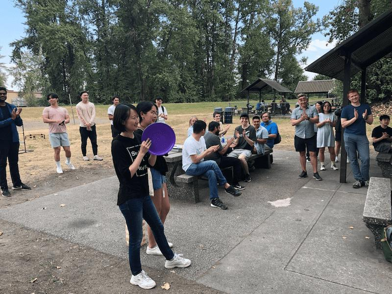

At Improving Vancouver, we’re excited about our people and love coming together for fun events. We recognize that it’s important to get to know each other and strive to build meaningful relationships.

This summer, we held our Picnic & Games event at Fraser Foreshore Park. We kicked off the weekend by spending a Friday afternoon playing all sorts of group games, such as badminton, spike ball, frisbee, slacklining, cornhole, table tennis, Bocci ball, and Jenga! To keep us fuelled throughout the day, we had our very own Steamworks food truck on standby serving up delicious lunches and treats. As we also welcomed several new team members, this was a great way to have them meet our team!

But wait… there’s more!!! We just loved spending time together so much that we decided to invite our family and friends to join in on the fun! The very next day after the picnic, Bit Quillians and their loved ones of ALL ages went to Playland and PNE for a day filled with laughter and smiles. From rollercoaster screams to indulgent, deep-fried mini donuts, we sure had a blast!
