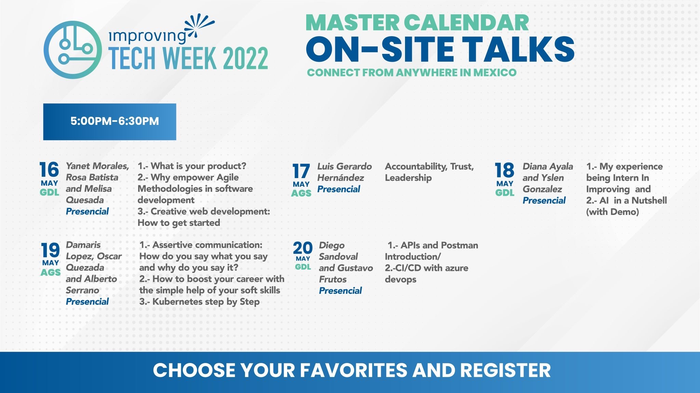
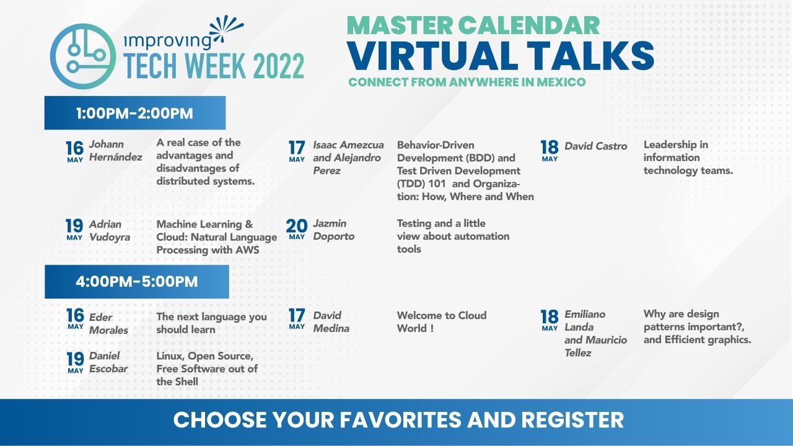

Tech Week 2022 is officially here! Improving Nearshore is hosting a week’s worth of talks from May 16th through 20th that will educate and inspire anyone who is looking to get into the tech world. These sessions will be held at our Guadalajara and Aguascalientes offices, but you can also join virtually! The best part is that they are all absolutely FREE to join.

****

### WHO IS TECH WEEK 2022 FOR?

Tech Week 2022 was created for anyone who is interested in starting a career in the IT industry. Join students and young adults from several universities across Mexico for this week of outstanding free learning experiences. Improving Nearshore invited 28 universities around Mexico to attend the events, but anyone in this season of life is welcome to join in on the sessions.

The talks will be on topics like cloud, Java, QA, machine learning, and other technical information you’ll need to know in the tech industry. There will also be discussions surrounding soft skills like leadership and trust. Our consultants worked to put these sessions together, so participants will receive information from current and successful developers!

### TECH WEEK 2022 SCHEDULE:

Most talks will be given in Spanish, but one goal of Tech Week is to remind attendees that they should practice their English. It’s increasingly important to work on this for the success of future careers.

To register for this week’s events, click on this [Registration Form.](https://forms.office.com/Pages/ResponsePage.aspx?id=Lnwm8lRa9EmE-uTy9AOKLiPge6cCcINDt1gnESi9ZXVURDhOV1FaSFlaRUo5WEVIVFFLNE1PUDFSMC4u)

If you are located in Mexico and want to learn more about our Improving Nearshore career opportunities, [click here](https://www.itexico.com/careers)!
