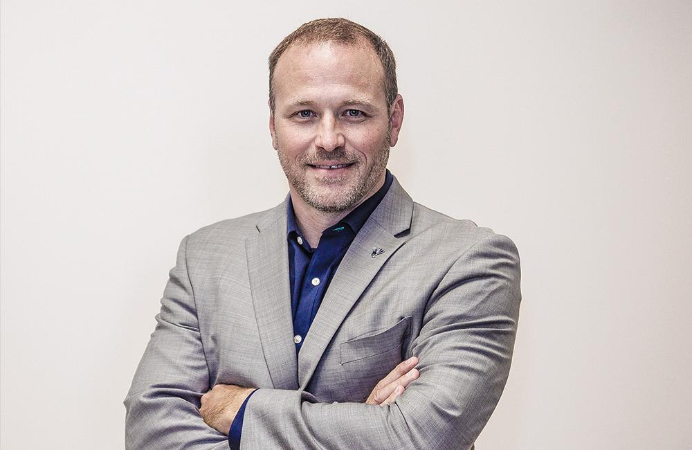

Curtis Hite, CEO and Chairman of Improving was honored today by A&M University with the Dwight Look College of Engineering’s Early Professional Achievement Award.

Hite is the first distinguished alumni to ever receive this award and was recognized for his outstanding achievements in business as a successful Aggie entrepreneur. In addition, he was honored for his commitment to continually improve the global software engineering community. Hite is the youngest recipient to receive one of Texas A&M University’s most prestigious recognitions.

And under Hite’s leadership, Improving Enterprises has been honored four consecutive years in a row as an Aggie 100 fastest-growing company. (highest rank #5) in addition, he also received the Distinguished Alumni Award from the College of Engineering at A&M University in 2009.

Hite is a very proud Aggie and is actively involved with both the College of Engineering and the University overall in several ways including targeted donations, scholarships, and through his position on several Advisory Committees.

Curtis Hite ’91 holds a Bachelor's degree and a Master's degree in Computer Science from A&M University and served as commanding officer in the Aggie Corps of Cadets. (Squadron 6).
