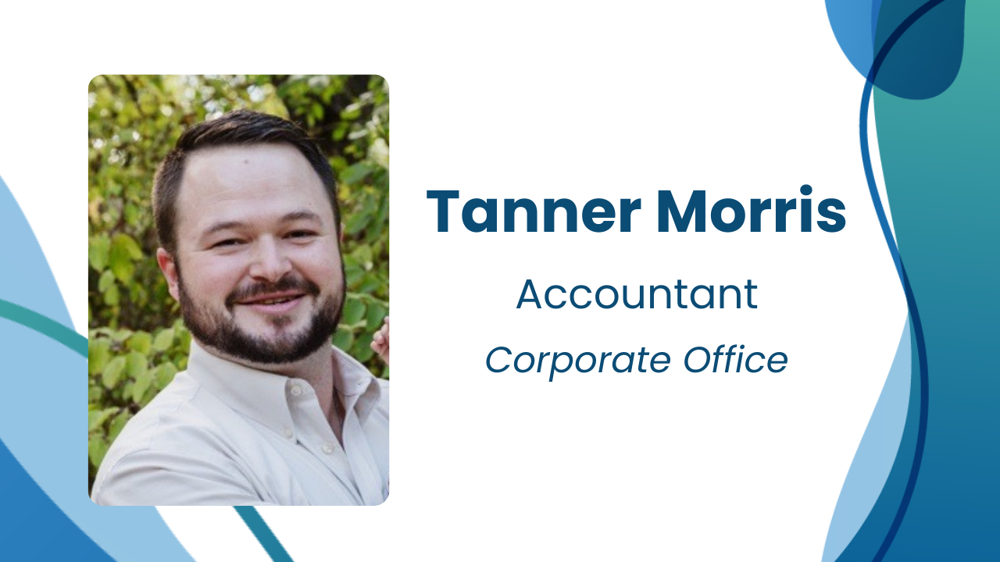
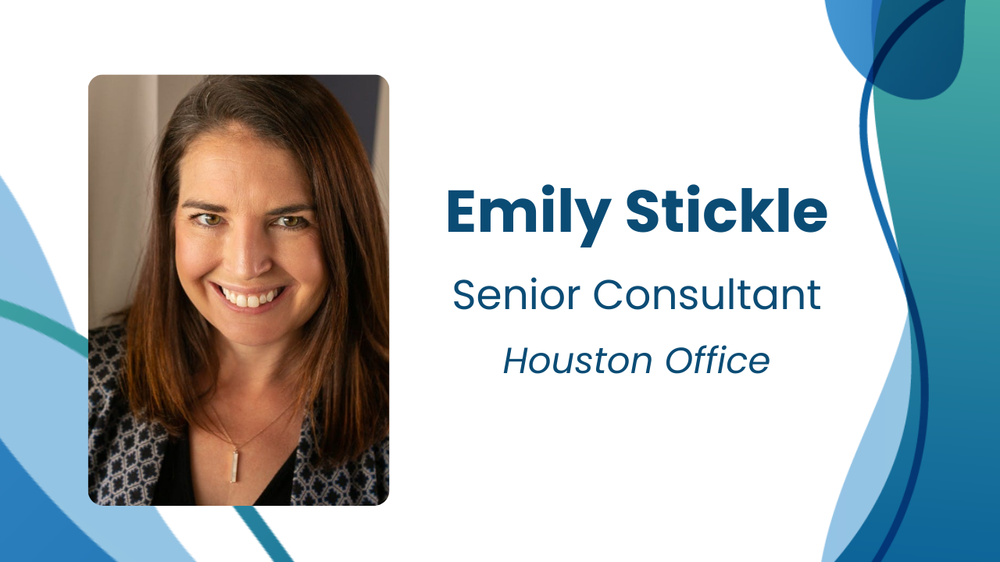
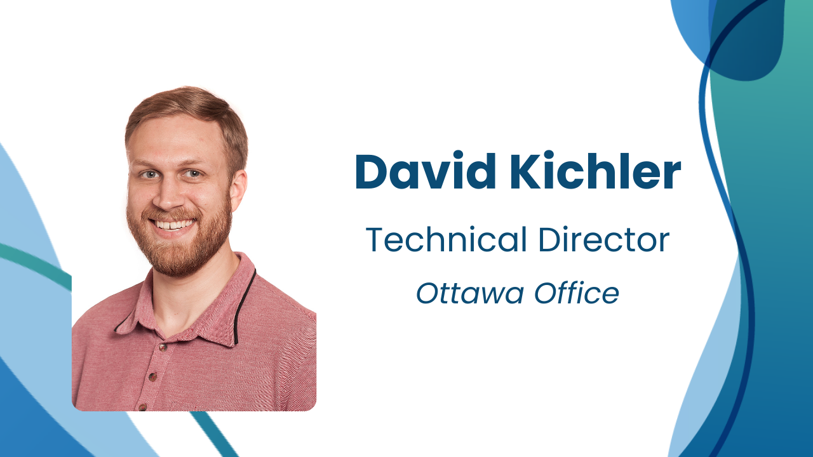
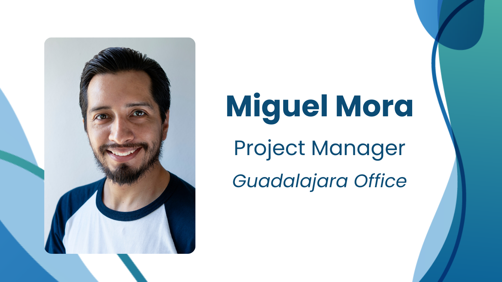
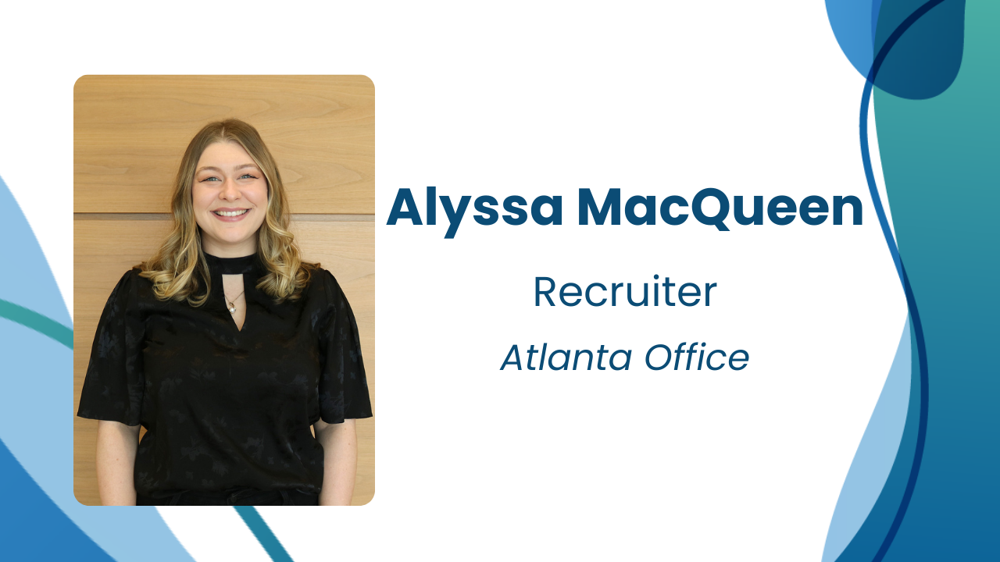
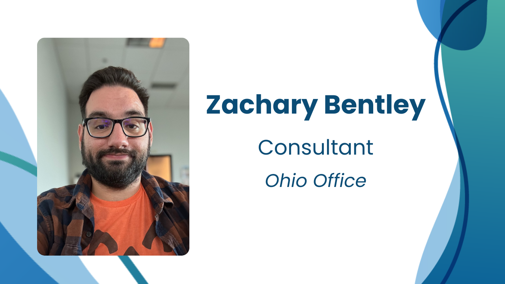
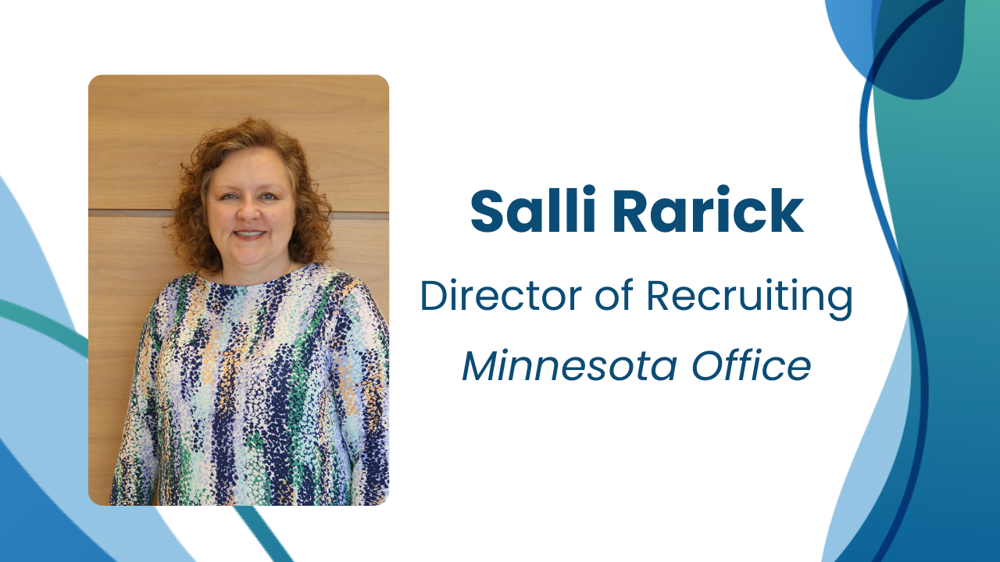

As we gather around the metaphorical Improving Thanksgiving table this year, we are grateful for each and every employee who made 2023 so special. To reflect on the year, we asked what Improvers were thankful for this season, from shared accomplishments to personal growth. Here are their responses...

**What are you thankful for professionally this year?**

I am thankful for Improving’s culture. Being surrounded by people who truly want the best for you in all aspects of life has been a fresh breath of air.

**What are you thankful for in your personal life?**

The advice that was given to me by a stranger who became a great friend earlier this year. It set the tone for this year being the best year of my life: “You won’t do what you need or have to do until you WANT to”.

**What are you thankful for professionally this year?**

I'm so thankful I get to work with Gezla and the fantastic team in Houston as the Come Together Champion! It's so important to me that people have the opportunity to explore all aspects of their human experience both at home and at work. It has given me the opportunity to learn so much about the work we do and to add details to the human experience as we explore new territory like AI and large language models.

**What are you thankful for in your personal life?**

I have so many things to be thankful for including my family and my job, but one thing that brings me so much personal joy and appreciation is my opportunity to run an election site in Houston. I am thankful to live in a country that allows for free and fair elections and thankful for the opportunity to serve my community.

**What are you thankful for professionally this year?**

My job and colleagues. In today’s trying economic times, I am thankful to work daily with the smartest group of people I’ve had the pleasure to surround myself with in my career. Every day I learn from and am inspired to be a stronger consultant by these folks.

**What are you thankful for in your personal life?**

My family and friends. As a father of a young family, having a strong support network is more than a blessing for me, and I am forever thankful. And my wife. Our family would surely fall apart without all that she does for us – I am thankful for her support every day.

**What are you thankful for professionally this year?**

In recent years, I've been gravitating towards life coaching. Having the Path Coaching Initiative at Improving has given me many opportunities to learn more about being an effective coach, and to help others to develop their careers. There's always something new to learn about managing projects and teams. Improving has allowed me to improve (ha!) my scrum game with several professional certifications and training courses, such as PSM I & PSM II (Professional Scrum Master) and PSPO (Professional Scrum Product Owner).

**What are you thankful for in your personal life?**

I'm truly grateful for the volunteers of the Cenotes Urbanos project. We are a bunch of people doing speleology and working towards educating our community about the importance of preserving the Yucatan Peninsula Aquifer. I'm grateful for the opportunity to witness the annular solar eclipse with my family and friends on a beautiful archeological site called Oxkintok. This trip reminded me of my passion to explore and learn, and to be one with our natural and cultural heritage.

**What are you thankful for professionally this year?**

I am thankful for the PATH program at Improving. Through PATH I am able to expand my knowledge on topics I am most passionate about and find meaningful ways to contribute to the organization via those passions. The PATH program helps me feel supported, trusted, and valued.

**What are you thankful for in your personal life?**

I am thankful for the relationships I have cultivated throughout the year. I am so appreciative of the opportunity to nurture and be nurtured by people I care for.

**What are you thankful for professionally this year?**

I am thankful for the opportunities that were given to me to show leadership abilities. I am also thankful for my manager for being supportive and encouraging during the current market volatility.

**What are you thankful for in your personal life?**

I am thankful for attempting and completing my 4th marathon!

**What are you thankful for professionally this year?**

I am thankful for the amazing consultants I had the opportunity to work with this year. I have enjoyed working with them and it has been fun to get to know them better.

**What are you thankful for in your personal life?**

I am most thankful for my family. Their unwavering support, understanding, and love have been a constant during a year full of change. They keep me grounded and fill my life with joy!
