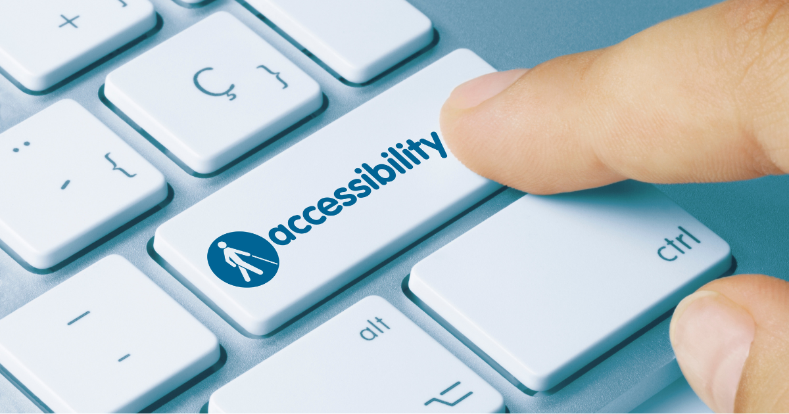

Under Title 2 of the Americans with Disabilities Act (ADA), all public entities, including state and local governments that serve at least 50,000 people, must ensure their websites comply with Web Content Accessibility Guidelines (WCAG) 2.1 Level AA by April 24, 2026!

It may be concerning to learn that the deadline has already passed, but just four days before it arrived, the Department of Justice (DOJ) extended it to April 26, 2027. WHAT A RELIEF!

However, that doesn’t mean you should wait another year to get started on your compliance journey. The DOJ specifically granted this extension after recognizing that many entities were struggling with the sheer volume of work required to comply. And if you think this only applies to public entities, think again. Lawsuits over digital accessibility have been increasing, with WCAG 2.1 standards often serving as the benchmark for compliance.

### **Why be ADA compliant?**

The two most obvious reasons are ones mentioned above: 1) the government requires it (with the potential for daily fines per infraction as a penalty) and 2) ADA compliance helps protect your organization from lawsuits related to digital accessibility. Both of these reasons ultimately boil down to the same thing - money. But rather than thinking about just what we *have* to do, let’s think about the real human element to ADA compliance - ensuring that everyone has equal access to the same opportunities.

WCAG 2.1 aims to create a perceivable, operable, understandable, and robust digital experience to improve web accessibility for users with cognitive/learning disabilities, low vision, and mobile device users.

According to the [Center for Disease Control](https://www.cdc.gov/) (CDC), more than 1 in 4 adults in the US live with some form of disability. Looking globally, that number exceeds *one billion *people. When you also consider their friends, families, and caregivers, then, according to Vispero, a leading assistive technology provider, a staggering 73% of the entire world is affected in some way by a disability.

And to be clear, accessibility is not only about extreme examples like a person who is totally blind. Most people have some vision loss as they age. I watch my father constantly put his glasses on his head, squint, and zoom in 400% when trying to read something on his phone. WCAG2.1 compliance can help him, and ALL the squint-and-zoom-to-400% dads, more conveniently access content across the internet.

### **What is the scope of work, and how do we get started?**

My particular project is a site used by several dozen state governments, which means it falls under the accessibility deadline. Our site has a fairly large footprint, with well over 150 unique pages, plus hundreds of RDL reports that can be generated as PDFs, exported to Excel, or even physically mailed. It is also a legacy system with limitations on the technology we can leverage.

For example, one of the early questions I ran into was: “How do we make a PDF ADA-compliant?” At first, I had no idea where to even start, but after some research, I can tell you it involves a lot more than just increasing the font size! For starters, images need meaningful alternative text, headers and tables need to be tagged in a logical order, and it should be rendered as an Accessible PDF.

It has taken several hundred hours of research to understand the scope of work for our project, and it will take hundreds more hours to fully address our compliance issues and implement the necessary fixes.

But the good news is that it isn't a new or unsolved problem!

There is a lot of information online about how other organizations have tackled accessibility efforts, and, of course, we have amazing colleagues here at Improving that you can reach out to for guidance as well! Our project has been utilizing Accessibility Insights for Web for our in-depth UI testing, ARC Toolkit for spot testing new UI features, Adobe Acrobat Pro for testing PDFs, and even Excel’s built-in accessibility checker. Who even knew that existed!

There are also several AI tools that can be leveraged - including [Windsurf](https://windsurf.com/?utm_keyword=windsurf&utm_term=windsurf&utm_campaign=Windsurf_Brand_Search&utm_source=google&utm_medium=cpc&hsa_acc=2306956870&hsa_cam=23792482491&hsa_grp=194695911046&hsa_ad=807001863485&hsa_src=g&hsa_tgt=kwd-10231843&hsa_kw=windsurf&hsa_mt=e&hsa_net=adwords&hsa_ver=3&gad_source=1&gad_campaignid=23792482491&gbraid=0AAAAA_ehtCvB3hN3SQlZeYhfcxnRJ8l1e&gclid=CjwKCAjwntHPBhAaEiwA_Xp6RlshRwaQiALH1h4_uOdn4YK6lY-x5lpQjyYtOS_MxmPWus7Cl5v8jBoC0tAQAvD_BwE)!

If you haven't already, consider this your call to action to get started addressing outstanding issues and adding ADA into your Definition of Done for new features. ADA compliance is a lot of work, and the best time to start was at least a year ago! But when we take a step back and consider who we’re ultimately helping, it becomes clear that the effort is absolutely worth it. We’ve also been pleasantly surprised by how excited most of our clients have been about improving accessibility once they understand the impact it can have – despite the significant costs!

### **Looking for fun ways to get involved?**

- Try a “No Mouse Monday,” where you try to navigate your solution entirely by keyboard
- Run a quick scan using one of the UI tools on a page and see what errors it finds
- Try a screen reader and see if you can understand just one page end-to-end
- Try a Chrome extension that simulates a vision impairment, such as blurred or low vision
- Bring ADA compliance up at your next client stand up and let me know the general reactions

[To find out how we can help your organization become not only ADA-compliant, but also inclusive to all users, reach out to us](https://improving.com/contact)
