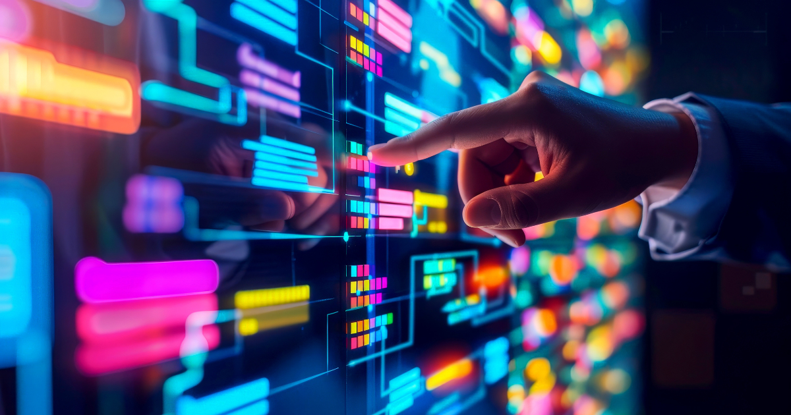

Let’s get real.

The Scrum Master role isn’t what it was in 2010. Honestly, it’s not even what it was in 2020. If you're still just scheduling standups, herding people into retros, and being the Jira police, you're not leading. You're lagging.

### **Welcome to the new era: The AI-Enhanced Scrum Master**

This isn’t sci-fi. This is now. And if you’re not using AI to up your game, you’re about to be outpaced by those who are.

The role has dramatically changed, and the 2020 Scrum Guide nailed it when it said: the Scrum Master is a leader who serves—a coach, a blocker-remover, a facilitator, and a change agent. You're not there to run meetings. You're there to drive agility, culture, and high performance.

But modern Scrum Masters face more complexity than ever:

- Distributed teams across time zones
- Data overload
- Burned-out developers
- Stakeholders who want dashboards *yesterday*

You need more than sticky notes and servant-leadership quotes. **You need tools that think, and that’s where AI comes in.**

#### **1. Use AI As a Tactical Edge**

It’s a myth that AI is here to replace Scrum Masters. Instead, it’s actually here to supercharge the role. You’ve been trained to observe patterns, sense shifts in team dynamics, and guide conversations that matter. But even the sharpest Scrum Master can spend hours trying to decode subtle signals or invent new ways to spark engagement. That’s where AI becomes your edge.

You should be using tools like Copilot to do simple, but time-consuming things like:

- Transcribe meetings in real time
- Summarize key themes and emotional tone
- Highlight blockers and action items automatically

With AI, you can move faster from observation to insight. Spend less time capturing data and more time coaching your team through what really matters.

#### **2. Spot Impediments Before They Blow Up**

Ever wish you had a sixth sense for when a sprint is about to derail? As a Scrum Master, you already know how to read the room, spotting subtle shifts in behavior, delivery, and communication. But your development team lives in data. So, why not use data to back your instincts? AI tools can analyze sprint metrics and flag early warning signs like:

- Drops in commit volume
- Task-switching patterns (a goldmine for uncovering focus issues)
- Communication slowdowns across tools like Slack or Teams

With AI, you’re not just guessing, you’re validating. You can bring hard data into retros and standups to spark deeper conversations, uncover hidden blockers, and coach your team with precision and speed.

You already know what to look for. AI just helps you see it faster.

#### **3. Real Talk From Retrospectives**

Maybe this is your situation: your current team is energized, interactive, and fully engaged in retrospectives. That is wonderful, but if we’re facing the truth, team dynamics will shift and engagement can dip. Sustaining that level of participation, sprint after sprint, takes real effort.

As a Scrum Master, you might already be spending a significant amount of time crafting fresh themes, designing creative prompts, and searching for new ways to provoke meaningful, reflective conversations. That cognitive load adds up.

This is where AI can become your co-facilitator. AI tools can analyze sentiment trends across sprints, detect subtle shifts in team morale, and surface emerging patterns that might otherwise go unnoticed. They can suggest retrospective themes based on emotional tone, flag recurring blockers, and even help you tailor your coaching to the team’s evolving needs.

In short, AI doesn’t replace your intuition; it amplifies it. It helps you coach the human, not just the process.

#### 4. **Stakeholder Updates Without the BS**

AI is powerful, but remember that it amplifies who and whatever you already are.** **As my friend Ty Crockett likes to say, “Scrum doesn’t fix your issues, it exposes them”.

- If you’re a bottleneck? You’ll be a faster one.
- If you’re empowering your team? You’ll be unstoppable.

Use AI to serve the Scrum values:

- **Transparency** through real-time data.
- **Inspection** through intelligent feedback loops.
- **Adaptation** through faster, smarter decisions.

But don’t lose your soul to automation. Your team still needs a human who cares. That’s you.

### **Real Talk: The Future of Scrum Mastery**

We’re done pretending that soft skills alone make a Scrum Master. You need systems thinking, emotional intelligence, and now… digital fluency. This is the hybrid leader of the future:

- Part agile coach
- Part systems hacker
- Part AI operator

Think of it like this: You're not being replaced. You're being rebooted.

### **TL;DR: Evolve or Fade**

In a world where AI writes code, predicts blockers, and analyzes team morale, the Scrum Master who refuses to adapt will fade into irrelevance. But the one who leans in, learns, experiments, and blends the heart of agile with the mind of AI? That Scrum Master will lead the revolution.

### **Ready to Evolve?**

Pick one AI tool during this sprint. Try it, break it, and LEARN.

As a Scrum Master, you're not just guiding the process; you’re coaching people, spotting patterns, and constantly reinventing how your team grows. That’s a lot to carry. So, what if AI could help you do it smarter?

Step into the future of agile leadership by checking out [Improving’s training courses](https://www.improving.com/services/training/), from Scrum.org to AI classes, we can teach you how to amplify your instincts, surface hidden team dynamics, and help you lead with insight.
