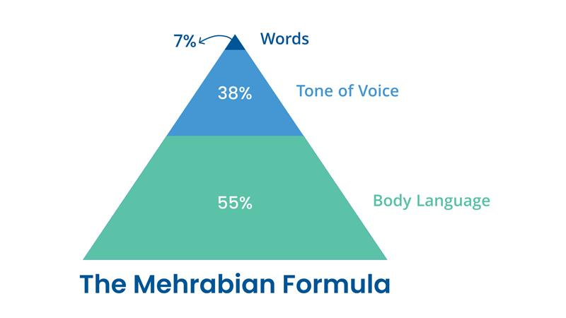
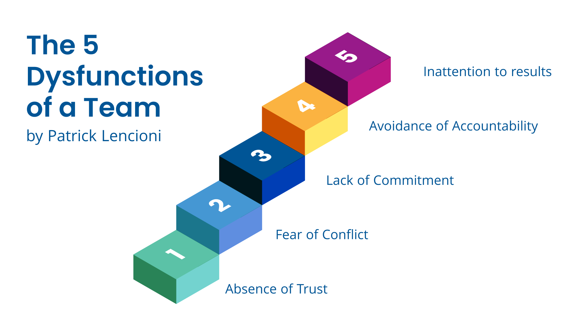

The time is up; the delivery deadline is hours away. The virtual meeting starts for everyone to show their piece of the puzzle. As each person shares their work, something becomes clear: even though the team discussed the scope just two weeks ago, the outcomes don’t quite match up

Everyone *did* their part. There were follow-ups, syncs, written updates, and spaces for feedback. Yet, somehow, the pieces don’t fit together.

So, what happened?

It turns out, talking isn’t always the same as truly communicating.

Albert Mehrabian’s communication model helps illustrate this. Depending on the context, it’s estimated that 60–93% of communication is non-verbal. Around 55% of communication is rooted in body language—our facial expressions, posture, and gestures. Another 38% is paraverbal—how we speak, our tone, and inflection. Only 7% comes from the actual words we say.

That means most of what helps us understand each other lies beyond language. And when we’re communicating virtually—on a call, in a chat, or through a slide deck—much of that richness is lost. We rely heavily on written and verbal clarity, but those tools alone aren’t always enough to build true alignment. It’s important to clarify: this doesn’t mean that words aren’t valuable—far from it. Especially in written or technical contexts, clarity of language is essential. But when conversations involve ambiguity, emotion, or interpretation, our brains tend to rely more heavily on non-verbal signals to make sense of what’s really being communicated. This is deeply rooted in how we’ve evolved: long before spoken language existed, humans communicated through facial expressions, tone, and body movement. Even today, a thoughtful pause, a quick smile, or a slight shift in posture can convey more than a dozen carefully chosen words ever could.

And that’s where Patrick Lencioni’s framework around team dynamics can offer some perspective. In his model of the five dysfunctions of a team, the root challenge isn’t usually a lack of effort—it’s a gap in **trust**.

Not trust in the sense of “I believe you’ll get your work done,” but the deeper kind: the confidence that it’s okay to admit uncertainty, to ask questions that might feel obvious, or to say, “I don’t think I fully understand.”

When that kind of environment isn’t intentionally cultivated, people—*ourselves included*—might hesitate to speak up. We might assume everyone else is aligned and does not want to be the one holding things back. We may not realize there’s a misalignment until it’s too late.

Another key layer is what Lencioni calls **fear of conflict**. In high-trust teams, constructive disagreement is welcomed—it’s a sign of engagement. But when trust feels fragile, even well-intentioned differences of opinion can feel risky. Instead of checking in, we might nod along. Instead of questioning, we stay silent, not out of disengagement, but out of care or caution.

It’s easy to confuse agreement with alignment. But alignment is active. It’s not just about whether we heard the same words—it’s about whether we interpreted them in the same way. And that takes time, intention, and the kind of communication where people feel safe clarifying, challenging, and asking without hesitation.

So, what can we do?

We can start by creating space for **curiosity over certainty**. By encouraging questions, modeling vulnerability, and normalizing the phrase, “Can we double-check we’re on the same page?”

We can invite healthy tension into conversations, making it okay to say, “I see it a bit differently,” and treating that not as a derailment, but as a way forward.

And above all, we can recognize that effective communication isn’t just a soft skill—it’s a strategic one. One that, when done well, builds alignment, strengthens trust, and helps us deliver as one team, not just as a group of individuals working in parallel, but as a team moving forward together. Want to learn more? [Reach out to us.](https://improving.com/contact)
