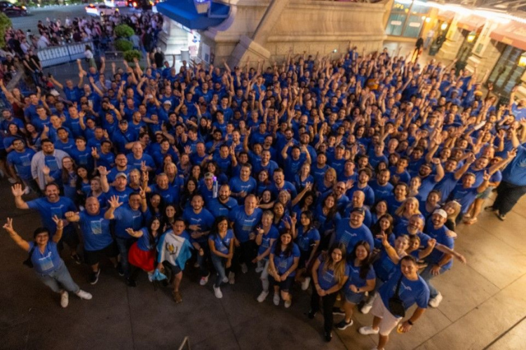
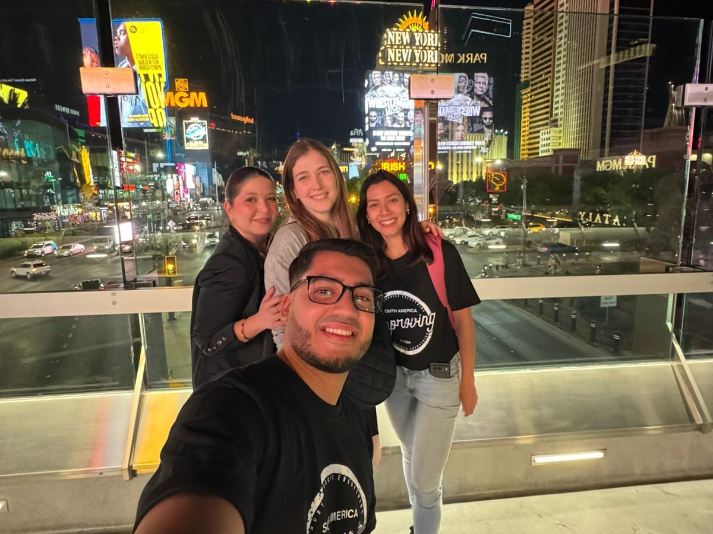
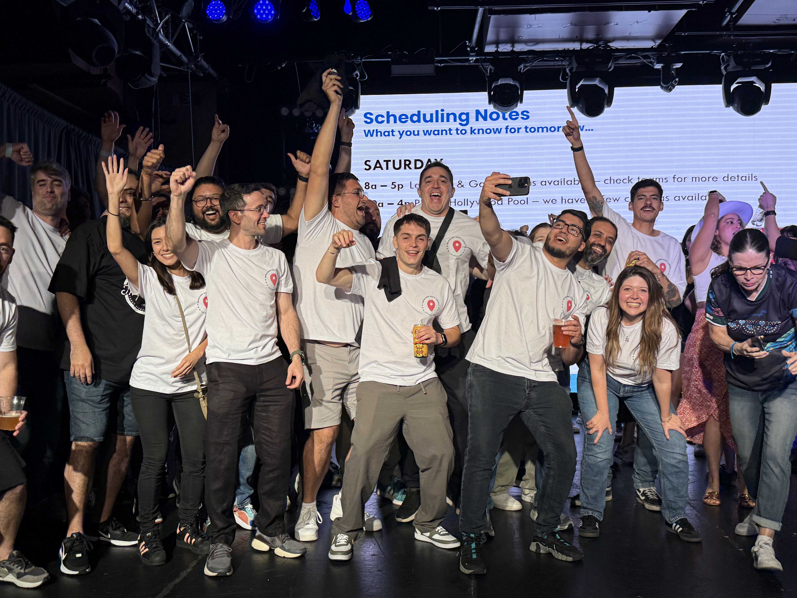
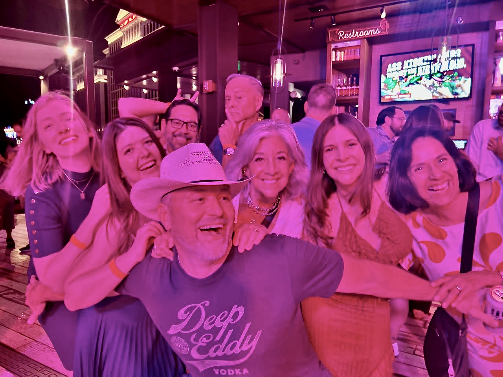

Some experiences can’t be explained; they have to be lived. The annual Improving Retreat in Las Vegas is one of them. No photo, video, or conversation could truly capture the excitement, joy, and connection that fill every corner of the city when hundreds of Improvers come together.

Last October, [LenioLabs officially became part of Improving](https://www.improving.com/thoughts/improving-expands-footprint-with-leniolabs-acquisition/). From day one, the legendary Vegas Retreat was always a topic of conversation. As one of the leaders for the Trust & Culture workstream, I had a front-row view of what was to come, but nothing could have prepared me for the reality of walking into that sparkling city surrounded by colleagues I had only seen on screens. I’m not talking about the lights, casinos, or the whirlwind of the Strip, but I’m talking about the smiles, greetings, inside jokes, and the unmistakable magic of being an Improver.

For many of us, this retreat was historic. It was the first time South America, Guatemala, and India joined, alongside our amazing teams from Mexico, Canada, and the USA. Months of preparation were a bustle of flights, schedules, logistics, and countless coordination calls. Each challenge continuously built anticipation. By September, my excitement was almost tangible.

On September 24th, after sixteen hours of flights and layovers, I finally landed in Nevada. The desert heat greeted us like an old friend, and Planet Hollywood became our first home for the week. Checking in, I was immediately wrapped in greetings, laughter, and handshakes. Familiar faces and new ones intertwined seamlessly, and the thrill of real connection hit instantly.

Even before the official retreat began, I had the incredible privilege of joining the Vegas Leadership Celebration on Wednesday evening at Ole Red Rooftop. This was a special gathering for leaders, directors, and above. The energy was electric with music, lights, and the presence of so many inspiring leaders that filled me with awe. Recognition was given to those shaping the standard of excellence across Improving, and for a moment, I allowed myself to fully revel in the pride of being part of this extraordinary community. Surrounded by leaders setting the standard for excellence, I felt the true power of our shared mission and the force that unites every Improver.

Thursday marked the official retreat start. Improvers from every corner of the globe arrived and were greeted with welcome bags, schedules, and enthusiasm for what lay ahead. The Welcome Reception at the Blue Moon Bar was pure delight as first hellos quickly became “I’ve missed you,” and smiles filled the room. That evening, adventure awaited. Each Improver was able to pick from vast amounts of activities, including the High Roller, mini golf, Area 15, Fremont Street, fine dining, and shows. I chose Mad Apple at NYNY Cirque du Soleil. From the live orchestra to trapeze acts, comedy, and theatrical brilliance, every moment transported me. Experiencing it alongside my fellow Improvers made it truly unforgettable.

The retreat wasn’t just about shows and parties; it was also about learning, connecting, and creating lasting memories. The Learning & Games Rooms buzzed with activity from Thursday to Saturday, with AI and M&A discussions sparking inspiring conversations about the future, innovation, and global collaboration.

I had the privilege of co-hosting a session for women in Improving alongside Bethany Hilton, Director of Corporate Affairs, and Sandy Hermosillo, Director of Community Relations Mexico. Our Authentic Relating workshop brought together around 25 women, creating a powerful space for connection beyond work tasks. It was filled with insight, shared stories, and meaningful conversation. Just an hour later, a highly requested dance class kept the energy alive, with everyone moving, cheering, and letting loose.

Friday night brought an evening full of excitement at the Hard Rock Café. There were stationed games, costumes, and beer pong *(oh yes, the beer pong, a big deal for many!)* I was asked to lead the “Global Delivery/New Continents” team for the station games, where we brought together South America and Pune-India Improvers. We made it to the beer pong semifinals and secured third place in the station games, earning a cash prize to share within the team. There was a fun reward and a big celebration of teamwork, collaboration, and pure enjoyment, especially considering it was the first retreat for both enterprises.

Later in the night, our CEO, Curtis Hite, shared inspiring words about upcoming company changes and celebrated colleagues stepping into new roles, reminding us why we do what we do. As the night unfolded, Improvers scattered across Vegas on their own adventures. Some people hit the dance floor, others explored Fremont Street, and a few, like me, went straight for karaoke. Meanwhile, some gathered at the Glass Bar in the Hollywood Casino Hotel, swapping stories, sharing high-fives, and soaking in the madness. Whatever the choice, the energy, camaraderie, and playful spirit of the night were absolutely contagious.

Saturday arrived early and bright. Despite tired voices and too-early alarms (seriously, who schedules 8 a.m. coffee in Vegas?), the energy never faltered. My morning kicked off with the Global Onboarding Strategy Champions, an initiative now in its second year, connecting new hires across the company and setting the stage for what’s ahead. After that, I joined the Come Together/Conscious Capitalism breakfast, another incredible space to share experiences, align goals for the year, and discuss new ideas. Between these sessions, I had several important meetings that I’m confident will spark fresh opportunities and collaborations across teams—truly energizing work.

Next up was the legendary pool party. Sun, good vibes, and casual connections set the tone for the grand finale:** The Amazing Race.** Picture 500 Improvers racing the Strip, completing challenges, taking photos, giving high-fives, and cheering each other on. Spoiler alert... my team didn’t win. But the fun, camaraderie, and memories we created were absolutely priceless. By the end, we gathered at the Paris Hotel for the buffet, toasts, and of course, the announcement of the winners.

As the retreat came to a close, the iconic global group photo outside the Paris Hotel captured more than just faces. It captured the heartbeat of Improving. Standing there, surrounded by colleagues from South America, India, Guatemala, Mexico, Canada, and the USA, these people had become friends, mentors, and even family, and the farewell felt bittersweet. There’s a strange magic in saying goodbye with a mix of nostalgia for the moments just shared and excitement for the adventures ahead. Knowing that we’ll meet again next year, carrying forward these memories and connections made every early flight, long layover, and busy day absolutely worth it.

This retreat reminded me that Improving isn’t just a workplace. It’s a culture, an investment, and a heartbeat that spans continents. Here, learning, laughter, and connection aren’t afterthoughts. They are at the core of how we grow, thrive, and belong.

Las Vegas dazzles, yes, but the magic comes from the people. From planned sessions to spontaneous hugs, from Learning & Games Rooms to pool parties, from AI discussions to dancing under the stars, the energy of the Improvers is what truly lights up the city. You can try to explain it, but you can’t. You have to live it. And once you do, you realize this truth: Improving isn’t just where I work. It’s where I belong.

Interested in becoming a part of the Improving family? [Contact us today](https://improving.com/contact) or [check out our career opportunities](https://www.improving.com/careers/).
