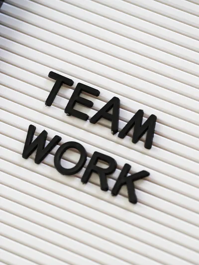

In our [last post](https://improving.com/thoughts/the-unseen-impact-on-your-agile-transformation-part-i), we discussed the impact that cognitive bias can have on an Agile transformation. What starts with good intentions can lead to a less desirable result. In this post, we discuss another impact of Agile transformation; that of relying on the adoption of processes to achieve success.

The definition of process is “*a defined series of actions or steps taken in order to achieve a particular end.”* In other words, how to do something, be it a task, a ceremony, or working together as a team.

Many times, as Agile coaches, we rely on defined processes to start a team on a transformation journey. We may also introduce a process to inspire new methods to deliver value. While there is nothing wrong with the introduction of a process as a starting point, stopping at the adoption will usually not bring the results desired.

The team may adopt the process as defined and simply go through the motions, never growing past the initial adoption. In simply adopting, they may not understand the purpose and the “why” of the process, losing its true potential. Seeing the process not producing the anticipated fruit, we may add more processes to correct, only making the problem worse. We end up with a frustrated and overburdened team that has done nothing but follow our guidance.

Why do we fall into this process adoption trap? Sometimes, it’s due to the pressure to quantify an agile adoption. We find ourselves resorting to measuring “Agile maturity” through a checklist of processes to show progress. Other times, the emotional exhaustion of a stormy transformation can lead to following the path of least resistance through the introduction of known processes that are easy to adopt. The goal of this adoption is the quick reduction of the drama and pain being experienced. It may also be due to confirmation bias, or even a lack of experience, and relying on one’s “cookbook” of standard processes to guide a team.

### What Are The Signs Of The Process Adoption Trap On a Team?

Let’s look at the example of a team set on the path of adopting processes without empiricism or an opportunity to improve:

- The Scrum Master acts as a process cop, project manager, and a ceremony facilitator. Rather than serving the team, the focus is on ensuring the team is serving the process.
- All stories are sized, and their time estimates are in place to show they are ready to start. Once a story is completed, it is confirmed that all tasks are closed to show that the stories are done.
- Time is in short supply as the expectation is that all team members are at all meetings so they all share a common understanding of the backlog and can be “cross-functional”.
- Retros produce no meaningful insight or actions and are usually pats on the back.
- Velocity is determined, but there is no understanding on how to use it. More than likely, it is used as a report for leadership to measure their progress.
- In the worst case, the team is serving both the newly introduced process as well as the old ones that have not been addressed or removed.

Ultimately, with the team that is serving the processes, rather than continual improvement, sprints produce limited value to stakeholders, and leadership is left unsatisfied.

How do we avoid the process adoption trap? Change our “P” word! By focusing on ***practice*** and shifting our mindset, we find ourselves building the habit of continuous improvement. The team gains an understanding of why a practice works and how to improve it. This increases shared ownership and accountability to each other. We usually think of practice as a noun; “*the customary, habitual, or expected procedure or way of doing something.” * But you can only get to that definition through practice as a verb, that is; “*to perform an activity or exercise repeatedly or regularly in order to improve or maintain one's proficiency.”*

### How Do You Shift The Focus From Adopting Processes To Practice?

- When you introduce a standard process, ensure it solves an existing problem and that the team understands the why. In that way, they can make it their own, practice it, and improve it.
- Don’t boil the ocean. In the rush to improve everything we tend to focus on adopting processes rather than working through the development of practices. Slow down, prioritize, and work through your adoption at a sustainable pace.
- Storming is a thing…embrace it. Remind your team what the anticipated outcome is and show them how far they’ve come. Celebrate the small wins. Giving in to the easy answer of a standard process only reduces short-term pain. Keep the teams’ focus on practicing and improving.
- If the pressure is on to “adopt Agile”, remember that it might just be confirmation bias. Review the “why” for the adoption and demonstrate how working through practices will result in continual improvement and improved teamwork. This is more important than a list of adopted processes.
- As you work toward practicing agile, keep it simple. A complicated practice that is hard to understand is not a good starting point. Break it down to first principles and start the practice there. Layer on more as the team becomes proficient.

If we now take our earlier example of “adopting Agile processes” and shift it to “practicing Agile” we wind up with a very different picture.

- The Scrum Master demonstrates that team success is more important than following a process. The desire is to help the team grow and learn how to be the best they can be.
- The team has a shared definition of ready and definition of done to guide a common understanding of outcomes.
- Retros are directly related to how the team worked in the sprint. Specific, Measurable, and Timely actions are produced and added to the backlog so the team can improve how they work together.
- Velocity is used as a tool to help in understanding how much value can be delivered in a sprint as well as a quantifiable input to a retro.
- Old, irrelevant practices are removed, replaced, or improved by the team.

If a sprint doesn’t produce value, the team reviews to understand why and, invariably, reviews their practices to determine how they could get better. Stakeholders and leadership see the improvements.

In conclusion, as with any Agile transformation, one of the goals is a strong, highly motivated, and efficient team. Ensuring the team is empowered to practice and adapt processes results in the mindset of continual improvement, ownership, and accountability. A team that understands why they work well together is a team that will have success.

To learn more about Agile transformation and how to do it effectively, [reach out](https://improving.com/contact). You can also take a look at our upcoming Agile courses [here](https://improving.com/services/training/full-schedule/).

*This has been part 2 in a 3-part series discussing confirmation bias, screwing up a team with process introduction, and how to fix a broken implementation. We’ll close it off with part 3: What to do if you’ve given in to Confirmation Bias or The Process Adoption Trap. *
