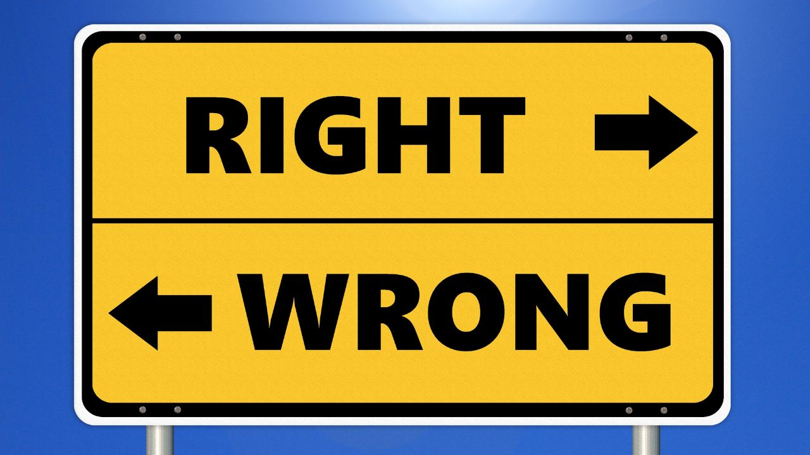
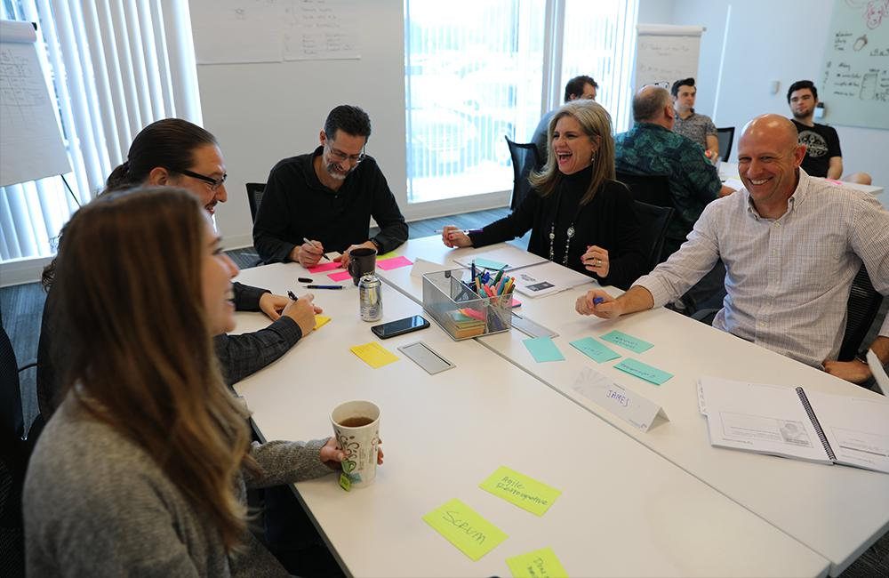

As with most people, my earliest values were created by my parents and the of course education system. Lessons I learned in childhood include learning to share, dressing and speaking appropriately, raising my hand in class, and otherwise fitting in society. Learning these lessons are unconscious acts, really, and if anyone were to have asked me to define my values, I would have been quite stupefied.

My first real exposure to understanding my own values came when I began my coaching studies. In short, I learned that if you are upset, someone had probably stomped on your values! By examining times of unhappiness and anger in my life (and yes there have been a few) I began to see some patterns emerge:

- I like to contribute and add value. Basically, I want to make a difference
- I want to be recognized for the value I add
- I value open and honest feedback
- I despise when value is assigned based on hierarchy
- I value transparency and honesty tempered with compassion
- I value learning and growth and am not afraid to learn from mistakes

I guess you could say that somewhere in my mid-forties, figured out what I wanted to be when I grew up! Better late than never, right? That is when I started my role as a Continuous Improvement Specialist and began to apply my coaching and Lean techniques to help my peers improve their working situations. I helped a team of 400 to identify and tackle issues in their daily work that frustrated them or caused them to waste a lot of time, particularly as downsizing efforts were put in place in order to get them to “work smarter”.

Have you ever noticed that people tell you to “work smarter” when the workload becomes unbearable but they never, ever tell you how?

During my last 15 years in telecommunications, I helped many teams to become happier and more efficient in their work. Some teams saved money but in other teams, the value was in better relationships and still, others were able to stem the tide of ever-rising banked overtime and unused vacation allotments.

I really did not understand the value of values though until I expanded my reading and training to truly become an Agilist. As I learned about Scrum, Toyota Methodology, Kanban, etc., I began to realize that each one of these approaches was underpinned by its own sets of values! How could I have used all the tools of lean for 15 years without ever having seen a list of the 14 Toyota Principles, especially with how closely they aligned with the 4 Values and 12 Principles of the Agile Manifesto?

As I began to teach Scrum and Agile to my clients and watched their successes and challenges, it became increasingly clear that the tools and techniques I was teaching were more likely to bring value to organizations that also lived by the values.

In fact, organizations that fail to recognize how they provide value to their customers are less likely to be in tune with their changing needs. More importantly, if they do not live by the values and appreciate their employees, they are doomed to either lose good people or drive them to mediocrity for the sake of keeping them under control.

In short, the tools without the values are like a sandwich on diet bread with no butter, filling, or toppings... very unsatisfying and not particularly fulfilling!

If you would like to find out more about this topic, [contact us](https://improving.com/contact/)! You can also learn about Improving's values by [clicking this link](https://improving.com/company/about/).
