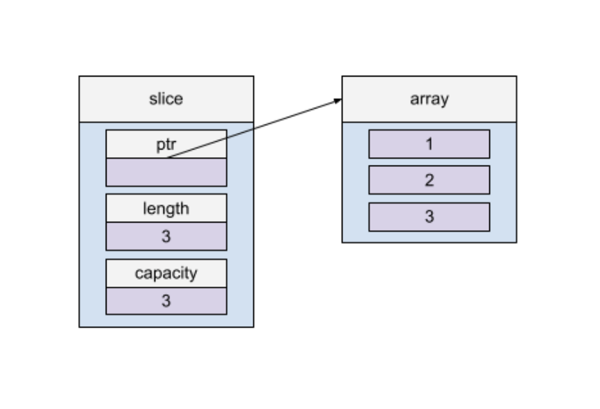
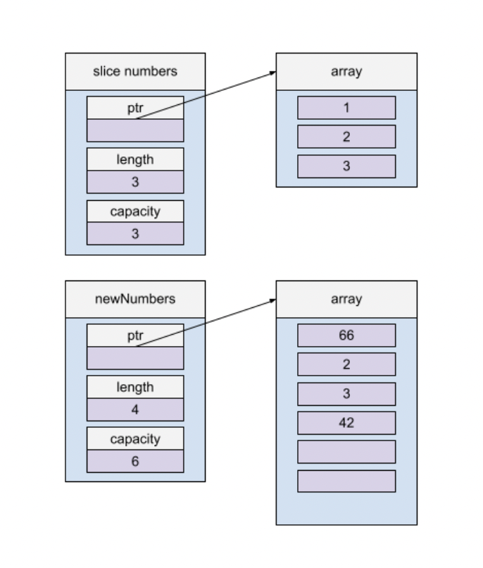
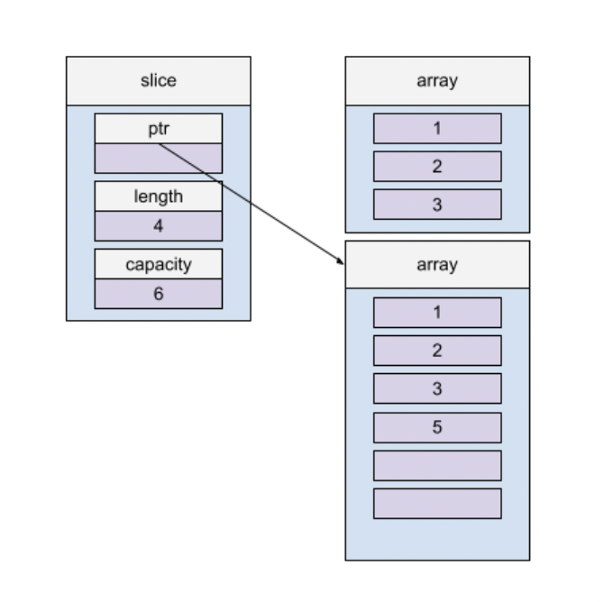
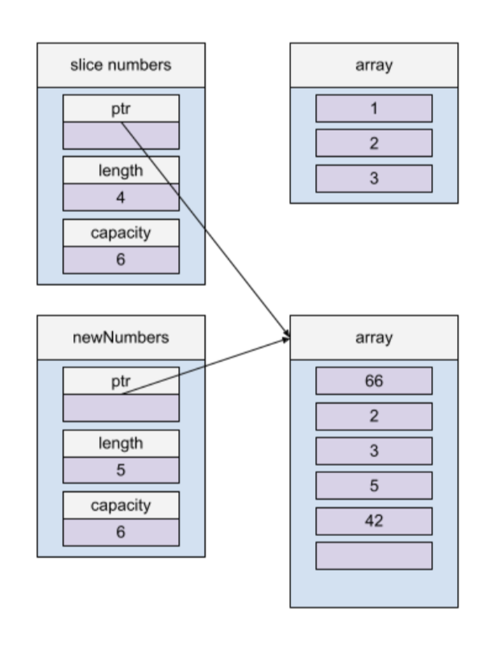
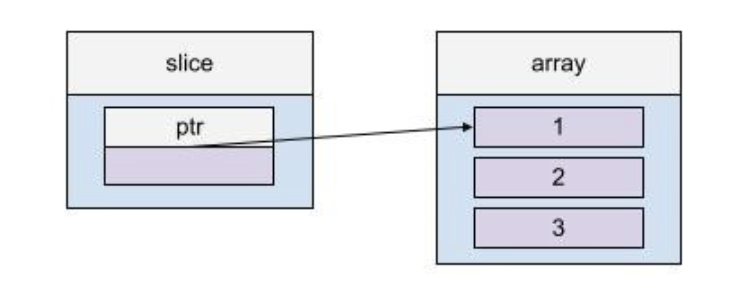
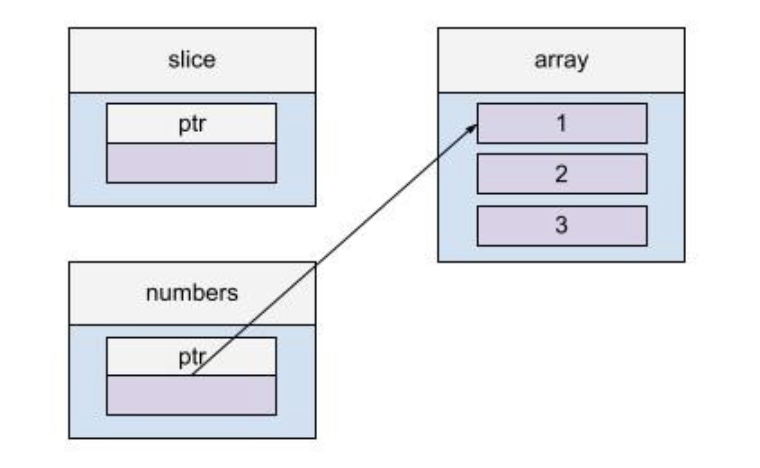
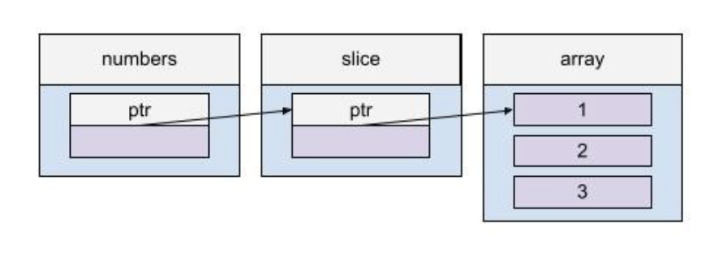
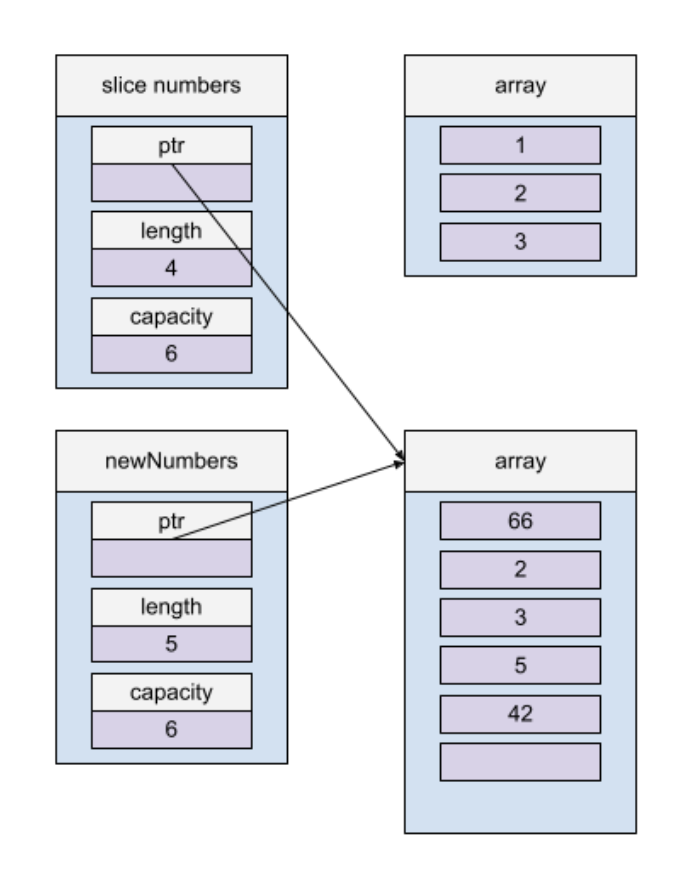

I have seen this Go example a few times but never felt like I had a complete understanding of what was happening. So, I drew some pictures to figure it out. Here is the Go example:

[https://go.dev/play/p/tRKXqPzvLOz](https://go.dev/play/p/tRKXqPzvLOz)

```go
package main 
 
import "fmt" 
 
func appendAndChange(numbers []int) { 
	newNumbers := append(numbers, 42) 
	newNumbers[0] = 66 
	fmt.Println("inside", newNumbers) 
} 
func main() { 
	slice := []int{1, 2, 3} 
	fmt.Println("before", slice) 
	appendAndChange(slice) 
	fmt.Println("after", slice) 
 
	fmt.Println("original slice is intact") 
	fmt.Println("-------") 
 
	slice = append(slice, 5) 
	fmt.Println("before", slice) 
	appendAndChange(slice) 
	fmt.Println("after", slice) 
	fmt.Println("original slice is modified") 
}  
Output:  
before [1 2 3] 
inside [66 2 3 42] 
after [1 2 3] 
original slice is intact 
------- 
before [1 2 3 5] 
inside [66 2 3 5 42] 
after [66 2 3 5] 
original slice is modified  
```

So, why do two calls to appendAndChange behave differently??????

Go slices have both a length and a capacity. The length of a slice is the number of elements it contains. The capacity of a slice is the number of elements in the underlying array, counting from the first element in the slice. The length and capacity of a slice s can be obtained using the expressions len(s) and cap(s).

The key to figure out why we see this behavior can be found in the documentation for append:

The resulting value of append is a slice containing all the elements of the original slice plus the provided values. If the backing array of s is too small to fit all the given values a bigger array will be allocated. The returned slice will point to the newly allocated array.

Let's walk through each step.

First, `slice := []int{1, 2, 3} `

A slice is created with len=3 and capacity=3. slice points to an underlying array where the data is actually stored:



Next,

`appendAndChange(slice) `

`newNumbers := append(numbers, 42) `

`newNumbers[0] = 66 `

`where numbers = slice. `We are trying to append 42 to slice, but slice only has capacity of 3, and the backing array is too small to fit all the value, so, a bigger array is allocated, and the returned slice points to the newly allocated array.



Note: For this code, the returned slice capacity seems to double to 6, but the growth strategy is not documented.

We now have a new backing array that `newNumbers` points to. After we return from the `appendAndChange()` function, `newNumbers` goes out of scope, and our original slice remains unchanged.

Now we call

`slice = append(slice, 5) `



A new backing array is created, and the slice variable is updated to point to it. The old backing array now has no pointers to it and goes out of scope. This time, when `appendAndChange` is called, the inside `append()` does not need to create another new backing array, because there is sufficient capacity.

`newNumbers := append(numbers, 42) `

`newNumbers[0] = 66 `

`where numbers = slice `



Now, slice and numbers are pointing to the new backing array, but slice has a length of 4 and `newNumbers` has a length of 5. This leads to:

`newNumbers = [66, 2, 3, 5, 42] `

`slice = [66, 2, 3, 5] `

### Correct Go

Admittedly, to fix this issue is very simple, and the answer is in the documentation itself:

Append returns the updated slice. It is, therefore, necessary to store the result of append, often in the variable holding the slice itself:

[*https://pkg.go.dev/builtin#append*](https://pkg.go.dev/builtin#append)

This means we can simply return `newNumbers` in `appendAndChange`, and then make sure we set the slice to that value when we call it, like so:

[https://go.dev/play/p/Vkm72dXxpnx](https://go.dev/play/p/Vkm72dXxpnx)

```go
package main 
 
import "fmt" 
 
func appendAndChange(numbers []int) []int { 
	newNumbers := append(numbers, 42) 
	newNumbers[0] = 66 
	fmt.Println("inside", newNumbers) 
    return newNumbers 
} 
func main() { 
 
	slice := []int{1, 2, 3} 
	fmt.Println("before", slice) 
	slice = appendAndChange(slice) 
	fmt.Println("after", slice) 
 
 
	fmt.Println("original slice is modified") 
	fmt.Println("-------") 
 
	slice = append(slice, 5) 
	fmt.Println("before", slice) 
	slice = appendAndChange(slice) 
	fmt.Println("after", slice) 
	fmt.Println("original slice is modified") 
}  
Output 
before [1 2 3] 
inside [66 2 3 42] 
after [66 2 3 42] 
original slice is modified 
------- 
before [66 2 3 42 5] 
inside [66 2 3 42 5 42] 
after [66 2 3 42 5 42] 
original slice is modified  
This works, and technically is the correct way to use append according to the documentation, but developers should not ha
```

This works, and technically is the correct way to use append according to the documentation, but developers should not have to read through base library documentation to look for edge cases.

### Introducing Rust

As a comparison, let's try to replicate this behavior in Rust, which has more compile safety checks.

[https://play.rust-lang.org/?version=stable&mode=debug&edition=2021&gist=010437e4280da7883dbdd41ae55e9327](https://play.rust-lang.org/?version=stable&mode=debug&edition=2021&gist=010437e4280da7883dbdd41ae55e9327)

```go
#[allow(non_snake_case)] 
fn appendAndChange(mut numbers: Vec<i32>) -> () { 
    numbers.push(24); 
    numbers[0] = 66;  
    println!("inside {:?}", numbers); 
} 
 
fn main() { 
    let mut slice = vec![1, 2, 3];  
    println!("before: {:?}", slice); 
    appendAndChange(slice); 
    println!("after: {:?}", slice); 
     
    println!("original slice is modified"); 
    println!("-------"); 
     
    slice.push(5); 
    println!("before: {:?}", slice);  
    appendAndChange(slice);  
    println!("after: {:?}", slice); 
    println!("original slice is modified"); 
}  
Output: (just the first error...) 
error[E0382]: borrow of moved value: `slice` 
  --> src/main.rs:12:29 
   | 
9  |     let mut slice = vec![1, 2, 3];  
   |         --------- move occurs because `slice` has type `Vec<i32>`, which does not implement the `Copy` trait 
10 |     println!("before: {:?}", slice); 
11 |     appendAndChange(slice); 
   |                     ----- value moved here 
12 |     println!("after: {:?}", slice); 
   |                             ^^^^^ value borrowed here after move 
   | 
note: consider changing this parameter type in function appendAndChange to borrow instead if owning the value isn't necessary  
```

Rust's vecs are very similar to Go's slices. However, instead of push being a function, it is a method, which must take a mutable reference to self, and it returns (). [https://doc.rust-lang.org/std/vec/struct.Vec.html#method.push](https://doc.rust-lang.org/std/vec/struct.Vec.html#method.push) This subtle yet powerful difference alone should be enough to prevent confusion over how to use the standard library.

This fails because the value of slice is moved into appendAndChange, but then it is referenced again after the move. Here are some (very simplified) pictures to explain what's happening:

We start with:



Then `appendAndChange` comes along and it TAKES the whole value. Our error message lets us know:

`--------- move occurs because `slice` has type `Vec<i32>`, which does not implement the `Copy` trait appendAndChange(slice); | ----- value moved here `



Rust doesn't allow the array to have 2 pointers to it, so **moves** the data in the array to numbers, taking away the pointer from slice.

Then, modifications are made to numbers, so numbers is now `[66, 2, 3, 24]`, and `appendAndChange()` returns to the main function.

Up until now, everything has run successfully, and if we had no more lines of code, the program would compile and be fine. But, we want to have that new numbers value back in our main

`println!("after: {:?}", slice); `

Now this is our actual error:

`println!("after: {:?}", slice); | ^^^^^ value borrowed here after move `

The compiler is saying, "Wait, you're trying to print 'slice'? You moved the value away from slice. I'm not going to be able to do that because slice has no value now" Lucky for us, it also gives a suggestion:

note: consider changing this parameter type in the function ``appendAndChange`` to borrow instead if owning the value isn't necessary. ` `

Rust is saying we are trying to do something that is unsafe, and it stops us. Let's try to get around it though. They suggest borrowing the parameter for `appendAndChange`. So lets pass a mutable reference:

[https://play.rust-lang.org/?version=stable&mode=debug&edition=2021&gist=ed5e97a3660782dfc50fb3e4c51cabf4](https://play.rust-lang.org/?version=stable&mode=debug&edition=2021&gist=ed5e97a3660782dfc50fb3e4c51cabf4)

```rust
#[allow(non_snake_case)] 
fn appendAndChange(numbers: &mut Vec<i32>) -> () { 
    numbers.push(24); 
    numbers[0] = 66;  
    println!("inside {:?}", numbers); 
} 
 
fn main() { 
    let mut slice = vec![1, 2, 3];  
    println!("before: {:?}", slice); 
    appendAndChange(&mut slice); 
    println!("after: {:?}", slice); 
     
    println!("original slice is modified"); 
    println!("-------"); 
     
    slice.push(5); 
    println!("before: {:?}", slice);  
    appendAndChange(&mut slice);  
    println!("after: {:?}", slice); 
    println!("original slice is modified"); 
}  
Output:  
before: [1, 2, 3] 
inside [66, 2, 3, 24] 
after: [66, 2, 3, 24] 
original slice is modified 
------- 
before: [66, 2, 3, 24, 5] 
inside [66, 2, 3, 24, 5, 24] 
after: [66, 2, 3, 24, 5, 24] 
original slice is modified 
```

Tada! Just like that, it's working now and has no strange edge cases to worry about. Here's how it works. When we pass a mutable reference of slice to `appendAndChange`, it creates a new pointer:



Now, numbers can make changes to the underlying values in array. When `appendAndChange` returns to the `main()`, numbers go out of scope, but slice remains as a pointer to the new values.

### Conclusion

Fundamentally, the problem in Go resulted from two pointers with different attributes pointing to the same value:



The Rust compiler will not allow for this to happen, preventing many potential bugs at compile time!
