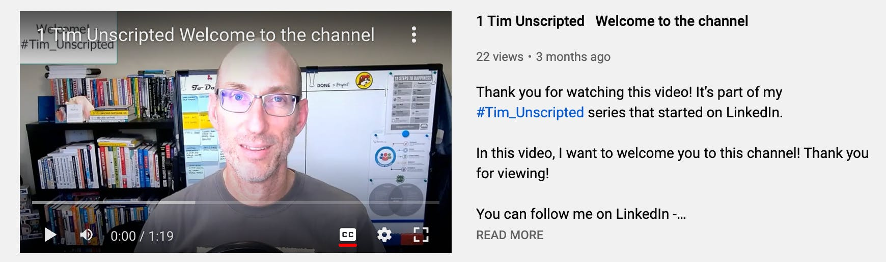

**Embarrassment. That’s how posting YouTube videos started for me. But this experience also moved me to consider podcasting.**

I know the statement above needs context, so let’s take a step back. I was on a live stream interview in March 2022 and the interviewer sent me my questions in advance of the session. However, I got lost trying to answer my own questions because I didn’t have a rapport with the interviewer.

In my mind, I was giving “word salad” answers. It was the most painful 30 minutes I have ever spent on camera! The experience led to self-reflection and questions like, “What can I do differently next time?” and “How can I prepare better next time?” This prompted me to record a short video about the experience and what I would change prior to the next interview.

To my delight, the video and written post were well received by my connections on LinkedIn! It was at that point that I decided to run an experiment with video posts. For me, it became almost like a game. I wanted to test engagement based on post type.

Would video posts receive more engagement than written posts from my LinkedIn network? I was determined to find out.

After nearly two months of video posts, I realized that written posts had better engagement on LinkedIn. I collected metrics to prove my hypothesis. As well, I discovered that directly posting videos to LinkedIn masked a lack of viewed videos versus posting to YouTube.

I digressed a bit as other inspiration started to grow and I allowed myself to work creatively with social media posting. I connected with different podcasts to work through the interview dynamics that caused me embarrassment in March. As I experienced different interviewer styles, I realized that I might be a good interviewer as well as an interviewee!

A question began to simmer in my mind. What would a podcast look like for me as a host? To help answer that, I started to have conversations with fellow Improvers about a concept I had in mind. I gathered their feedback. I considered their suggestions. I formulated a plan for how the concept might work.

What I landed on was a novel concept. I don’t mind hosting interviews, but it’s not what I want to do as a creator. What I want to do is inspire others to create!

Content creation isn’t all that difficult and anyone can do it. It is a process and there needs to be some discipline and structure around it to make it work. Once those ideas are out of your head, that’s when you start the journey to thought leadership.

## Begin Your Own Content Creation Adventure

1. Start simple. Consider how you might express your thoughts on a topic you are passionate about.

2. Start small. You don’t need to write a 500-word blog post for your first “experimental” post. Nor do you need to record a 30-minute webinar!

3. Enlist others who are already on the journey. Reach out to content creators who are doing what you would like to do. If you can connect with a thought leader in your network, politely ask for a 15-minute video call or send a short message asking for their feedback.

4. Ask your network for encouragement. Explain what you intend to do. Announcing an experiment makes creating and posting much easier as it takes the pressure off you to be perfect.

5. Don’t be afraid to embarrass yourself. Self-deprecating humor is well received by many people. It helps people relate to you.

[Tim Dickey's Youtube Channel](https://www.youtube.com/c/TimDickey)

### Here's How I Worked My YouTube Posts

One topic, 60 to 90 seconds, and press record. I share my thoughts on the topic, and I’m done. I do some editing, but not much. The time invested is minimal and it gets the concept to the market for fast feedback.

I started an internal podcast pilot for my colleagues. The concept is to connect with fellow Improvers on a more personal level. Guests have 25 questions they can choose from, and we talk for about 15 minutes.

My intent is to make the internal podcast into a framework that anyone can use to host their own shows. That’s how I plan to help creators create. It’s only the beginning for me, and I am excited to see where these projects take me in the future.

How about you? Are you ready to tackle the journey to thought leadership?

[*Reach out*](https://improving.com/contact)* to learn more about thought leadership at Improving and take a look at Tim’s Youtube channel *[*here.*](https://www.youtube.com/c/TimDickey)
