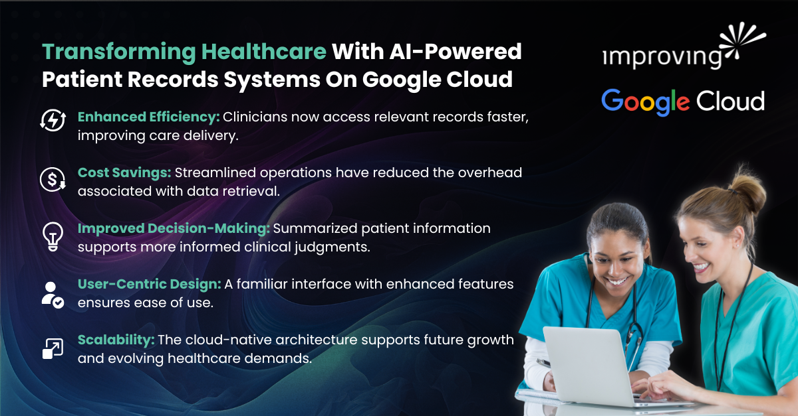

The healthcare industry is undergoing a seismic shift in 2025, driven by the need to transform vast volumes of patient data into actionable insights in a secure and scalable manner. As highlighted in a [**Google Cloud blog**](https://cloud.google.com/blog/topics/public-sector/unlocking-medical-insights-secure-ai-analyzes-data)** **from last year, the implementation of clinical AI has historically lagged due to challenges in translating research into practice. However, the opportunity is immense: with the proliferation of electronic health records (EHRs) and medical imaging, AI and cloud computing are now poised to revolutionize diagnostics, prognosis, and care delivery. Researchers such as Marieke van Buchem and Neo Christopher Chung emphasize that the key lies in moving AI from the lab into the clinic, where it can support real-time decision-making and improve patient outcomes.

### How We’ve Been Transforming Healthcare With AI Accelerators on Google Cloud

At Improving, we’ve been helping healthcare agencies across Canada transform their approach to modernizing healthcare applications through AI-powered accelerators on Google Cloud. In collaboration with Google Cloud, our team developed an AI-powered patient records system for a major provincial health authority in Canada. This innovative solution was designed to address the inefficiencies of legacy systems that hindered clinicians from accessing critical patient information in a timely manner.

### **The Challenge: Outdated Systems, Delayed Care**

The client's existing system used by the health authority was no longer fit for purpose. Clinicians faced frequent and significant delays in retrieving relevant patient records, which not only disrupted workflows but also compromised the quality and timeliness of care. The system’s limitations also contributed to increased operational costs and resource inefficiencies.

### **Our Solution: AI-Powered Patient Records System**

To address these challenges, our team implemented a modern, AI-driven patient record system built on Google Cloud’s Healthcare API and Vertex AI Search for Healthcare. The solution retained the familiar user interface of the legacy system to ease and streamline adoption, while introducing powerful new capabilities such as semantic search and automated record summarization. These features enabled clinicians to quickly locate and interpret patient data, significantly reducing the time spent navigating complex records.

**The key benefits of our AI-Powered Patient Record System **were improved efficiency, insight, and scalability over the previous legacy patient record system.

The impact of this transformation had been substantial. These included:

- **Enhanced Efficiency: **Clinicians now access relevant records faster, improving care delivery.
- **Cost Savings: **Streamlined operations have reduced the overhead associated with data retrieval.
- **Improved Decision-Making:** Summarized patient information supports more informed clinical judgments.
- **User-Centric Design:** A familiar interface with enhanced features ensures ease of use
- **Scalability:** The cloud-native architecture supports future growth and evolving healthcare demands

### **Strategic Partnerships and Innovation With Google Cloud**

This initiative was made possible through a close partnership between Improving, Google Cloud, and the healthcare agency. Google Cloud’s customer engineering and product teams provided critical support, particularly in navigating the complexities of pre-release technologies. Our agile, user-focused approach, coupled with our experience in developing transformative AI-powered solutions on Google Cloud while emphasizing iterative testing and feedback, ensured that the final solution met the real-world needs of healthcare professionals.

### **A Blueprint for the Future of Healthcare AI**

This project exemplifies how AI, when thoughtfully implemented, can address longstanding challenges in healthcare. By combining domain expertise, cutting-edge technology, and strategic collaboration, Improving has delivered a solution that not only meets today’s needs but also lays the groundwork for future innovation in patient care.

[**Click To Learn More About Our AI Expertise In Healthcare!**](https://www.improving.com/expertise/code_explorer_for_healthcare/)
