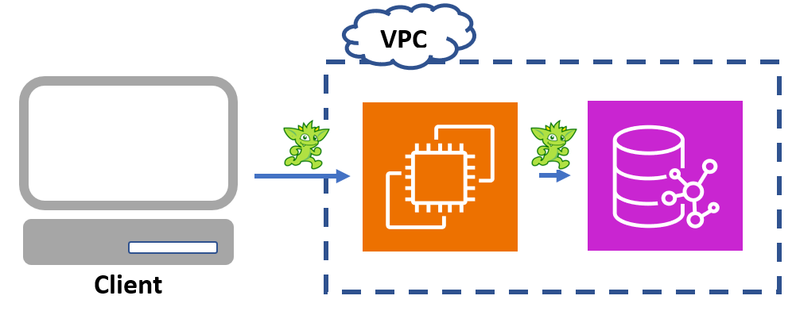
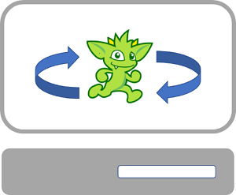

A previous post ([Automated testing of Amazon Neptune data access with Apache TinkerPop Gremlin](https://aws.amazon.com/blogs/database/automated-testing-of-amazon-neptune-data-access-with-apache-tinkerpop-gremlin/)) describes the benefits of unit testing your [Apache TinkerPop Gremlin](https://tinkerpop.apache.org/gremlin.html) queries and shows how you can add the tests to your CI/CD pipeline. It covered some of the pain points that users would face if they attempted to use [Amazon Neptune](https://aws.amazon.com/neptune/) as the target of their unit testing queries which includes the need to be connected to the internet and the need to connect to the VPC (currently Neptune can only be accessed from within the VPC where it’s hosted). Additionally, you can save money by unit testing with a local Apache TinkerPop Gremlin Server. That post also suggested and demonstrated how you could use TinkerGraph hosted inside a Gremlin Server to address these testing issues.

In this post, I build upon the approach of the previous post and show how you can use TinkerGraph to unit test your transactional workloads. Additionally, I show how to use TinkerGraph in embedded mode. Embedded mode requires the use of Java, but it simplifies the test environment considerably as there is no need to run the server as a separate process.

The following two diagrams show the architectural differences between running a query against Neptune and running a query against an embedded graph.





The examples in this post assume that you are working with Java and therefore have access to the embedded version of TinkerGraph. See [Automated testing of Amazon Neptune data access with Apache TinkerPop Gremlin](https://aws.amazon.com/blogs/database/automated-testing-of-amazon-neptune-data-access-with-apache-tinkerpop-gremlin/) for more information on how to use the remote version of TinkerGraph inside a Docker container. Note that embedded transactions have more capabilities than remote transactions, so you should only test features that exist for remote transactions (which is what is used when connecting to Neptune).

## Overview of Transactions in TinkerGraph and Neptune

Historically, one drawback of using TinkerGraph for testing was that it didn’t support transactions. Transactions are an important part of ensuring correctness when modifying the underlying database, and this type of behavior couldn’t be tested with TinkerGraph. However, with the [introduction of the transactional TinkerGraph](https://tinkerpop.apache.org/docs/current/upgrade/#_tinkergraph_transactions), TinkerTransactionGraph, in version 3.7.0, this has now changed and TinkerGraph is a suitable solution in most cases.

There are some important differences between the transaction semantics of TinkerTransactionGraph and Neptune and so there are some scenarios that you shouldn’t test with TinkerTransactionGraph. These scenarios should instead be covered by your full testing suite, which should run against Neptune.

First, TinkerTransactionGraph only provides guarantees against dirty reads, so it has a read committed isolation level. Neptune, on the other hand, can provide [strong guarantees against dirty reads, phantom reads, and non-repeatable reads](https://docs.aws.amazon.com/neptune/latest/userguide/transactions.html). This means that your unit tests should be written with the expectation that only dirty reads can’t occur.

Second, TinkerTransactionGraph employs a form of optimistic locking, so if two transactions attempt to modify the same element, then the second transaction will throw an exception. Neptune uses pessimistic locking (wait-lock approach) and allows for a maximum wait time for acquiring a resource. You may need to account for this optimistic locking behavior by catching **`TransactionExceptions`** and retrying.

Additionally, there are differences in Gremlin support between TinkerGraph and Neptune. For more information, see [Automated testing of Amazon Neptune data access with Apache TinkerPop Gremlin](https://aws.amazon.com/blogs/database/automated-testing-of-amazon-neptune-data-access-with-apache-tinkerpop-gremlin/) and [Gremlin standards compliance in Amazon Neptune](https://docs.aws.amazon.com/neptune/latest/userguide/access-graph-gremlin-differences.html).

## TinkerGraph unit testing examples

Let’s walk through an example of a simple airport service.

**Prerequisites**

To run these examples against the transactional TinkerGraph directly, you must include the tinkergraph-gremlin artifact to your build. For example, if you are using Maven then you would include the following dependency to your pom file:

```markup
<dependency>
	<groupId>org.apache.tinkerpop</groupId>
	<artifactId>tinkergraph-gremlin</artifactId>
	<version>3.7.0</version>
	<scope>test</scope>
</dependency>
```

Version 3.7.0 is used here as an example as it’s the first version that transactional TinkerGraph is available. The version you should use depends on the version of your Neptune engine. See this [table](https://docs.aws.amazon.com/neptune/latest/userguide/access-graph-gremlin-client.html#best-practices-gremlin-java-latest) for more information.

Alternatively, to run these examples against Neptune, you need access to a Neptune cluster.

**Example Airport Service**

The following code shows what the interface for such a service might look like:

```java
public interface AirportService {
    public boolean addAirport(Map<String, Object> airportData);
    public boolean addRoute(String fromAirport, String toAirport, int distance);
    public Map<String, Object> getAirportData(String airportCode);
    public int getRouteDistance(String fromAirportCode, String toAirportCode);
    public boolean hasRoute(String fromAirport, String toAirport);
    public boolean removeAirport(String airportCode);
    public boolean removeRoute(String fromAirportCode, String toAirportCode);
}
```

Now let’s look at what the implementation might look like for the `addRoute` method. The following code shows the implementation of `addRoute` and some class fields:

```java
public class NorthAmericanAirportService implements AirportService {
    private GraphTraversalSource g;

    public NorthAmericanAirportService(GraphTraversalSource g) {
        this.g = g;
    }
    
    /**
     * Adds a route between two airports.
     *
     * @param fromAirportCode   The airport code of airport where the route begins.
     * @param toAirportCode     The airport code of airport where the route ends.
     * @param distance          The distance between the two airports.
     * @return                  True if the route was added; false otherwise.
     */
    public boolean addRoute(String fromAirportCode, String toAirportCode, int distance) {
        Transaction tx = g.tx();
        GraphTraversalSource gtx = tx.begin(); // Explicitly starting the transaction.

        // This try-catch-rollback approach is recommended with TinkerPop transactions.
        try {
            final Vertex fromV = gtx.V().has("code", fromAirportCode).next();
            final Vertex toV = gtx.V().has("code", toAirportCode).next();
            gtx.addE("route").from(fromV).to(toV).next();
            tx.commit();

            return true;
        } catch (Exception e) {
            tx.rollback();
            return false;
        }
    }
```

We might want to have two unit tests for this method: one for a non-existent airport, which should fail, and one for valid airports, which should pass. Notice how the instance variable g is used to swap between different graph providers:

```java
public class AirportServiceTest {

    // In this example, "STAGING_ENV" is used to determine whether to test against TinkerGraph or Amazon Neptune.
    private static boolean STAGING_ENV = (null != System.getProperty("STAGING_ENV"));
    private static Cluster cluster;

    private GraphTraversalSource g;

    @BeforeClass
    public static void setUpServerCluster() {
        if (STAGING_ENV) {
            cluster = Cluster.build().addContactPoint("your-neptune-cluster").enableSsl(true).create();
        }
    }
    
    @Before
    public void setUpGraph() {
        if (STAGING_ENV) { // In this example, STAGING_ENV is a system property used to determine which database to use.
            g = traversal().withRemote(DriverRemoteConnection.using(cluster));
            g.V().drop().iterate();
            // Currently, Neptune only accepts URLs reachable within its VPC as an input to the io step.
            g.io("your-presigned-s3-url").read().iterate();
        } else {
            // Create a default, empty instance of the transactional TinkerGraph.
            g = TinkerTransactionGraph.open().traversal();

            g.io("your-local-data.xml").read().iterate(); // This is how you insert your GraphML test data.
            g.tx().commit(); // By default, transactions are automatically opened, so commit the changes from io().
        }
    }

    @Test
    public void testAddRouteWithIncorrectAirportCode() {
        final NorthAmericanAirportService service = new NorthAmericanAirportService(g);

        // Add route with airport code that doesn't exist.
        final boolean wasAdded = service.addRoute("INCORRECT", "AUS", 500);

        assertFalse(wasAdded);
        // Check to see if any routes exist between those two airports.
        assertEquals(0L,
                     g.E().where(inV().has("code", "INCORRECT"))
                          .where(outV().has("code", "AUS")).count().next().longValue());
    }
	@Test
    public void testAddRouteWithValidAirportCodes() {
        final NorthAmericanAirportService service = new NorthAmericanAirportService(g);

        final boolean wasAdded = service.addRoute("PBI", "ORD", 500);

        assertTrue(wasAdded);
        assertEquals(1L,
                     g.E().where(inV().has("code", "PBI"))
                          .where(outV().has("code", "ORD")).count().next().longValue());
    }
```

Let’s explore what this might look like for a slightly more complicated scenario where you want to temporarily halt routes to a specific airport. The following code illustrates the implementation for a function that stops incoming traffic:

```java
/**
     * Removes incoming routes to an airport.
     *
     * @param airportCode   The airport code of the airport to remove incoming routes.
     */
    public void stopIncomingTraffic(String airportCode) {
        Transaction tx = g.tx();

        try {
            g.V().has("code", airportCode).inE().drop().iterate();
            tx.commit();
        } catch (Exception e) {
            tx.rollback();
        }
    }
```

The following code illustrates a unit test for `stopIncomingTraffic()`:

```java
@Test
    public void testStoppingTrafficToAus() {
        final NorthAmericanAirportService service = new NorthAmericanAirportService(g);
        final String airport = "AUS";

        service.stopIncomingTraffic(airport);

        // Check that there are no outgoing routes into that airport.
        assertEquals(0, g.V().out().has("code", airport).toList().size());
    }
```

## Clean up

If you followed the examples using an embedded TinkerGraph, then it will automatically be cleaned up when the tests end.

If you followed the examples using a Neptune cluster, then you can avoid incurring charges by [deleting](https://docs.aws.amazon.com/neptune/latest/userguide/manage-console-instances-delete.html) the Neptune cluster.

## Conclusion

Unit testing is an important aspect of CI/CD. For cost and flexibility reasons, you may want to run your unit testing against TinkerGraph. The transactional TinkerGraph, TinkerTransactionGraph, introduced in 3.7.0, is a good candidate when needing to test transactions. For the staging portion of your CI/CD pipeline, which runs less frequent tests like performance or integration, you might consider running against a test instance of [Amazon Neptune Serverless](https://aws.amazon.com/neptune/serverless/), which is a cost-effective way of running spiky test loads and will have the same transaction semantics as your production Neptune database.

“*This post is a joint collaboration between Improving and AWS and is being cross-published on both the *[*Improving blog*](https://www.improving.com/thoughts/blogs/all/)* and the *[*AWS Database Blog*](https://aws.amazon.com/blogs/database/unit-testing-apache-tinkerpop-transactions-from-tinkergraph-to-amazon-neptune/)*.”*
