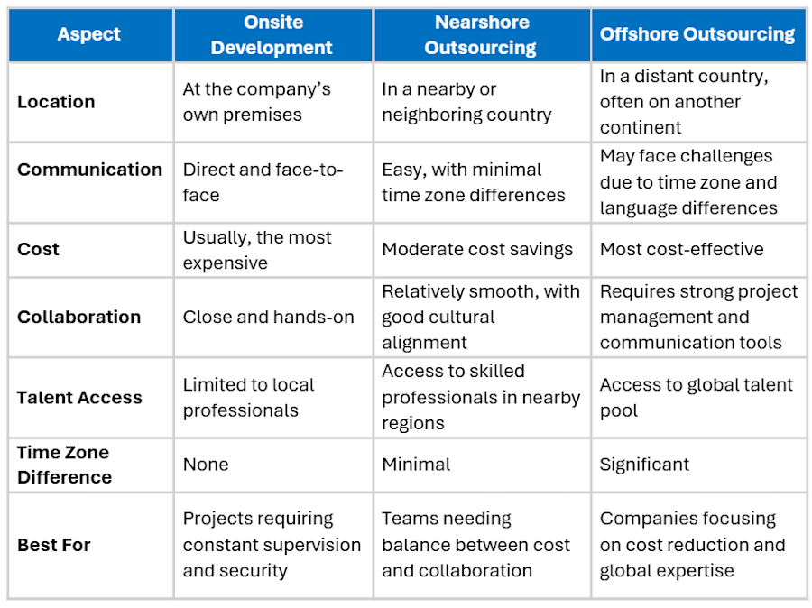

Companies usually have tight timelines and limited resources while the goals keep changing and evolving. Hiring and training the right talent can take weeks if not months. That’s where the [outsourcing](https://www.improving.com/services/outsourcing/) engagement model shines.

However, not all outsourcing and consulting models are the same. One of the major differences is the distance between the organization and consulting firms. This proximity brings shared values, culture, and ethics, which leads to better collaboration. However, local talent is limited, and sometimes out of budget. Nearshoring provides balance by combining the reliability and trust of onsite talent with the flexibility and affordability of outsourcing. That's why [87% of IT organizations](https://www.deloitte.com/us/en/services/consulting/articles/global-outsourcing-survey.html) have considered nearshore outsourcing to cut costs.

In this blog post, we’ll explore different consulting models and take a closer look at the benefits and advantages of nearshore software development outsourcing.

## What is the difference between Onshore vs Nearshore vs Offshore?

### What is Onshore Software Development?

Onshore/onsite software development is the process of developing software at the client’s location or within the company’s own premises. In this model, developers work directly with the in-house team, allowing for better communication, quick feedback, and closer collaboration.

### What is Nearshore Software Development?

Nearshore outsourcing is a popular trend that involves hiring a third-party service provider that is geographically close to the hiring company, usually in a neighboring country or region. It is a cost-effective way for businesses to access skilled professionals while minimizing the time zone differences and cultural barriers that can arise from offshore outsourcing.

### What is Offshore Software Development?

Offshore outsourcing involves hiring a service provider or team located in a different country, often on a different continent, and with significant differences in time zones, cultural norms, and language. The main goal of offshore outsourcing is typically to reduce costs by leveraging lower living costs in other countries.

### Onshore vs Nearshore vs Offshore

In summary, onsite, nearshore, and offshore outsourcing differ mainly in terms of location and proximity to the company.

## Benefits of Nearshore Outsourcing

### **1. Cost-Effectiveness **

One of the biggest advantages of nearshore outsourcing is cost savings. By working with a service provider in a nearby country, [businesses can reduce the costs by 40% to 70%](https://devsdata.com/latam-developers-rates-pros-cons-insights-latin-america/), according to DevsData. Nearshoring also cuts down on extra costs that come with hiring full-time employees, such as benefits, training, and office space. Companies can skip long recruitment processes by tapping into ready-made talent pools in nearshore locations

### **2. Closer to your Company**

Nearshore outsourcing enables businesses to have a closer proximity to their service provider, limiting the communication and cultural barriers that can arise from offshore outsourcing. With nearshore outsourcing, if needed, businesses can easily visit their service provider and communicate more efficiently.

### **3. Time Zone Advantage**

A one hour increase in time-zone distance reduces synchronous communication by an average of 11%, which eventually leads to poor productivity, [according to Organization Science research](https://pubsonline.informs.org/doi/10.1287/orsc.2023.17558). Nearshore outsourcing allows businesses to work with service providers who are in the same or similar time zones, which means there are no critical time differences and communication can be more effective. This leads to more efficient work processes, faster delivery times, and a shorter project turnaround time.

### **4. Wide Range of Professionals**

Each year, 437 universities in [Latin America produce over 220,000 STEM graduates](https://www.statista.com/outlook/tmo/software/south-america), contributing to a growing pool of more than 2 million skilled developers. By working with nearshore teams, American companies can find specialized skills that might be hard and expensive to get locally. Nearshoring also gives businesses flexibility; they can easily [scale their teams up or down](https://www.improving.com/thoughts/growing-software-teams-with-nearshoring/) based on project requirements without investing the time and capital of hiring full-time staff.

### **5. Similar Intellectual Property Laws**

Countries like Mexico, Chile, Guatemala, and Argentina have strong Intellectual Property (IP) laws similar to those in the U.S., making them even more reliable for nearshore software development collaboration. These nations take data protection seriously and offer clear legal frameworks that keep your software, code, and ideas secure.

### **6. Culture & Communication**

Effective communication goes beyond the same language. There are nuances to non-verbal and verbal communication that can be inferred better through proximity. In nearshoring, you are working with your nearby countries that share history and often culture. Team members, despite being across borders, often understand each other better and have fewer communication problems.

### **7. Track your Project**

The short distance and similar time zones make it easier to have face-to-face meetings and on-site visits. Being close also allows companies to monitor progress, hold regular check-ins, and give feedback right away. With better observability into the team, project, and development, businesses can respond faster to changes in the market or goals. Being adaptable is quite important and valuable in software development.

### **8. Free Up the Main Team**

Many organizations leverage nearshore teams as an extension of their crew. By delegating non-core tasks to a nearshore team, companies concentrate their internal resources on strategic initiatives that contribute to their competitive edge. Nearshore outsourcing frees up time for employees to engage in higher-level strategic thinking and problem-solving that drives the business forward.

### **9. Manage Disruption Efficiently**

When your nearshore team is close by, it is easier and faster to send help or resources when needed, minimizing project disruptions. Whether it’s a natural disaster, political unrest, lack of resources, or a security problem, you can act quickly. Acting fast helps prevent issues from disrupting your business.

## What are some of the best places to hire nearshore talent in LATAM?

### Mexico

Mexico is one of the most popular nearshore outsourcing destinations due to its proximity to the United States, cultural similarities, and large pool of skilled IT (Information Technology) professionals. Some of the leading nearshore destinations in Mexico include:

- [Aguascalientes](https://www.improving.com/locations/aguascalientes/): Aguascalientes is an emerging technology hub in Mexico known for its strong infrastructure, stable economy, and growing pool of skilled professionals. It offers a business-friendly environment and competitive operating costs, making it attractive for nearshore outsourcing.
- [Guadalajara](https://www.improving.com/locations/guadalajara/): Guadalajara is known as Mexico's "Silicon Valley" and is home to a growing number of technology startups and outsourcing providers. It is particularly strong in software development and IT services.

### Guatemala

[Guatemala City](https://www.improving.com/locations/guatemala/) in Guatemala is becoming a preferred nearshore location due to its ease of business policies. More than 200 U.S. and other foreign firms have active investments in Guatemala. For example, Guatemalan talent helped produce Duolingo and Hotels.com. The city has a growing IT sector with smart developers.

### Argentina

[Buenos Aires](https://www.improving.com/locations/buenos-aires/) in Argentina is a growing tech hub with advanced technology, research centers, and innovation parks. Government programs like software promotion and entrepreneurs’ laws have boosted its IT industry, expected to reach $2.7 billion by 2026. With a lower cost of living than the U.S. or Europe, Argentina is an attractive and affordable destination for nearshoring.

### Chile

[Santiago](https://www.improving.com/locations/santiago/) in Chile is one of the most stable and business-friendly countries in Latin America, making it a great nearshore option for U.S. companies. It has free trade deals with 65 countries, including the U.S., which helps make international business easier. Also, 50-55% of Chilean software developers speak good English, making communication with U.S. teams smooth and effective.

You can tap into LATAM’s best tech talent with [Improving’s strategic presence](https://www.improving.com/thoughts/south-america-your-next-strategic-move-for-it-consulting-success/) and proven nearshore delivery model.

## Final Words

To sum it up, nearshore outsourcing offers a powerful balance of cost efficiency, talent quality, and operational alignment. By partnering with teams in nearby regions, tech businesses can enhance collaboration, reduce turnaround times, and maintain better control over their projects.

If you’re ready to see what nearshore collaboration can do for your business, Improving is here to help. Learn how we connect companies with [nearshore consultants](https://www.improving.com/services/outsourcing/nearshore/) that deliver real results.

*Note: This article was originally written by *[*Preeti Gupta.*](https://www.improving.com/profile/preeti-gupta/)* On November 13, 2025, the article was updated by Faizan Fahim.*
