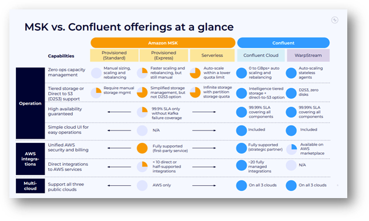

Enterprises are increasingly under pressure to modernize their event-driven architectures and real-time data streaming pipelines to remain competitive, acquire new customers, keep their customers satisfied, accelerate innovation and productivity, while reducing their operational burden. Apache Kafka is one of the pioneering event streaming technologies that has become the backbone for digital transformation initiatives aimed at helping organizations implement and leverage event-driven architectures and real-time data pipelines to meet these challenges head-on, but not all Kafka services are created equal.

While solutions such as AWS MSK (Managed Streaming for Apache Kafka) offer a familiar entry point for organizations already invested in cloud ecosystems such as AWS, its limitations are increasingly apparent as businesses scale, innovate, and demand more from their data infrastructure. Technology leaders are now turning to Confluent Cloud, a fully managed, cloud-native Kafka platform, driven by the need for advanced features, operational simplicity, and cost efficiency. This blog explores the challenges of AWS MSK, the compelling advantages of Confluent Cloud, and how Improving’s Code Explorer accelerates migration for enterprises looking to make the switch.

## **The Limitations and Challenges of AWS MSK for Enterprises**

As organizations grow, the limitations of AWS MSK’s offering become more pronounced. According to Gartner, over 70% of enterprises cite operational complexity and lagging feature releases as major barriers to scaling real-time data platforms on legacy managed services such as MSK. Though organizations in a hybrid or multi-cloud environment may recognize that there are indeed some short-term benefits of utilizing a managed Kafka service such as MSK when many of their enterprise applications, infrastructure, and data are already on AWS, there can be long-term limitations to MSK that may limit the full potential of their event-driven architectures.

**Key Limitations of AWS MSK:**

- **Lagging Feature Releases:** MSK often trails behind the latest Kafka updates, delaying access to critical features that drive innovation and security.
- **Limited Tooling:** Unlike Confluent Cloud, MSK lacks integrated tools such as data portals, stream governance, and cluster linking, forcing teams to cobble together third-party solutions at additional cost.
- **Complex Multi-Region Deployments:** MSK requires manual setup for multi-region clusters, whereas Confluent Cloud offers seamless, out-of-the-box multi-region support.
- **Operational Overhead:** MSK users must manage infrastructure and scaling, leading to increased DevOps burden and risk of downtime. Confluent Cloud abstracts these complexities with a streamlined, fully managed experience.
- **No SLA for Kafka-Related Failures:** AWS MSK’s SLA does not cover failures caused by the underlying Kafka or Zookeeper engine, exposing enterprises to significant risk and downtime.

## **The Cost and Complexity of MSK**

Beyond the strategic limitations of MSK, there are some financial and operational limitations when compared to Confluent, according to a [Gartner Peer Insights comparison.](https://www.gartner.com/reviews/market/event-stream-processing/compare/amazon-web-services-vs-confluent) From Confluent’s extensive product testing and real-world customer case studies, these limitations of MSK include:

- **Cost Savings:** Companies migrating from MSK to Confluent Cloud have reported savings of over $1 million annually, thanks to reduced infrastructure costs, DevOps overhead, and downtime risk.
- **Accelerated Time-to-Value:** Enterprises can deploy and scale Kafka within minutes on Confluent Cloud, enabling them to get to market six months faster than with MSK.
- **Reduced Downtime:** Confluent Cloud’s 99.99% SLA covers all components, including Kafka, while MSK’s 99.9% SLA excludes Kafka-related failures, resulting in up to 10x more downtime risk for MSK users.

## **Why Enterprises Are Considering Confluent Cloud for Managed Kafka**

The shift to Confluent Cloud is driven by the need for a complete, cloud-native data streaming platform that goes beyond basic Kafka provisioning. Yes, MSK does have features that offer organizations the ability to develop, deploy, and manage real-time data pipelines. However, in an increasingly data-rich landscape where organizations need additional benefits, such as a library of 200+ fully supported and ready-to-use connectors, Confluent Cloud offers the ability to implement real-time event streams that align with your very specific needs.

Having 200+ ready-to-use connectors in Confluent Cloud enables organizations to instantly integrate diverse systems—such as databases, analytics platforms, and SaaS apps—without custom development, accelerating real-time use cases like retail personalization and analytics, whereas AWS MSK lacks this connector ecosystem and requires manual integration efforts.

**Advantages of Confluent Cloud:**

- **Fully Managed, Cloud-Native Experience:** Automated provisioning, elastic scaling, and zero operational overhead.
- **Advanced Security and Governance:** Enterprise-grade features like RBAC, audit logs, field-level encryption, and stream governance are built in.
- **Rich Connector Ecosystem:** 120+ pre-built and 80+ fully managed connectors for seamless integration with AWS, Azure, Google Cloud, and popular enterprise systems.
- **Infinite Storage and High Availability:** Store data cost-effectively at any scale, with a 99.99% uptime SLA and multi-region availability.
- **Committer-Driven Expertise:** Confluent is responsible for over 60% of all Apache Kafka commits, with 1M+ hours of experience and 24/7 support from the world’s foremost Kafka experts.

## **Seamless Migration: Reducing Cost and Complexity with Code Explorer**

If you’ve read this far and are thinking of making the switch, migrating from AWS MSK to Confluent Cloud can be daunting, especially for organizations with large, undocumented, or legacy codebases. This is where Improving’s Code Explorer comes in, a purpose-built, AI-powered migration accelerator that can simplify and speed up your move from MSK to a more robust service, such as Confluent Cloud, seamlessly.

**How Code Explorer Simplifies Migration:**

- **Layered Analysis:** Code Explorer performs deep analysis of existing producers and consumers, mapping dependencies and generating actionable migration plans tailored to your tech stack.
- **Minimized Dual-Cost Windows:** By streamlining the conversion process, Code Explorer shortens the period where you’re paying for both MSK and Confluent Cloud.
- **Data Privacy:** All analysis is performed within your environment; no data is sent to third-party services.
- **Domain-Specific Insights:** Unlike generic LLMs, Code Explorer is tuned to your use case, providing relevant, context-aware recommendations for migrating streaming applications.
- **Scalability:** Whether migrating 20 or 600 streaming applications, Code Explorer builds a comprehensive knowledge base and migration roadmap, empowering your team to move faster, smarter, and with confidence.

## **The Advantages of Confluent Cloud Over AWS MSK**

From our extensive experience migrating data pipelines and workloads to managed Kafka services, Confluent Cloud has repeatedly proven that it is a complete data streaming platform designed for enterprise scale and innovation. Forrester reports that enterprises using Confluent Cloud achieve 60% faster deployment times and 35% lower total cost of ownership compared to AWS MSK.

**Key Differentiators:**

- **Elastic, Automated Scaling:** Scale from zero to GBps with automated capacity management and load balancing.
- **Unified Operations and Billing:** One bill for software, infrastructure, networking, and metrics—no hidden costs.
- **Global Availability:** Deploy on AWS, Azure, and Google Cloud, with seamless hybrid and multi-cloud support.
- **Enterprise Security and Compliance:** SOC 1/2/3, PCI DSS, ISO 27001, GDPR, and HIPAA readiness.
- **Effortless Stream Processing:** Fully managed Apache Flink for real-time analytics and transformation.
- **Customer Success Stories:** Enterprises like AO.com, RevLifter, and Bankers Healthcare Group have achieved significant cost savings, improved resilience, and accelerated innovation by migrating to Confluent Cloud.

With these advantages and with AI-Powered migration accelerators such as Code Explorer, leveling up your event streaming architecture and capabilities is simple, painless, and most importantly, cost-effective compared to more traditional migration methods.

## **Why SecurityScorecard Switched from AWS MSK to Confluent Cloud**

SecurityScorecard, a global cybersecurity ratings provider, migrated from AWS MSK to Confluent Cloud to overcome operational bottlenecks and accelerate innovation. Initially relying on MSK for Kafka infrastructure, the company faced challenges with manual cluster management, delayed upgrades, and limited scalability. In 2022, SecurityScorecard transitioned to Confluent Cloud to support the launch of its Automatic Vendor Detection (AVD) product. The migration enabled hourly data refreshes, seamless CDC integration with PostgreSQL, and future observability via ksqlDB—all powered by Confluent’s fully managed, cloud-native platform. The result: reduced infrastructure costs, improved developer productivity, and faster onboarding of new data sources, validating Confluent Cloud as the strategic choice for scalable, secure, and resilient data streaming infrastructure ([Confluent).](https://www.confluent.io/resources/demo/why-confluent-over-msk-for-streaming-data-pipelines-at-security-scorecard/)

## **Make The Leap To Confluent Cloud From MSK**

The limitations of AWS MSK are clear: operational complexity, lagging features, and hidden costs are holding enterprises back from realizing the full potential of event-driven architectures and real-time data streaming. As we’ve seen so far, Confluent Cloud offers a future-proof, cloud-native platform that delivers advanced capabilities, seamless integration, and significant cost savings. With Improving’s Code Explorer, migration is no longer a barrier that is compounded by layers of complexity. It simplifies, streamlines, and accelerates the migration from streaming services such as MSK to more future-proof, cost-effective, scalable, and feature-rich services such as Confluent Cloud.

**Ready to unlock the full power of Confluent Cloud?** Connect with our team today to learn more about our MSK to Confluent Cloud migration offering and discover how Code Explorer can streamline your journey to a modern, scalable architecture. [Get started now!](https://www.improving.com/contact/)
