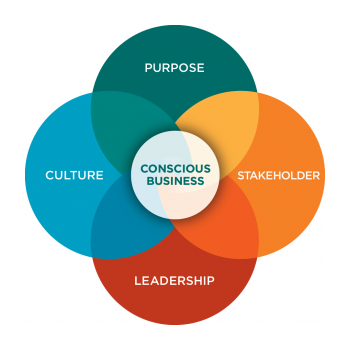

[*Conscious Capitalism*](https://www.consciouscapitalism.org/)* is a transformative set of ideas that guides companies to operate ethically while also pursuing profit. It is a philosophy that Improving is very dedicated to as we strive to elevate and broaden the way traditional businesses operate.*

*The four pillars of Conscious Capitalism are Higher Purpose, Stakeholder Orientation, Conscious Leadership, and Conscious Culture. In this new blog series, we unravel the wisdom within these pillars and Conscious Capitalism as a whole and flip it on its head by looking at how we can use these traits in our personal lives to become better, more mindful people.*

[*Read blog #1: *Unveiling the Power of Conscious Capitalism’s Higher Purpose in Your Own Life](https://www.improving.com/thoughts/unveiling-the-power-of-conscious-capitalisms-higher-purpose/)

## Conscious Capitalism Pillar #2: Stakeholder Orientation

In the world of conscious capitalism, the concept of stakeholder orientation plays a pivotal role in shaping the way businesses operate. It is driven primarily by businesses’ higher purpose (discussed in part one of this blog series). The stakeholders are the ecosystems that the businesses exist within. Examples of stakeholders include employees, vendors, customers, industry members, and local government. Stakeholder orientation serves as a decision-making and meaning-making mechanism, providing a lens through which people view and interact with the world around them.

When you make this personal, it becomes immensely powerful, orienting your higher purpose to the ecosystem in which you exist. Essentially, *it’s how you activate your higher purpose.*

#### There are four key attributes of a personal stakeholder model:

**Specificity in Groups:** Stakeholders must be identified in specific groups, such as friends, family, and community, allowing for a collective approach. For example, add “friends” as a collective, not just “my friend Bill”, or use “the non-profit community” and not “the community in my location”.

**Measurable Impact:** The impact on each stakeholder should be measurable, allowing you to gauge the effectiveness of your engagements. How do you measure friends or family? An easy way is targeted, intentional time spent with them.

**Impactfulness:** Stakeholders should have a direct impact on you. It should be a meaningful and reciprocal relationship.

**Actionability: **You should be able to both impact and be impacted by your stakeholders.

A significant thing to remember while creating your personal stakeholder orientation: make sure each stakeholder is beneficial to you as well. You have probably been in a relationship, whether friendly or romantic, that has not served you well in the past. Knowing when to let relationships go is a key aspect of this.

Surround yourself with people and stakeholders that will lift you up and make you better. Letting go of relationships does not make you selfish, and that is something to be aware of as you go through your stakeholder journey. If a stakeholder is negatively shaping you on a consistent basis, you're probably focused on the wrong stakeholder. That could be a sign that you should reevaluate your model. Remember, it should be feeding both you and them.

#### How to generate multiple wins with multiple sections of your stakeholder model:

An amazing way I have created multiple wins is through a charity tailgate for the Ohio State Buckeyes. I have been able to engage several nonprofits while bringing my friends and family into the fold. It’s a triple-win scenario and illustrates the power of the stakeholder model. If you are intentional and aware of inner connectivity, it creates scenarios that give win after win and shows why the stakeholder model is so incredibly powerful.

#### Stakeholder orientation models always evolve:

While a higher purpose should be more permanent, stakeholder models can be fluid in nature. As you go through different stages of your life, stakeholders will come and go. However, centering stakeholders around your purpose ensures a cohesive and purpose-driven life.

As you walk through the world, start looking at who and where you spend your time. It will be eye-opening to learn how your ecosystem is shaping you into who you will be in the future. Ready to learn more about conscious capitalism and how you can integrate it into your life or work? [Contact us here.](https://www.improving.com/contact/)
