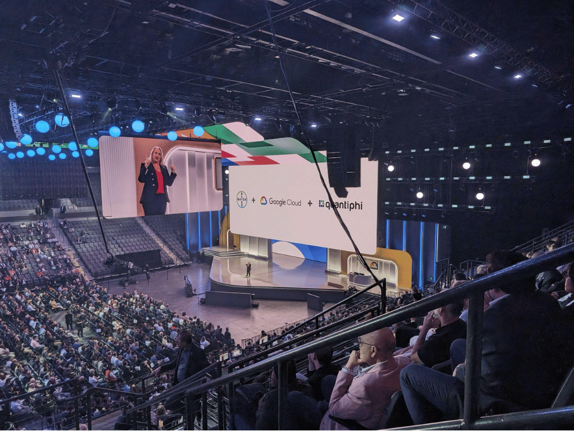
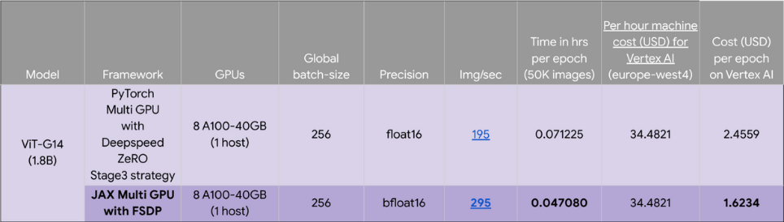
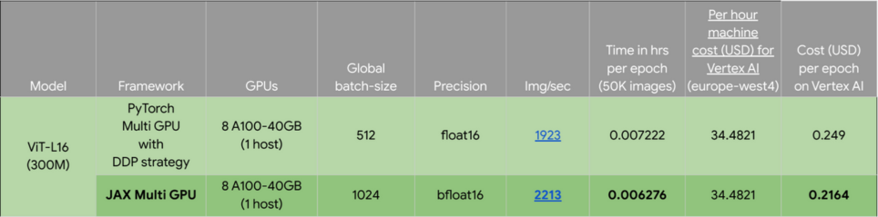
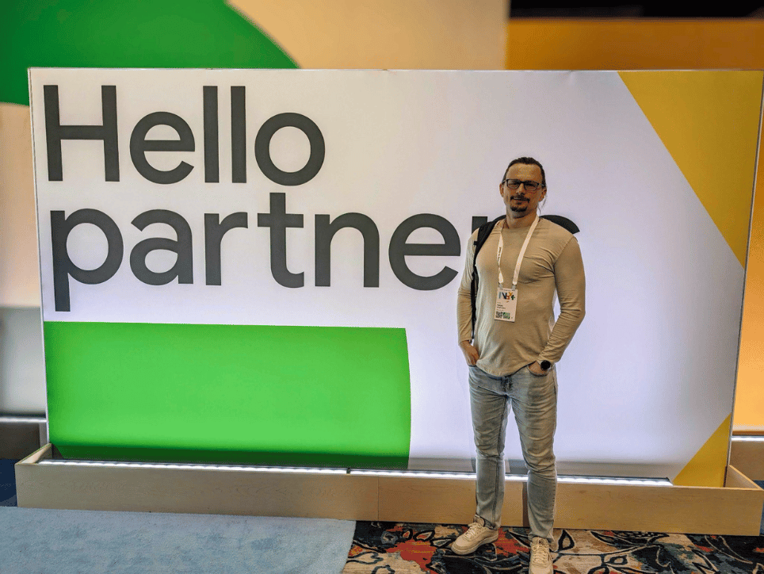

The recent Google Cloud Next '24 in Las Vegas, April 9-11, 2024, was a thrilling hub of activity, brimming with the latest cloud computing and artificial intelligence advancements. The conference announced many innovations in AI development, which will significantly impact and reshape the industry! I had the opportunity to attend on behalf of the Improving team and have prepared a list of exciting highlights and insights from the event.

### JAX Takes the Wheel for High-Performance AI

One of my favorite sessions at Google Cloud Next ‘24 was on the JAX framework. JAX is a Python framework for accelerator-oriented array computation and program transformation designed for high-performance numerical computing and large-scale machine learning. It is built on top of NumPy, which makes it quite easy for NumPy to adopt. The framework is specially designed to use the power of GPUs and TPUs to speed up a model’s' training processes- it outperforms Tensorflow and PyTorch in this particular area. With JAX, we can modernize ML code and leverage the GCP platform hardware to move model development to a new level!

*((Image source: https://github.com/GoogleCloudPlatform/vertex-ai-samples/blob/main/community-content/vertex_model_garden/benchmarking_reports/jax_vit_benchmarking_report.md#benchmarking-results))[[#969696]]*

### Embeddings Unleashed: Understanding the World, One Vector at a Time

Embeddings is a way to store data that captures relationships and the underlying meaning of text. It plays a crucial role in various AI applications, particularly in natural language processing, which helps computers understand the nuances of human language. Embeddings are now available across all databases, which is a significant step forward. Also, now you can unleash the power of search with multimodal embeddings. This move will make it easier for us to integrate embeddings into their workflows and unlock their full potential for various tasks like sentiment analysis and vector search or recommendation systems.

## Enrich Your Application With Multimodal Gemini AI

At Next ‘24, Google made an exciting announcement about their preview of Gemini AI 1.5. Gemini AI is a multimodal generative AI model that provides the reso processing images, audio, videos, text, PDFs, and it supports up to 1M input tokens! Even though it was groundbreaking before, these new abilities makes Gemini even more compelling when it comes to specifc use cases for applications such as summarization. For instance, Gemini can now provide insights and summarization of documents, images, video, and audio files. With these new updates, our teams are able to utilize Gemini AI to extract a wide range of inferences from various data sources! Gemini AI can describe an image or video with different levels of detail; for example, it can return chapters with timestamps from video and audio files. We are not only limited to the mentioned use cases; the uses cases for Gemini AI are seemingly infinite! Our team will be leveraging technologies such as Gemin AI to help develop leading-edge solutions for our clients.

### Operationalizing Generative AI

I also visited a great demonstration that provided insights into GCP workflows and Gen AI models. Workflows is a GCP orchestration tool that allows the development of ML pipelines, business processes, and microservices. Any of these workflows can be described easily with a YAML file. Workflows uses connectors to call on a multitude of GCP services - now, it also has connectors to call Generative AI APIs directly. This innovation will enable applications to effortlessly integrate with one of the most advanced LLMs—Gemini AI.

### A Transformed AI Landscape

The new Google Cloud announcements on AI development are simply put, incredible. JAX empowers developers, embeddings unlocks a deeper understanding and insight into your data, Gemini AI multimodality opens new horizons for working with a variety of data sources, and using Workflows with Gen AI unleashes a new wave of creative possibilities. By using these technologies, Improving can develop innovative, modern, AI-based applications on GCP that help our clients solve their operational and strategic challenges. The future of AI is bright, and Google Cloud is at the forefront of this exciting journey!

