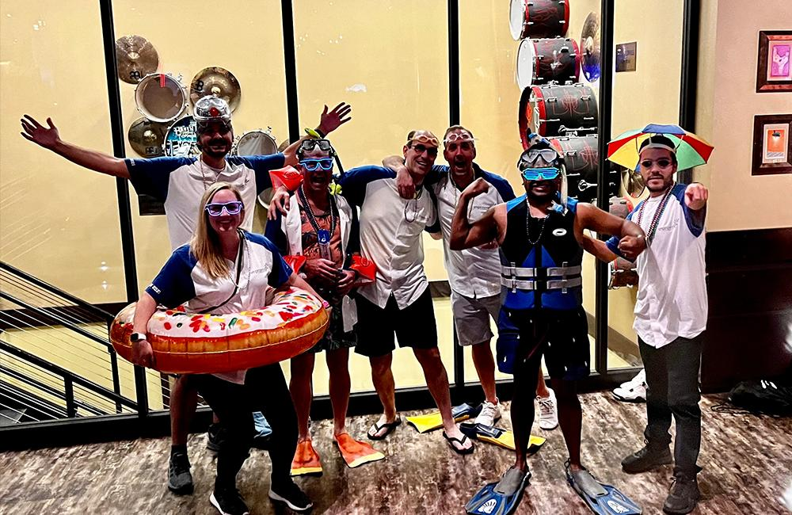
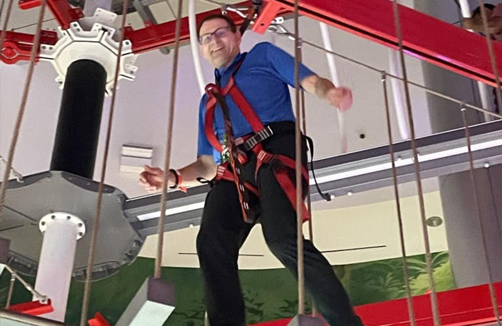
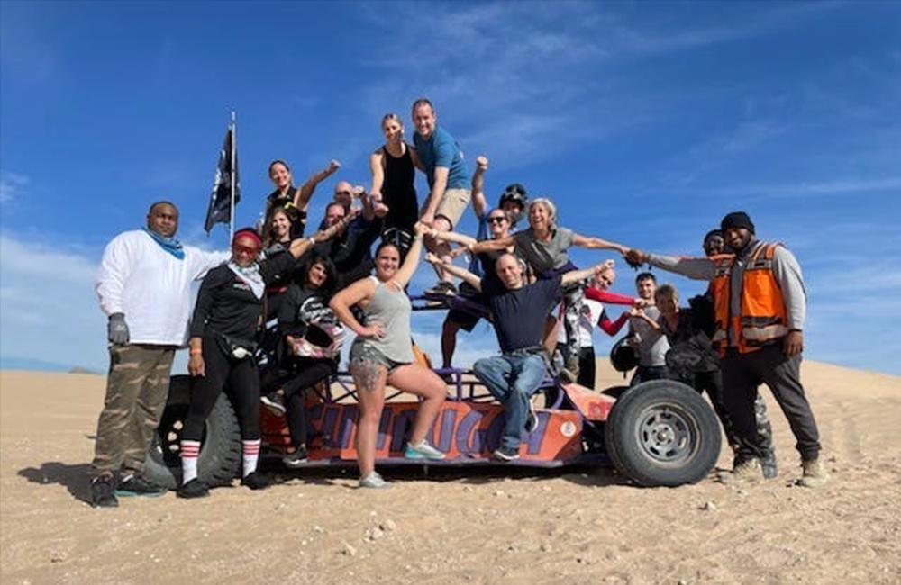
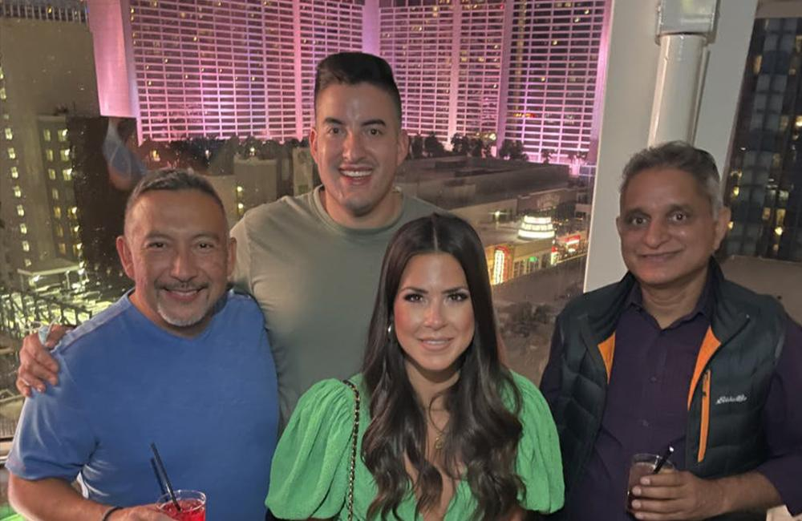

We had a blast at this year's Las Vegas Retreat in October! Improvers from every US, Mexico, and Canada office gathered in the entertainment capital of the world for an exciting few days of never-ending fun.

There were well over 100 new attendees this year. For our Nearshore family, it was the first time they could join us for the retreat since our iTexico merger in 2020. Financial Analyst and Senior Accountant Sara Jop heard so many great things about the retreat from other Improvers after the merger and was ready to experience it herself. A lot of her time with Improving has been through a computer screen, so she looked forward to getting to know people personally across all of our enterprises.

I think this retreat is really well planned for people to actually get out of their cocoons to naturally talk and truly get to know each other. It was super fun for me!

Sara Jop, Senior Accountant, Improving - Austin

Houston President Devlin Liles says the retreat is all about trying to make sure people have space to build long-term relationships that are authentic, and what that enables. It gives everyone a space where they can share memories that can be talked about for years on end. It turns coworkers into true friends and gives opportunities to blossom relationships once they are formed.

There were endless options for amusement during the retreat. People enjoyed the High Roller observation wheel, tons of amazing meals, pool time, and walking through the strip. One specific night, Improvers had the option to eat another amazing meal, walk a ropes course, see an exhibit called Area 15, and more. There were a lot of preplanned activities too. During the time spent together as a company, Improvers played highly competitive games like beer pong and experienced team-building activities.

Devlin says he loved watching all the new people participate for the first time at this retreat. One experience he will never forget was the last night during the prize announcement.

It was the impact of knowing they are loved, cared for, and we wanted them to have fun. That was an overwhelming moment and a pretty impressive thing to see.

Devlin Liles, President, Improving - Houston

During the retreat, people had a lot of freedom to plan their own events as well. Some people hiked, others shopped. The trust coordinators for the company even rode ATVs through the desert.

Sara's last day was filled with pool time in the morning, followed by the group photo and the legendary Amazing Race competition. Participants go all around the city competing to win it. This is an activity where you are put together with many people you do not know. Sara says it was an amazing way to meet people through adrenaline and fun.

...during the last few hours Saturday, I thought, 'I am exhausted, but I am leaving tomorrow and I still want to know who more people are!' It was great to be outgoing and put myself out there.

Sara Jop, Senior Accountant, Improving - Austin

The special and unique part of these retreats is the lasting friendships that come out of them. Photos of winning teams turn into emails years later. Adrenaline-high moments like the High Roller make for laughs in the breakroom. Pool conversations lead to happy hours after work.

In both Sara and Devlin's opinions, that is exactly what this retreat was all about.

If you would like to join our team of spectacular Improvers, [check out our open positions](https://improving.com/careers). You can also email *careers@improving.com* if you do not see a job that perfectly matches your background.
