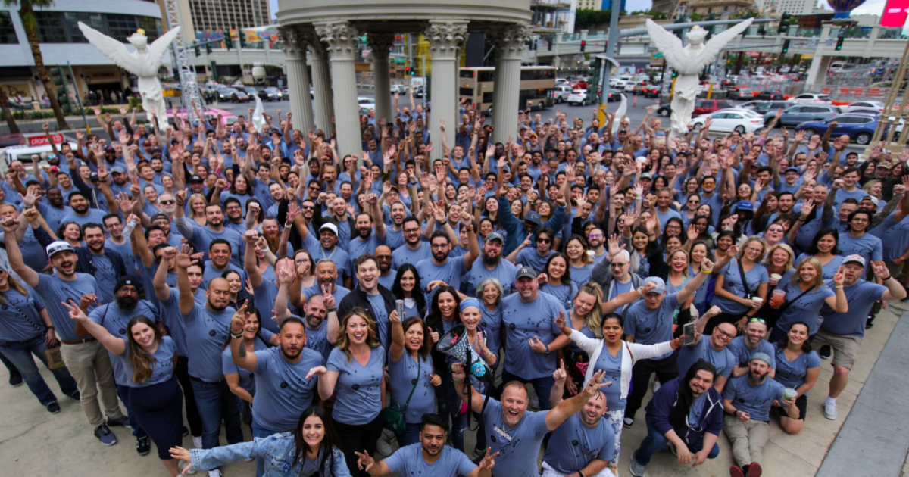
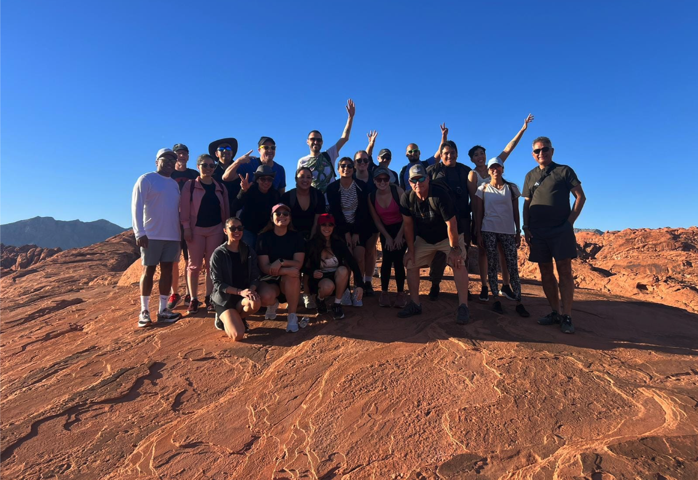
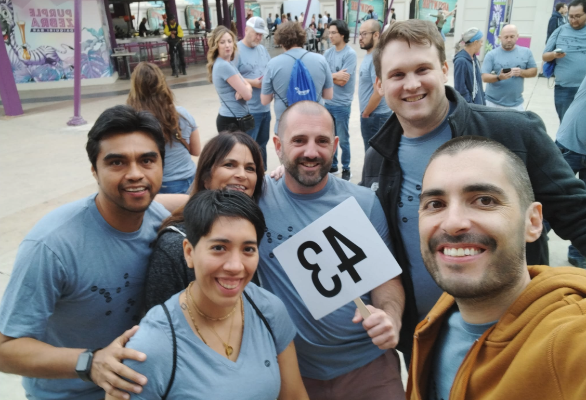

When I start thinking about the fact that the Mexican enterprises have only been a part of Improving since June 2020, it blows my mind. In a short time, we have come a long way. For starters, it was the middle of a global pandemic, so there was fear of the unknown, refusal to lose our “identity” and the list goes on. It was not a very pleasant time for Improving Mexico to be honest.

And now here we are, almost three and a half years later and we just came back from our third official corporate retreat! Can you believe how much things have changed during this time?

I still find it amazing that we have all become so attached to people from other enterprises (and countries) and it is in great measure because of these three-day trips! Talk about taking the most advantage of precious time.

I thought it was not possible, but this year surpassed even my wildest expectations! Based on experience, apparently, this will be my thinking every time I come back from the retreat with all these amazing feelings, and I love that!

From the get-go, everything went smoothly. There were no delays, no last-minute surprises (PTSD activated and CUT TO 2021’s required flashback, when a group of us had our flight delayed for hours, making it impossible to get to the Happy Hour and Thursday activities on time). It was a trouble-free, user-friendly flight to Las Vegas, which certainly set the tone for the rest of the trip.

Even while we were arriving at our destination, I think many of us had this very difficult past year in mind. Love for the people left behind, economic uncertainty, etc. We were all aware of what we had been going through in 2023, but this time we were going to be together and start the healing process as a family, and meeting and hanging out with all Improvers was just what the doctor prescribed.

As soon as I got to Planet Hollywood, where 400+ Improvers would be staying, I quickly went to the hospitality room. There, I got my new Improving swag, and I started befriending new people left and right!

These out-of-the-blue and random meetings are a common practice during these trips for me. I will be talking to someone from Canada one minute and meeting another person from the USA next. And then five minutes later, I’ll be hanging with Improvers from Mexico that I have just met for the first time face to face. It’s the Greetings Olympics, and I wouldn’t have it any other way!

Almost immediately after that, I got to experience one of my personal highlights of this trip! Shervin Joseph, a close friend from the Houston office, had invited a few people to his room just before the opening happy hour to, as he put it, “share a moment of gratitude” when he could gather all of us at the same time.

I have to be honest, I had no idea what this really meant, I was just excited to see him again, as well as the other people who he had invited. But what came next was very emotional and unexpected. He had very kind words for everyone while giving each of us a special personalized present. Everyone got emotional and I got teary-eyed, of course.

After sharing this special and unforgettable moment with the group, we went running to the hotel’s lobby for the Welcome Happy Hour. After that, it was time for our official Thursday activity.

This year I chose the High Roller Ferris Wheel, where participants could take a bird’s eye view of Vegas and ride it with a group of people in an open bar.

As luck would have it, that was also the weekend when The Sphere would have its official opening with Irish rock band U2 beginning a 36-show residency called “U2:UV Achtung Baby Live at Sphere”. That was the talk of the town during those days and as you can imagine, it is a sight to behold, and doing so from 366 feet high is just something I will never forget.

To close this amazing first day, Christopher Sauer and Chris Steele hosted their annual room party, where everyone was welcome to stop by after their evening events in a 1,200 sq ft suite this year; Secret Pizza and Drinks included! By the time I had to leave, the room was full of life and good energy.

When early Friday morning came, it was time for one of my favorite parts of the retreats: the Valley of Fire Hiking tour at sunrise. This hike is all about having fun and experiencing the great outdoors. Petroglyphs and dramatic rock formations await you as you hike through the wilderness and seriously, photo opportunities are everywhere!

This is the third year in a row that I’ve had the opportunity to enjoy this once-in-a-lifetime experience, which started thanks to Amber Leese in 2021 and we’ve kept the torch burning ever since. This time I was with a group of 25 Improvers, and I swear it keeps getting better and better.

Once we came back, tons of Improvers headed for the Pool Party extravaganza! And what a fun time we had! You could see friendly faces all over the pool, talking and laughing, enjoying the sun. Presidents, developers, and operative folks... all got together for this extremely enjoyable afternoon before heading out to the Hard Rock Café.

Friday night’s annual and friendly “tournament” among Enterprises is where Improvers get to cheer all night, represent your office during really cool contests and enjoy a delicious buffet dinner together. The beer pong tournament is always nerve-wracking, and this time the teams were in costume, which added a little something-something extra to the festivities!

But the night was not over! After leaving the Hard Rock Cafe, me and more than 60 Improvers were on our way to see Tiesto at the Zouk. Three big party buses were needed to transport the Improvers of various Enterprises to the club. Can you imagine what an incredible time we had?

Saturday morning brought our last official day of the retreat, and I still wanted to do so much stuff and hang out with a lot more people! My two breakfast meetings that day certainly helped with that, since I got to enjoy the company of all the Come Together champions with Curtis Hite and also gather with Devlin Liles and Emily Stickle in a thank you breakfast for people who had worked on some of the COO office’s projects during the year.

Another one of my highlights came later that day when Shervin Joseph, Nicole Hilland and I decided to lunch together for some quality time of “The Three Amigos”. Hours felt like minutes with these two, and suddenly it was almost time for the official photograph at the Caesar’s Palace esplanade.

There was a sense of pride and love in the air while everyone was getting together before the Amazing Race started. As we were waiting for instructions, I thought to myself that all of us were exactly where we belonged, amongst our tribe!

And then, it was time to start the race and off we went! A very important part of this activity is the team you are on, and I was really lucky! We all clicked right away and had the best time together! Mind you, we didn’t win anything, but we certainly were a loud, fun team!

A couple of hours later, we were arriving at our final reunion spot: Margaritaville! And while everyone was anxiously waiting for the results, people started sitting at the tables to share dinner with old and new friends alike!

And just when I thought the night was winding down… an international dance popped off surprisingly! Being in the middle of so many people dancing, singing, and laughing was the BEST possible way for the retreat to end. If I could describe the atmosphere at this precise moment, it would be pure happiness. Anyone who witnessed this incredible moment can attest to that.

Like last year, I was beginning to feel sad while starting to say my goodbyes. So many dear friends, so little time! Mariachi music was waiting for us outside the bar while we left, and it really felt like serendipity. Mexicans started singing while joined by Improvers from other Enterprises. What a magical moment we shared to close up the night!

I’ve never worked at a company that invests so much time and resources in their people and their well-being. Above all else, Improving knows an important part of its success lays within the meaningful relationships that Improvers create. When a company fosters a sense of a second home, retreats like these feel that much more important and beloved.

And the countdown begins until our Improving family reunites again. T MINUS 365 days!
