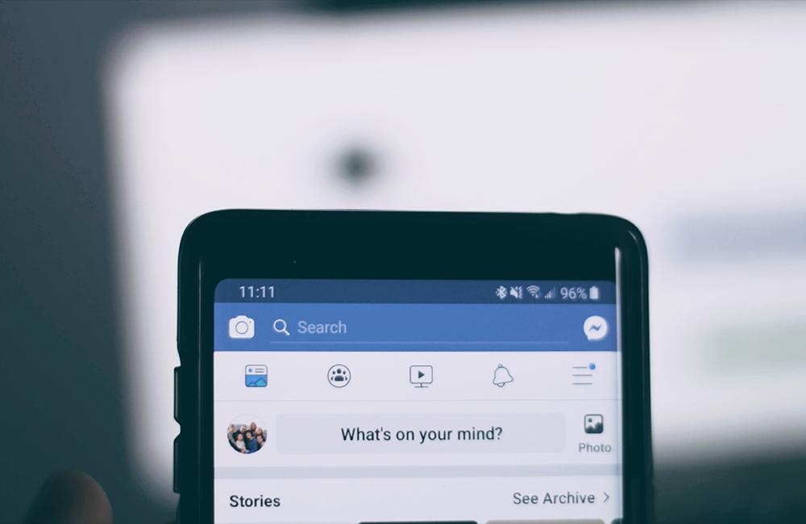

The world wide web, or "Web" for short, continues to evolve into our daily lives. The transition between Web 1.0 and 2.0 may best be defined as a shift from asynchronous (one-way) communication to synchronous (two-way) communication.

Web 2.0 is more interactive and engaged than its prior version. Coding language has evolved to allow for dynamic interaction between people and the Web. Being in 1999, this latest web iteration brought systems into play that allow content creation and rapid feedback between people using the internet to engage each other with minimal boundaries.

One of these systems is the concept of social media. The rise of Facebook (Now Meta), LinkedIn, and the like heralded an era of interactions between people around the world in real-time. It ignited a revolution of connected devices known as the Internet of Things (IoT).

From smartphones to connected televisions, internet-connected devices have allowed people to experience life from anywhere in the world with new friends in distant places. Science fiction is now an engineering fact with the rise of Web 2.0.

One of the more profound business impacts Web 2.0 has ushered in is the use of collaborative platforms. Specifically, Microsoft Teams, Slack, Zoom, and more have allowed businesses to work from anywhere. This has been accelerated over recent years due to the impact of the global pandemic.

## What Does Web 2.0 Mean for Business?

For technologists, Web 2.0 creates opportunities for entirely new businesses to be created that operate primarily on the internet. Many, like Amazon, have evolved from their internet-based roots to brick-and-mortar. Others, like Netflix, moved from brick-and-mortar constructs to entirely online serve the customers via the internet.

As business continues to evolve in the real world, so will it evolve on the internet. Hybrid business operations have been refined by many companies to accommodate the changing preferences of clients and customers.

[Telemedicine](https://www.goodrx.com/healthcare-access/telehealth/what-is-telemedicine) is an example of this change. Now in use by many doctors and hospital systems, practitioners and patients can connect via video conference to triage health concerns. This time-saving innovation allows healthcare professionals the ability to assess the need for an in-person visit and follow-up evaluations.

Financial institutions are following suit with hybrid offerings. To complement physical branches, banks, credit unions, and other financial institutions now offer smartphone-based applications and interactive websites. No longer do customers need to drive to a branch building to deposit a check, it can be done with a few clicks and photos directly from a mobile device.

## Is There a Downside to Web 2.0?

There are risks associated with Web 2.0 as well. Businesses, clients, customers, and partners need to understand the risk of doing business online and participating in the content-centric nature of the web. Security concerns are more relevant today than ever before as well as the potential for reputation damage that comes from having a web presence.

Both companies and individuals alike need to understand the risk and reward balance of life on Web 2.0. A good way to look at Web 2.0 is the quote from Spiderman's (or Peter Parker's) uncle, “With great power comes great responsibility.”

Enjoy Web 2.0 and do it responsibly!

To learn more about Web 2.0 [reach out](https://improving.com/contact) to us!
