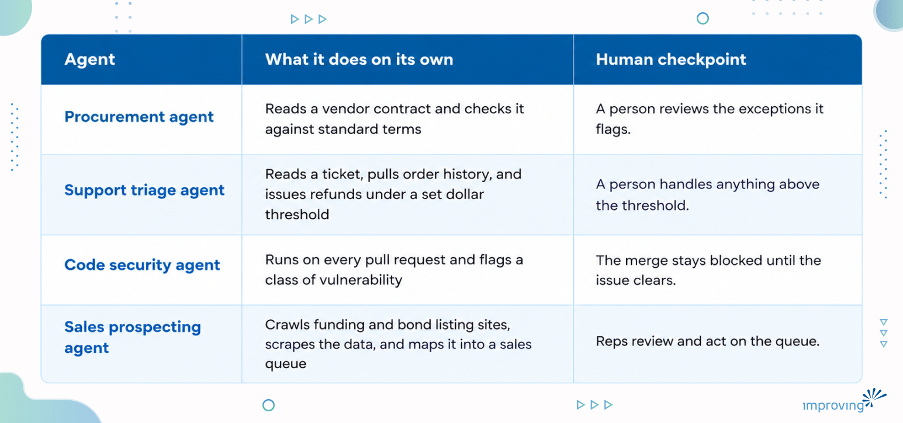

Ask ten executives what an AI agent is and you'll get ten answers, and most of them describe a glamorized chatbot.

That confusion costs money, because the gap between a tool that answers a question and an agent that takes a sequence of actions on its own is the gap between a demo and a production system. Most of the deployment failures we see trace back to a company not knowing which side of that line it's standing on.

In this blog post, we'll understand what an AI agent is, shows where the line between a tool and an agent sits, and covers what AI agent deployment takes in production.

## What Is an AI Agent?

An AI agent is software that pursues a goal by taking a sequence of actions without a human approving each individual step along the way.

Search for AI agent examples and you'll get a list that mixes chatbots, copilots, and scripted automations in with systems that genuinely operate on their own, because most of the market hasn't bothered to tell them apart. The distinction determines what you can safely hand to the system and what happens when it gets something wrong.

Here are four AI agent examples and the human checkpoint in each:

## Why the Tool-Versus-Agent Line Matters

Start with the tool stage, because almost every company reading this is already there. You type a request into ChatGPT, Copilot, or [Claude](https://www.improving.com/services/training/ai/claude-cowork-for-professionals/). You get something back. You read it, you accept or reject it, you decide what happens next. Every output passes through a human before it becomes an action in the world. This stage is where people build the judgment that makes the next stage safe: what the tool is good at, where it quietly gets things wrong, what a "close enough" answer looks like versus a wrong one.

An agent is a different relationship entirely. You define a task, hand it explicit rules for how to approach it, and let it execute without a step-by-step sign-off. You review the result after the fact.

A procurement agent that reads a vendor contract, checks it against a standard set of terms, and flags exceptions is doing something categorically different from a chatbot that summarizes the same contract when asked. The agent acted. The chatbot answered. Mapping that boundary, workflow by workflow, is the first real work in any [AI and automation engagement](https://www.improving.com/expertise/ai/), long before anyone talks about which model to use.

An enterprise team that hands an AI agent broad autonomy without first knowing where the tool gets things wrong ends up debugging failures it never learned to recognize.

## **What This Looks Like Across a Business**

### AI Agents in Customer Service

[Customer service](https://www.improving.com/thoughts/why-customer-onboarding-is-the-most-important-project-msps-run/) is the clearest example because most companies already run a version of it. A support bot that only answers FAQs is a tool. Once it checks order history, issues refunds under a dollar threshold, and escalates anything above that threshold to a person, it is an agent. The threshold tells the system what it may decide alone and what still needs a human.

### AI Agents in Code Review

[Code review](https://www.improving.com/thoughts/ai-code-review/) works the same way. A coding assistant that writes a feature is a tool as long as a developer reviews every line before it merges. A security pass that runs on every pull request, flags a class of vulnerability, and blocks the merge until it clears has become an agent, because nobody has to remember to ask for it.

### AI Agents in Sales and Business Development

Sales and business development show a similar shift, and this is where we watched the line move in a real engagement.

Lakeshore Learning, a manufacturer of educational materials and classroom furniture, had sales reps manually scouring funding websites and bond listings, then hand-entering results into spreadsheets to catch bond and funding opportunities before they closed. That was manual work a machine could do.

Improving built an [agent pipeline](https://www.improving.com/case-studies/lakeshore-learning/) instead:

- AI agents crawl the relevant sites
- Scrape the data
- Map it directly into the sales team's queue

The reps went from hunting for opportunities to reviewing and acting on them. Within about 90 days of delivery, the team was working three times as many qualified leads with the process itself running 42% faster. The gain came from taking the manual searching off the reps' plate, not from the software getting any smarter.

### AI Agents in Finance Operation

Finance operations show the same line even more sharply, because the cost of getting it wrong is denominated in dollars rather than developer time.

Improving ran into this internally before we ever pitched it to a client. Our own monthly financial variance review, forecast against actuals, broken out by region, used to take our finance team three to five days to fully investigate.

We built an internal agent, we call it Penny, with the role-based access and governance to pull the financials, flag the variances, and trace each one back to a root cause. The same investigation that took three to five days now takes about fifteen minutes. Penny surfaces what changed and why, and a person still decides what to do about it, since Penny never posts anything on its own. That's the agent boundary working the way it should: the system does the finding, a human still owns the deciding.

## **Why AI Agents Matter for Competitive Operations**

The businesses getting real value from agents right now are the ones that drew the boundary between "the system finds it" and "a person decides it" before they turn the system loose.

Skipping that step means getting an agent doing work nobody signed off on, discovering the day something goes wrong instead of during design. The [Lakeshore Learning](https://www.improving.com/case-studies/lakeshore-learning/) and Penny examples above both worked because the boundary was explicit from day one, not retrofitted after a failure.

## **Where the Hype Gets Ahead of the Reality**

The current pitch for AI agents is that one sufficiently capable model will eventually hold an entire process end to end: read the request, do the work, ship the result. In practice, a single agent hits a ceiling.

A single agent asked to write code, for instance, optimizes for whether the code compiles and satisfies the prompt. It doesn't simultaneously hold security, performance, architectural consistency, and readability the way a properly staffed team does, because those concerns compete with each other and a single objective function collapses them into whichever one the prompt happened to emphasize. The result is a burst of productivity in the first few weeks, followed by a flattening curve as the unreviewed concerns show up as rework. Teams report gains in the range of fifteen to fifty percent from a single generalist agent, then plateau there. A bigger model doesn't move that ceiling, because the ceiling was never about model size. It's about one perspective doing a job that needs several.

What actually works is distribution among several agents, each with a narrow job and its own quality bar.

- **One validates the plan: **It checks the approach against architectural standards before any code exists, so a bad design gets caught before anyone writes a line.
- **One drafts the implementation:** It writes the feature against the requirement and nothing else.
- **One writes tests from the requirement: **This keeps the whole chain honest. A test written against the code will always pass, because it only describes what the code already does.
- **One reviews for security:** It runs on every pull request, whether or not anyone remembers to ask.

This is AI agent orchestration: put the agents in the right order and each one catches what the previous one missed. It is the surgical team Fred Brooks described in The Mythical Man-Month in 1975, staffed with software instead of people. Good teams don't ask one engineer to be the developer, the security reviewer, and the architect at once, and there is no good reason to ask one model to.

## **Math That Explains Why This is Harder Than it Looks**

If you chain enough steps together, even reliable ones, and the reliability of the whole chain drops faster than intuition expects.

Most people assume a chain of ninety-five-percent-accurate steps stays close to ninety-five percent overall, since each step is individually reliable. That's wrong, because the steps don't average, they multiply. Run the math on a ten-step process where each step is independently correct 95% of the time: 0.95 raised to the tenth power is about 0.60. Six in ten full runs complete correctly, and four in ten don't, even though every individual step looked solid. Stretch the same chain to twenty steps: 0.95²⁰ works out to roughly 0.36, so the completed-correctly rate falls to about one in three. Nobody built anything wrong at the step level. This is what happens mathematically when probabilities multiply across a sequence, a fact reliability engineers have understood since Robert Lusser worked it out on rocket components in the 1940s.

**Common mistake:** Teams read "ninety-five percent accurate" and assume that's the number that matters. It isn't. The number that matters is how many of those ninety-five-percent steps are chained together before anything checks the output, because that's what turns a good step-level number into a bad end-to-end one.

This is the number that should reframe how a business leader hears "we're deploying an AI agent for X." The question is never simply whether the agent is capable. It's how many steps are chained together before a human or a check ever looks at the output, because that chain length is what determines whether the eventual failure rate is something the business can live with. A five-step process with a check after each step and a twenty-step process with no checks can do the same amount of work, and only one of them is trustworthy at scale.

## What AI Agent Deployment Requires

Three governance practices separate companies that get value from agents from companies that pay for an expensive lesson.

- **Draw boundaries:** Define what data the agent can see, what systems it can change, and which decisions still require a person. Write it down.
- **Add a checkpoint: **Validate the output against a stated standard before it moves to the next step. The check can be a rule, a second model, or a person.
- **Keep an audit trail: **Log what the agent did, on what input, with what result. Teams skip this first and regret it most: the day the agent goes off script, an unlogged decision is a decision you can't debug.

It's the same discipline a factory applies that a workshop never needed, because a craftsman working alone is the quality check, present at every cut, while a factory runs machinery that operates whether anyone is watching or not. A business moving from "[we tried the chatbot](https://www.improving.com/thoughts/agentic-ai-gemini-enterprise-agent-platform-retail-ecommerce/)" to "we deployed an agent" is making that exact move, whether anyone frames it that way or not. Skipping the boundaries, the checkpoints, and the record doesn't make the agent simpler to run. It just moves the discovery of what was missing from the design phase to the incident it eventually causes.

**Counterintuitively:** Writing down these boundaries feels like it slows the rollout. In practice, it is a short conversation that replaces a multi-day incident review after an agent does something nobody authorized

Boundaries, checkpoints, and an audit trail cover an agent that oversteps. An agent that forgets context between sessions is a related but separate problem, covered in [our guide to agent memory systems](https://www.improving.com/thoughts/building-agent-memory-systems/).

## The Question to Ask Before You Deploy an AI Agent

Narrow, well-bounded agents with a clear checkpoint already do dependable work in customer service, code review, procurement, and operations. The companies getting that result built the [prerequisites to AI deployment](https://www.improving.com/thoughts/navigating-the-ai-minefield-the-prerequisites-to-ai-deployment/) before they turned the autonomy on. For any specific task, the question that predicts success is this: how much of the decision are we willing to hand over, and what have we built to catch it when that decision goes wrong?

Before you greenlight the next AI initiative, pull up the workflow you plan to automate and trace it step by step. Mark every point where a person reviews the output, and ask whether each review still earns its place. Then find the step where the agent would act instead of suggest, and check whether anyone has written down what it may decide on its own. That written boundary is usually the missing piece.

Improving's [AI readiness assessment](https://www.improving.com/PLACEHOLDER) runs that same trace across your workflows, so the boundaries, checkpoints, and audit trail are in place before an agent goes live.

## **Frequently Asked Questions**

**How do we know if a workflow is ready to become an agent instead of staying a tool?**

If people using it as a tool already know what "close enough" looks like and can spot a wrong answer quickly, the judgment exists to write the rules an agent needs. If nobody's sure yet, stay in the tool stage longer.

**What if we don't have the resources to build checkpoints and logging before deploying?**

Then scope the agent down until you do. A narrower agent with a real checkpoint beats a broad one without one, and the checkpoint doesn't have to be expensive to build, a rule or a second model both count.

**Does adding more checks slow the agent down too much to be worth it?**

Usually not. Penny's finance review dropped from three to five days to about fifteen minutes with the checks in place, because the check replaces the manual investigation instead of adding to it.

**Is a multi-agent setup always better than a single agent?**

No. A single agent is fine for a narrow, low-stakes task. The surgical-team approach earns its complexity only when the task has multiple competing concerns, like security, performance, and correctness, that one objective function can't hold at once.

Where in your own workflow is that boundary currently unwritten? If you want a second set of eyes on it, I'm happy to look at the workflow with you. [Reach out](https://www.improving.com/expertise/ai/) and let's trace it together.
