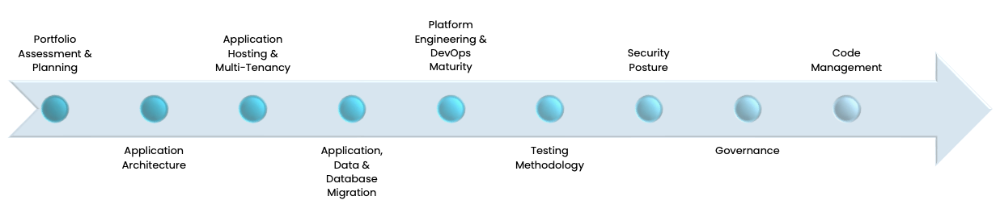

Applications don't become outdated overnight; it's a gradual process. However, applications that fail to update or upgrade themselves face a greater risk of becoming obsolete sooner.

"Modern" applications become legacy systems when they face some common challenges. You might have a legacy application if you encounter the following:

- Difficulties in developing, maintaining, or updating your application
- Failures in having the application interact with newer systems
- A lack of flexibility to satisfy emerging customer needs
- Application elements that are no longer supported
- Limited or bottlenecked performance
- Responsiveness and availability issues
- Potential security or compliance risks
- Scalability and resiliency issues
- High maintenance costs
- An absence of automation

So, what exactly are legacy systems? Legacy systems or applications are outdated software, technology, or methods/languages that are still in use by organizations despite the availability of newer and improved technologies. These systems are challenging and expensive to maintain or upgrade, they are incompatible with newer hardware or software components, making it challenging to integrate them with other systems. Also, legacy systems may have vulnerabilities and lack the necessary security measures to protect against modern threats. What Makes an Application Modern? A modern application is one that embraces contemporary principles and technologies to meet the evolving needs of users and businesses. **Let’s explore what makes an application “modern”:**

- Using modern programming languages such as Scala, Haskell, F#, Clojure
- An architecture that ensures responsiveness, scalability, and resilience
- Uses an autonomous and isolated modular design
- Streams data for consumption by modules or systems
- Uses modern distributed NoSQL databases such as Cassandra, Scylla, and Dynamo
- Leverages Distributed Data & Storage Isolation
- Uses containerization and microservices through technologies such as k8s, EKS, AKS, or GKE
- Utilizes cloud infrastructure on hyperscalers such as AWS, Azure or GCP Services
- Uses CI/CD and DevOps techniques

Simply put, modern applications are built using advanced technologies, architectures, and methodologies. Modern applications are known for their flexibility, scalability, resiliency, and ability to adapt to changing business needs and technological advances. Should You Invest in Application Modernization? Businesses must embrace change and modernize their legacy applications to save money, improve operational efficiency, ensure and reinforce their IT security, prepare for new business opportunities, remain competitive, and, most importantly, survive. Application Modernization provides the following benefits for organizations:

- **Cost Reduction:** Modernizing applications can lead to significant cost savings in the long term.
- **Improved Efficiency:** Modernized applications are designed to be more efficient, responsive, and scalable. They can handle larger workloads, process data more quickly, and provide users with a smoother experience, leading to improved productivity and operational efficiency.
- **Enhanced Customer Experience:** Modernized applications can offer customers a more seamless and intuitive user experience. By incorporating modern design principles, improving performance, and adding new features, businesses can greatly enhance customer satisfaction and loyalty.
- **Faster Time-to-Market:** Modernizing applications can accelerate the development and deployment of new features and functionalities, allowing businesses to respond more quickly to changing market demands and gain a competitive edge.
- **Increased Security:** Legacy applications are often more vulnerable to security breaches and cyberattacks due to outdated technology. Modernized applications incorporate the latest security protocols and features, helping businesses mitigate security risks and protect sensitive data.
- **Greater Scalability and Flexibility:** Modernized applications are designed to be more scalable and flexible, allowing businesses to adapt to changing requirements and scale their operations more effectively.
- **Improved Compliance Requirements:** By implementing modern security and privacy measures, businesses can ensure compliance with industry regulations and avoid costly penalties.

In essence, application modernization is not just about keeping up with the latest trends—it's about futureproofing your business, staying agile, and seizing new opportunities in an ever-changing technology landscape.

Your business relies heavily on software and applications, making the prospect of migrating to the cloud or adopting new solutions daunting and potentially disruptive. Faced with this dilemma, you may wonder whether to endure the risks and challenges of transitioning to new software, investing in extensive employee training, or risk the obsolescence of your current applications. Fortunately, there is an alternative approach: application modernization. This process involves enhancing existing systems to align with evolving business needs, rather than discarding familiar systems. By leveraging the foundation of your current systems and optimizing them to suit modern business requirements, you can retain the core functionalities essential to your operations while addressing any limitations that may be holding you back. Challenges and Best Practices Stakeholders should be well-versed in an organization's strategic objectives, including areas such as revenue growth, cost reduction, market expansion, customer satisfaction, and competitive positioning. This understanding ensures that application modernization efforts are aligned with their overarching business goals. Before you plan your Application Modernization journey, it is important to have answers to these questions:

- Which aspects of the legacy application are currently effective?
- What are your specific objectives for a modernized application?
- What modernization strategy aligns with your needs an objectives?
- How will application modernization accomplish these objectives?
- What are the various stages involved in modernizing your legacy systems?
- What resources do you need to accomplish successful modernization?

By addressing these questions head-on, you will steer clear of legacy application modernization hazards. Modernizing legacy applications comes with challenges such as dealing with outdated codebases, data migration, cultural resistance, and integration complexity. To overcome these challenges, organizations can adopt best practices like taking an incremental approach, fostering collaboration, leveraging automation, and embracing continuous improvement. This process begins with **portfolio assessment and planning,** which entails evaluating existing applications for modernization. This evaluation includes the adoption of modern technologies such as microservices, containers, serverless computing, and cloud platforms, and embracing agile development practices to accelerate software delivery cycles. It involves enhancing collaboration between development and operations teams and implementing robust security measures to protect against cyber threats and ensure compliance with regulatory standards.

Application modernization is essential for businesses looking to future-proof their operations, stay agile, and seize new opportunities in an ever-changing landscape. By embracing modernization strategies and best practices, we can unlock the full potential of our software landscape and drive long-term success.

Stay tuned for the next installment in our series, where we'll delve deeper into the key steps and considerations for successful application modernization.

If you’re unsure where the opportunities to enhance your systems exist, Improving can help you find path forward that aligns with your organization's needs and goals. [Reach out to us today](https://www.improving.com/contact/) to kickstart our application modernization journey!
