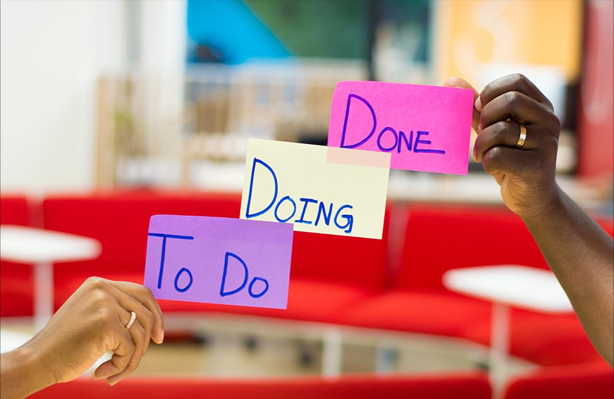
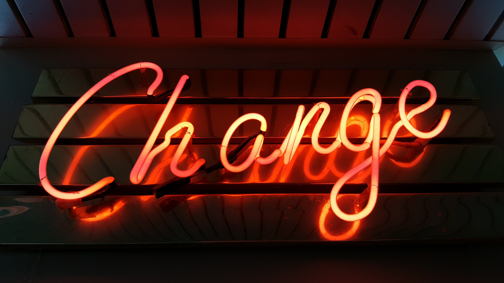

Even the question above can be a bit tricky. Agile coaches will often argue about the true nature of their work, especially since Agile is already hard to define. Is it a practice? A mindset? A toolbox? Maybe it’s the governing body of other practices like Scrum and Kanban? The answer really boils down to yes, no, and maybe. And, that’s the point of Agile.

To understand where Agile comes from you can start with traditional Project Management. Traditional Project Management, often referred to as Waterfall, is the rigid set of standards and practices used to manage projects from start to finish. Its governed by the Project Management Book of Knowledge (the PMBOK) that governs every document and process.

But, until the most recent version, there was little to no discussion on value. It uses all 370 pages to help guide you through the process of delivery. And you either finish your project or you abandon it.

That is terrifying. Most of us are not building bridges, instead, we are trying to provide value in our work while responding to change. Leadership isn’t clear-cut, and most people are able to fill all the roles required. *Enter Agile*.

Agile developed as a direct criticism of all things tradition project management. Even the values, upon which the Agile Manifesto was built on, confront what the PMBOK has said for years. Guess what, it worked. By confronting values that don’t fit the needs of a project with an alternative approach, people were able to succeed. This is now the standard thought process in most software development projects.

Not only that, but all areas of business are seeing benefits to using Agile in their practices. Again, Agile isn’t one thing, but it can be best summed up as the other thing. It's the practice to use when traditional work cannot apply to your current situation. The Agile manifesto opens with four values, that regardless of practice, provide guidance on how to govern Agile projects. What are the Agile values?

To me, they read as a plea to people in leadership that took their time empowering the people who own the work. Each one is confrontational, demanding, and provides a clear path for what developers want out of leadership. Their work can pave the way for each area of business to challenge the status quo, and take a new approach.

### Differences Between Agile and Waterfall

Here we discuss the fundamental differences between agile and traditional waterfall project management.

### 1. Individuals and Interaction Over Processes and Tools

On its surface, it’s simple. If you value and trust your people to work, they can do so regardless of the tools. But this reads as a direct affront to the ideas of traditional Project Management.

Agile is telling leaders, that when they want something completed, they cannot dictate themselves to a goal. Instead, it must be collaborative. Trust the work you do and produce something meaningful.

### 2. Working Software Over Comprehensive Documentation

In project management, results come from completed work and finished products. This is difficult when you work in the setting of being dynamic. Things change, and requirements change with that.

Software is where iteration originated from, but it is present in every department out there. The team cannot and should not be responsible for proving worth. That is a collaborative process between leadership, the team, and the world it will exist.

### 3. Customer Collaboration Over Contract Negotiation

Speaking of collaboration, this one should hit home. Most people who do the delivery work do not understand the process of contract negotiation. Collaboration is key when changes are frequent, and changes are necessary. Many people do not have a clear picture of what they want, instead of building on ideas. Allow the system of producing deliverable increments to help your stakeholders see what is possible. This can help collaboration.

## 4. Responding to Change Over Following a Plan

This is the biggest reason Agile is now a recognized and celebrated practice. This is the singular reason why software developers wanted to change the system, but all departments take note. The world we live in needs to respond to change. Customers change, stakeholders change and that's OK. Let that occur and lean in. Then, find a way to have a process in place to grow from those changes.

Not every Agile practice will work for every department. Instead, let it be the framework that provides an alternative to a proven approach to making the work you want to occur happen. Find what you need to change, and allow a people-driven process to propel you forward.

If you would like to learn more about Agile, check out our [upcoming classes](https://improving.com/services/training/full-schedule/) or [reach out](https://improving.com/contact)!
