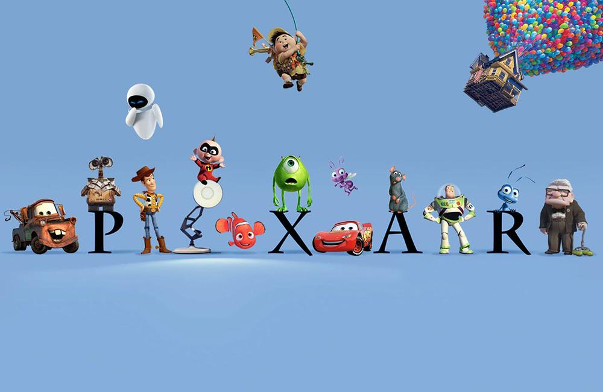

I recently started reading one of the books that are recommended in the [Professional Agile Leadership Essentials (PAL-E) class](https://improving.com/services/training/professional-agile-leadership-essentials/).

***Creativity, Inc.: Overcoming the Unseen Forces That Stand in the Way of True Inspiration*** by Ed Catmull and Amy Wallace.

It has been on my reading list since I first took the PAL-E course and learned about the book. When I began teaching PAL-E, my interest in the book only increased.

The book touches on many concepts that are important for leaders to consider to cultivate an environment where creative people can thrive. I was inspired to write this article when I read how Pixar uses feedback to build better movies. The directors use a specific feedback process to make bad movie ideas they start with (their words!) into some of the incredible movies I have enjoyed over the years.

The director of a film provides early versions of it to other Pixar employees so they can get feedback from them. One important group that gives feedback is called the “Brain Trust”. The Brain Trust members are composed of movie-making subject matter experts who have gone through the process of making movies themselves. Their advice and critiques are extremely useful because they have been through the same process.

The other key element is that the Brain Trust doesn’t have any authority over the director’s decision-making power. They do not mandate solutions, instead, they help bring problems to the surface and work to identify the true causes of the problems. Pixar believes that the director and their team are the ones best suited to solve the identified problems.

This made me think about one of the problems organizations face with their Product Owners. One of the most common anti-patterns is where the stakeholders of a product create the list of solutions (aka requirements) and give them to the Scrum Team to implement. The Product Owner on the Scrum Team will only have the autonomy to sequence the solutions and sometimes they even lack that. What is needed here is actual ownership.

That is what Pixar gets right. The director and their team have full responsibility to make a high-quality film that their customers will love. They use the feedback of the Brain Trust to help uncover blind spots and see problems.

What are some of the roadblocks that prevent organizations from adopting this model for themselves?

- Product Owners are not given the authority to make decisions for the Product
- Teams are not trusted to create solutions to problems
- Stakeholders are incentivized to create solutions instead of identifying problems

These are not simple problems to solve. However, these are the types of problems that Agile leaders, Scrum Masters, and even the Product Owners themselves are challenged to solve. How they overcome these challenges will vary based on their ability to influence changes in culture and policy, and the urgency the organization feels to change. These concepts are explored in the Professional Agile Leadership Essentials course.

The benefits of pursuing these changes are:

- Decisions made closer to where the work is being done
- Reducing waste by minimizing work done on things that don’t provide value
- Higher engagement and fulfillment for the teams

Pixar has produced some remarkable films, starting with the first computer-animated movie ever made: Toy Story. Much of their success is built on their ability to learn as they refine their ideas. Try experimenting with the way your team and organization process feedback. This will require openness and courage for the Product Owner and the relationship they have with their stakeholders. You may think this will turn your organization *Inside Out*, but if you are *Brave,* you can see the effectiveness of your Scrum Team go *Up*.

Learn more about our [Scrum and Agile courses here](https://improving.com/services/training), and if you have any questions please reach out to us.
