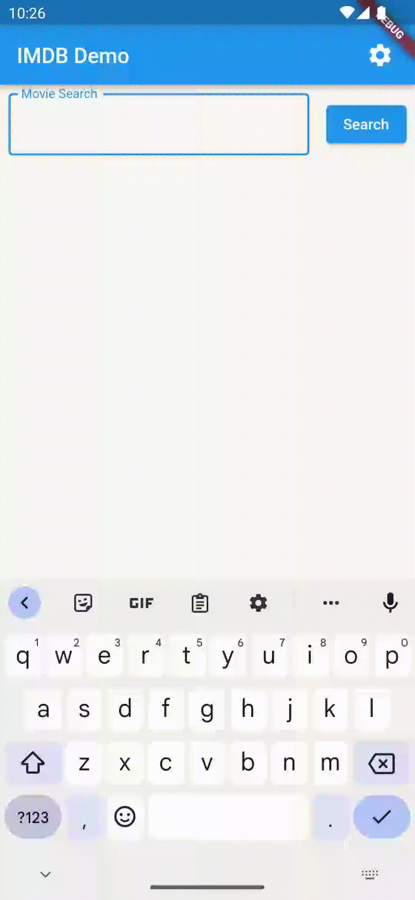

## What is Flutter?

There are several cross-platform development frameworks that have become popular over the years. These frameworks allow a developer to write one codebase that builds binaries that are executable on multiple platforms. In the case of mobile software development, this usually means one codebase that builds an iOS and Android application. What if you could also build a Windows, MacOS, and Linux native application as well as a website?

Enter Flutter, Google’s entry into the world of cross-platform frameworks. Not necessarily new to the scene, with version 1.0 launched in 2018, Flutter continues to grow and add features and enhancements. Based on Google’s own Dart language, Flutter provides smooth graphics and near-native performance on whatever platform it is running on.

Recently I took the opportunity to build a basic application using Flutter that accesses the IMDB API. It simply allows the user to enter a title search word, displays the results in a list, and when an entry is tapped, the details of that movie are displayed. The inspiration came from our Mobile Practice here at Improving which has been working on iOS training materials for those interested in learning to write iOS applications. If you want to try out what I have written, you will need to apply for your own API key. The repository link for the project is at the bottom of this post.

Here is the application in action on Android:

## Getting Started with Flutter

To get started with Flutter, it is necessary to install the Flutter SDK and a development tool. IntelliJ IDEA or Android Studio are great choices that have mature plugins to make development easier. Visual Studio Code is another choice. I personally have not used it for Flutter development, but I understand that plugins are also available for that IDE. Read and follow the Flutter installation instructions to get going quickly. The only problem I encountered was installing CocoaPods on MacOS. I ended up using homebrew to get CocoaPods installed versus using the gem installer. CocoaPods is not required if you only want to develop using Android. The **flutter doctor** command will tell you if you have everything installed correctly and hint at what needs to be fixed.

When you create a new project, either through the command line or your IDE of choice, a basic application is built that counts how many times a button has been pressed. It is nothing fancy, but the code is well-commented to show what all the pieces do. To start developing, nearly all of that code should be deleted and new widgets put in place of what was removed.

## Everything in Flutter is a Widget

Speaking of widgets, almost everything in Flutter is a widget. Flutter has a wide selection of widgets used to allow users to interact with an application to widgets that help with layout, positioning, and animation. If a widget does not fit a need, new widgets can be built by either extending an existing widget or composing a new widget. For me, I think the most difficult thing about Flutter is knowing what widgets exist and how they work, especially related to layout.

Widgets are either stateful or stateless. Stateless widgets are considered lightweight and are used for things where the configuration of the widget does not change. If the widget needs to change, it is thrown away and a new one with the new configuration replaces it. Stateful widgets are for when the widget needs to change dynamically or when there are dependencies outside of the widget. It is necessary for the developer to notify Flutter when the state changes so the widget can be redrawn. It can be tricky to pick the right widget type and as development progresses, the widget can change from stateless to stateful or even the other way around if a widget is simplified.

An example stateless widget is a `**Text**`** **widget. Once it is configured, it does not need to change. It will always have a certain value, and the font and size will remain the same. In comparison, an example stateful widget is `**TextField**`. It is expected to change as a user types on the keyboard.

When building an application, the widgets are laid out into a tree, not unlike what Java developers do with the Swing toolkit. Nearly every aspect of a widget can be configured. For instance, a `**Text**`** **widget simply displays text on the screen. Yet the size, font, direction, alignment, what happens when it overflows, and more can all be specified. A Flutter app can be beautiful!

## What About Dart?

As far as the Dart language, it is a C-style syntax language not unlike JavaScript or Java. It is object-oriented, garbage collected, and has many other features found in popular languages. It uses the async/await pattern throughout which returns Futures. All of this happens inside an event loop like JavaScript uses. It is a very comfortable language to develop in.

The hardest part of Dart for me is the async/await pattern and how it is viral in the call stack. Once a method is labeled as async, everything calling it needs to be async. It is a very different way to write code from my previous experiences with Java and related languages. It is necessary, however, in Flutter to keep the UI responsive and smooth. Flutter has a single-threaded model with an event loop to process events. It is possible to spawn more threads (or isolates as Dart implements them) to run heavier processing tasks which helps an app remain responsive.

## Can I Test This Thing?

Yes! Unit, widget, and integration tests are all supported. Unit tests are easy to write using Mockito for Dart to mock out external dependencies. Widget tests allow a developer to ensure that when a button is pressed, the expected behavior is displayed on the screen. Integration tests can be run on real or emulated devices to ensure all parts of the application are working together.

I found the testing to be straightforward and not unlike any other testing framework. Related tests can be grouped and there is a range of matches available. Unit testing the middle layer code is easy using Mockito to mock out external dependencies. Mockito is also useful for testing widgets to mock out the middle layer code. I did not try a full integration test, but it looks to be very similar to widget tests where expectations of UI behavior are checked after interacting with the UI.

## My Experience with Flutter

Building this small sample app showed me how quickly a UI can be built with Flutter. I have some previous Flutter experience, but it took less than a day to write plus another partial day to figure out how to properly test it. My biggest hangups were: Which layout widgets should I use, overcoming some weird iOS versioning thing with the iOS simulators (not related to Flutter), and figuring out what additional Linux libraries I needed to make my app work on Linux. For my case, I needed to install some additional C++ libraries as well as one to support the` ``**flutter_secure_storage**` plugin to get the Linux app to compile. Using IntelliJ IDEA with Android emulators worked perfectly. The hot reload functionality also makes building interfaces with fast feedback a real joy.

Flutter’s documentation is also pretty solid. Of the widgets I looked up, they all had a brief explanation and sample code to show how it should be used. Third-party libraries are also plentiful, though the quality of the documentation of those libraries may be a bit mixed. Doing a quick browse on [https://pub.dev](https://pub.dev/) (the official package repository for Dart), there looks to be a library available for many common and some uncommon needs. There are plenty of answered questions on Stack Overflow, many blog posts, and other avenues for help. The Flutter community seems to be very active.

## Should I Use Flutter for My App?

It is the same answer for most things: it depends. I think you should strongly consider it.

If you need an app to run on more than one platform, in a native way, it is an obvious choice. If you are looking to create a beautiful UI with either Material or Apple’s design language, you should use Flutter. I also think any size application, large or small, is a good candidate for using Flutter.

One thing that may not make Flutter a good choice is if you need some specific hardware requirements that only exist on one platform. The same functionality will not exist on another platform and there likely will not be a Dart library to support it. But Flutter does support using platform-specific APIs so it is still a possibility.

The question that should be asked is “Why shouldn’t I use Flutter for my next app?”

### ***Related Links ***

*Flutter Home Page - *[*https://flutter.dev/*](https://flutter.dev/)* *

*Dart Language Home Page - *[*https://dart.dev/*](https://dart.dev/)* *

*Dart / Flutter Package Repository - *[*https://pub.dev/*](https://pub.dev/)* *

*IMDB API - *[*https://imdb-api.com/*](https://imdb-api.com/)* *

*Sample Project Repo - *[*https://github.com/improving-minnesota/flutter-imdb*](https://github.com/improving-minnesota/flutter-imdb)* *
