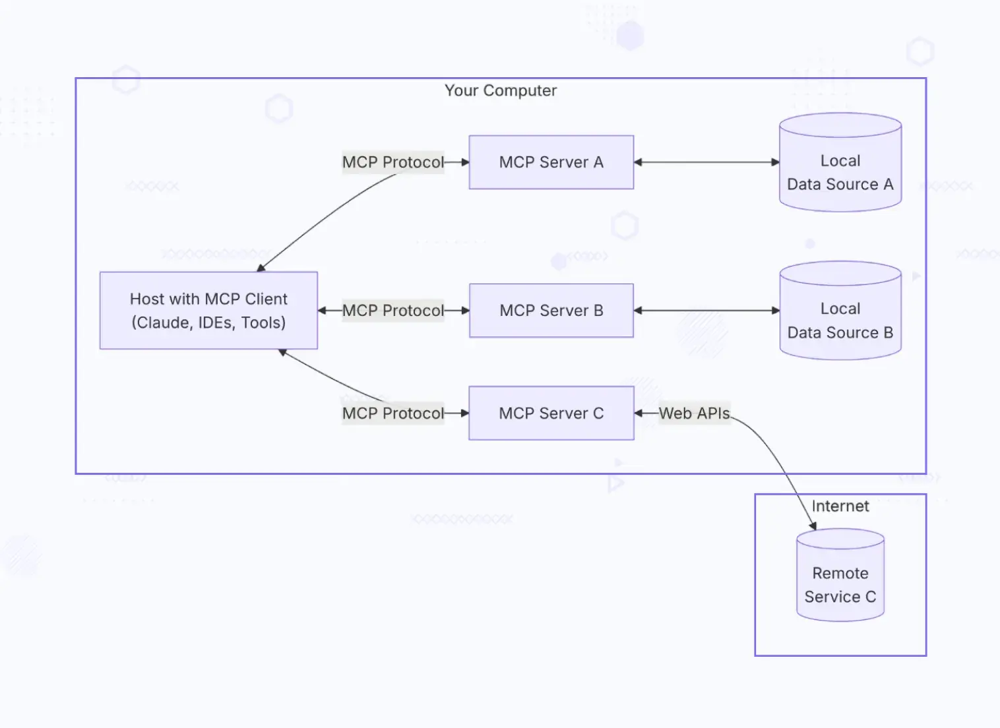

Model Context Protocol (MCP) has quickly moved from concept to conversation starter across the AI engineering community. At Improving, we’ve been actively tinkering with it, [building](https://www.infracloud.io/blogs/build-your-own-mcp-server/#what-is-an-mcp-server), writing, and talking through what MCP really looks like beyond the hype. The concept is promising; give your AI models structured access to real tools and watch them transform from chatbots into agents that get work done.

But introducing MCP introduces real complexity, costs, and risks that don't appear in the initial stage. It's powerful when your users need it, and expensive over-engineering when they don't. In this blog post, we will cut through the hype to examine the trade-offs that matter in production, when benefits of MCP justify the costs, where simpler approaches work better, and what hidden challenges emerge once you move past the POC Phase.

## What is an MCP and MCP Server?

MCP is an emerging standard that helps large language models (LLMs) interact with external tools, services, and data in a consistent and predictable way. In simple terms, MCP gives AI models a common language for using tools.

Think of it like a universal plug adapter for AI. Instead of teaching every model how to talk to every API or database separately, MCP defines one standard way to do it. Once a tool is connected through MCP, different AI models can use it without needing custom integrations each time. An MCP Server runs this protocol and acts as a middle layer between AI models and real-world systems like APIs, databases, or internal apps. Developers define tool connections once on the MCP server and can then reuse them across models from different providers, saving time and reducing duplicated work.

The architecture diagram below shows this at a high level: the LLM talks to the MCP server using the MCP protocol, and the MCP server handles communication with the actual tools and data sources behind the scenes.

To learn more about MCP in detail, check out our blog post on [Model Context Protocol](https://www.infracloud.io/blogs/model-context-protocol-simplifying-llm-integration/).

## Benefits of Adding MCP Servers to Your Program/Software

MCP servers provide a durable architectural layer that helps organizations scale AI capabilities without locking into specific models or vendors. They shift AI integrations from short-term hacks to long-term infrastructure. From an end-user perspective, MCP servers enable more reliable, consistent, and future-ready AI experiences within your product. By adopting this architecture early, you not only deliver faster innovation and smarter features to your users but also gain a competitive edge among early adopters in the market.

### Standardization and Interoperability

MCP introduces a unified, model-agnostic protocol for accessing tools and resources, allowing AI systems to interact with enterprise data and services through a consistent interface. This abstraction decouples AI applications from individual model providers, allowing organizations to integrate new models or switch providers without rewriting downstream integrations.

### Developer Velocity and Resource Efficiency

By separating model reasoning from tool execution, MCP simplifies system design and reduces integration complexity. Tools implemented once on an MCP server can be reused across multiple applications, models, and teams, eliminating duplicated effort and accelerating delivery of new AI capabilities. Over time, this reuse compounds: each new tool becomes shared infrastructure, increasing overall development efficiency and lowering marginal costs for future AI initiatives.

### Centralized Control and Governance

An MCP server provides a single point of control for managing tool behavior, permissions, updates, and access policies across all AI clients. The centralization makes it easier to enforce compliance requirements, maintain audit trails, and implement consistent security controls, while supporting multi-client and multi-model architectures.

### Architectural Flexibility for Growth

MCP enables organizations to add, modify, or remove tools without redeploying AI applications, reducing operational risk and increasing adaptability. As business needs, workflows, and regulatory environments change, the architecture can evolve without costly rewrites. MCP becomes a durable foundation that grows alongside an organization’s AI maturity, supporting increasingly complex use cases over time.

## Hidden Costs: What MCP Adoption Really Means

While MCP promises elegant AI-tool integration, the path from proof-of-concept to production adds operational, performance, and organizational complexity and expenses that teams must be prepared to absorb.

### Operational Burden and Complexity Tax

An MCP server is not a thin abstraction layer; it is a long-lived distributed system. It requires deployment pipelines, configuration management, backward-compatible schema evolution, and capacity planning. [SuperAGI's overload incidents](https://web.superagi.com/optimizing-mcp-tool-performance-advanced-strategies-for-maximizing-roi-and-minimizing-downtime/) from client surges forced urgent pipeline overhauls, revealing underestimated migration complexities. Unlike one-off integrations, MCP introduces ongoing responsibilities that scale with usage, appearing gradually during incident handling and dependency changes.

### Performance Trade-offs

Introducing MCP adds an extra network hop for each tool invocation, often in the range of tens to hundreds of milliseconds, which can compound noticeably in multi-step or agentic workflows. Under high load, the MCP server can become a bottleneck if not properly scaled, cached, or tuned. Achieving acceptable performance typically requires additional engineering investment in concurrency management, caching strategies, and performance monitoring.

### Security Risks if Misconfigured

MCP centralizes access to powerful tools and sensitive data, which increases the blast radius of configuration errors. Overexposed tools or overly permissive schemas can lead to unintended data access, while prompt-driven misuse can cause models to invoke tools in unsafe ways as happened in the [postmark-mcp case](https://thehackernews.com/2025/09/first-malicious-mcp-server-found.html) where the malicious server BCC'd emails to attackers, exposing memos and invoices via high-privilege trusts in thousands of workflows. Without carefully designed permission models, input validation, and guardrails, misconfigurations can be exploited either accidentally or maliciously.

### A Nascent Ecosystem

MCP is still an evolving standard, with fewer mature, off-the-shelf tools compared to traditional API ecosystems. Best practices, architectural patterns, and operational playbooks are still emerging, which increases uncertainty and experimentation costs. For simple or single-purpose integrations, MCP may introduce more complexity than value, making it important to avoid premature adoption.

### Debugging and Observability Challenges

Failures in an MCP-based system often span multiple boundaries: model reasoning, protocol translation, network calls, and downstream services. Non-deterministic LLM behavior makes issues harder to reproduce and diagnose, increasing mean time to resolution. [Dynatrace's TELUS deployment](https://www.dynatrace.com/news/blog/mcp-best-practices-cline-live-debugger-developer-experience/) required Cline Live Debugger to unify traces across these layers, exposing vanilla servers' logging gaps. Effective operation requires sophisticated observability infrastructure, logging, tracing, and metrics adding further tooling and operational investment.

## When MCP Is the Wrong Choice: Critical Red Flags

MCP has some hidden flags, making it not ideal for everything.

### Customer-Facing Latency Sensitivity

MCP introduces per-call overhead that degrades real-time UI experiences, where streaming connections amplify delays in interactive workflows. Transactional paths suffer from routing everything through the protocol, as burst requests from LLMs overwhelm simpler direct APIs. Sidecar integrations or non-blocking patterns deliver better responsiveness here.

### Minimal Tool or Static Integrations

Stable, limited tools lead to bloated schemas repeated across interactions, wasting context without delivering dynamic benefits, direct function calls or basic RAG pipelines handle these more efficiently. Short sessions accumulate unnecessary history, favoring prompt-level optimizations over protocol layers.

### Regulated or Enterprise Security Gaps

Absence of built-in SSO, audit trails, and fine-grained authorization leaves regulated setups vulnerable to unmonitored shadow servers and injection risks in containerized deployments. Tool poisoning enables scope overrides, requiring custom gateways beyond the core spec.

### Immature Teams or Shadow Deployments

When servers are set up without clear ownership or rules, it leads to inconsistent configurations, poor visibility, and slower troubleshooting. Teams without platform discipline may find that MCP increases complexity instead of improving efficiency. For smaller or early-stage use cases, simple direct LLM API calls are usually enough. You don’t need full orchestration until your AI usage becomes more central and complex.

### AI as a Peripheral Feature

If AI is just an occasional enhancement, like “adding a chatbot to a settings page”, MCP’s architecture is overkill. In these cases, a simple call to your LLM provider’s API with some context from your database is enough. You don’t need servers, tool schemas, or protocol layers. MCP only makes sense when AI needs to orchestrate multiple tools or capabilities. For a single, specific AI feature, adding that extra complexity slows development without real benefit.

## Decision Framework for Adopting MCP Servers

Now that we’ve explored the pros and cons of MCP, how do you determine whether your use case requires the dynamic context and standardized transport layers it provides, or if your application is better served by traditional endpoint-to-endpoint integrations that avoid the complexity of the Model Context Protocol lifecycle.

### Complexity Assessment

Begin by assessing both current and anticipated AI requirements, including the number of models, tools, integrations, and teams involved. The key question is whether complexity is already causing friction or is credibly projected based on the roadmap, rather than being hypothetical. MCP introduces an abstraction layer, so the question should be to ask whether this layer solves a real coordination, scaling, or governance problem or whether it would simply add unnecessary infrastructure at this stage.

### Team Capability Audit

Evaluate whether your organization has the platform engineering maturity required to implement and operate an MCP server effectively. The process includes operational capabilities such as monitoring, incident response, versioning, and access control, as well as a realistic skills gap analysis around distributed systems and API design. MCP can create long-term leverage, but only if the team can properly build, maintain, and evolve the platform without becoming a bottleneck.

### Total Cost of Ownership (TCO) Calculation

Look beyond initial implementation costs to understand the full TCO over time. This should include migration effort, infrastructure and operational overhead, training or hiring costs, and opportunity costs. These costs should be weighed against benefits in your specific context, such as reduced rework, faster delivery, improved governance, and increased vendor optionality.

### Strategic Alignment

Assess whether MCP aligns with your broader business and AI strategy. Vendor optionality is most valuable when AI is central to your product or operating model, or when regulatory, cost, or performance considerations may force provider changes. You should also consider their risk tolerance for adopting an emerging standard and whether MCP supports the organization’s long-term AI roadmap rather than short-term experimentation.

### Pilot Before Commitment

Before committing broadly, start with a constrained pilot using a non-critical application and a limited set of tools. The trial project allows teams to validate assumptions, uncover operational challenges, and measure real-world benefits and challenges in their environment.

## Common Pitfalls Organization Fell Into

### Exposing Overly Powerful Tools

A frequent mistake is exposing broad, high-privilege tools to models instead of narrowly scoped capabilities. This increases the risk of unintended actions, data leakage, or destructive operations, especially when models behave unpredictably or are influenced by ambiguous prompts.

### Treating MCP As A Security Boundary By Itself

MCP is an integration protocol, not a security control. Relying on it as the sole line of defense, without downstream authorization, validation, and rate limiting creates a false sense of safety and leaves systems vulnerable to misuse or exploitation.

### Skipping Monitoring And Logging

Without comprehensive logging and monitoring, MCP-driven systems become opaque and difficult to debug. Teams often underestimate how essential visibility is for understanding tool usage, diagnosing failures, and responding quickly to incidents in non-deterministic AI workflows.

### Allowing Unrestricted Model Access to Production Systems

Giving models direct, unrestricted access to production resources dramatically increases operational risk. Safe architectures enforce environment boundaries, approval gates, and least-privilege access, ensuring that models cannot independently execute high-impact actions without safeguards.

## Conclusion

While MCP servers offer powerful capabilities for connecting AI models to tools and data, they also introduce trade-offs in complexity, performance, and operational overhead. Using them indiscriminately adds unnecessary costs and security risks, and MCP may not be the right choice for every application. Success depends on careful design, strong security, and platform engineering maturity.

Organizations should evaluate MCP adoption based on their specific use cases, weighing benefits against operational and architectural costs. If you are in doubt, it never hurts to take a second opinion from experts. Get in touch with [MCP and AI experts](https://www.improving.com/expertise/ai/) of Improving to learn why Fortune 500 companies trust us and get your doubts cleared before making the decision.
