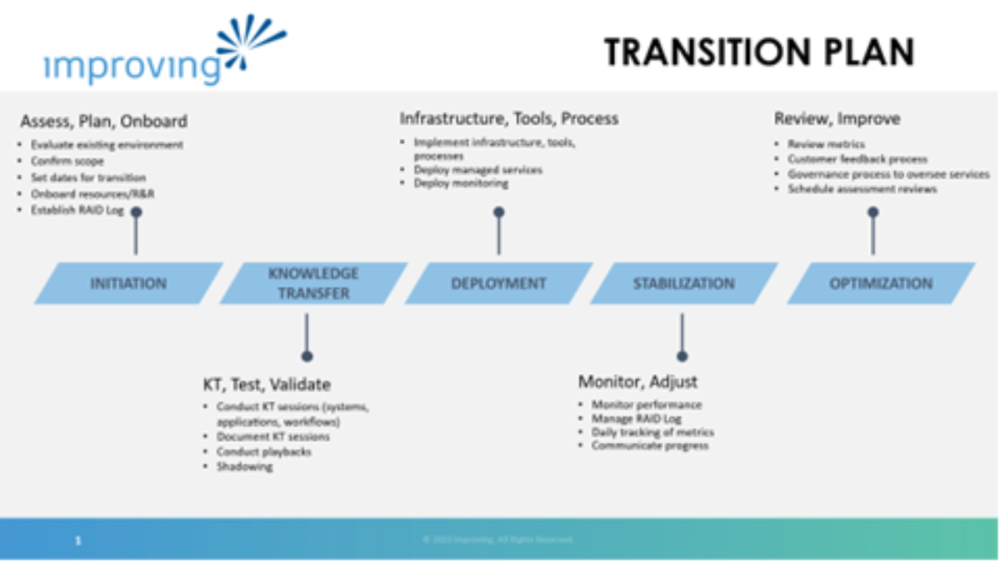

For Managed Service Providers (MSPs), every new customer engagement begins with one critical project — onboarding. While it may seem routine, customer onboarding is arguably the *most important* project an MSP runs. It sets the tone for the entire client relationship, establishes trust, and lays the groundwork for operational success. Done well; onboarding transforms a new account into a long-term partnership. Done poorly, it can create friction that lingers for years.

## First Impressions Define the Relationship

The onboarding process is often a client’s first experience with how your MSP delivers on promises. During sales, clients hear about reliability, responsiveness, and technical excellence — onboarding is when they see it in action. A structured, transparent process shows professionalism and gives clients confidence that their technology is in good hands.

## It’s When the MSP Learns About the Client

Onboarding isn’t just about setting up systems — it’s about understanding the client. Every environment is different: business processes, key users, existing technologies, and security postures vary widely. The onboarding phase gives your team a deep dive into how the client operates, what matters most to them, and how your services can best support their goals.

## Repeatable Methodology Critical for Successful Onboarding

At Improving, we believe that when clients feel heard, informed, and supported from the start, they’re far more likely to stay and expand services later. Improving MSP deploys a repeatable methodology for customer onboarding. A project plan is developed and shared with the customer as a joint agreement for how our successful relationship will begin.

Customer onboarding is more than a checklist or kickoff — it’s the most strategic project your MSP runs. It determines how clients perceive your value, how efficiently your team operates, and how long your partnerships last.

Invest in making your onboarding process structured, repeatable, and customer focused. When onboarding goes right, everything that follows gets easier. To see how a structured, repeatable onboarding approach is built into our broader offering, explore Improving’s [Managed Services](https://www.improving.com/services/managed-services/) and how they support long-term client success.
