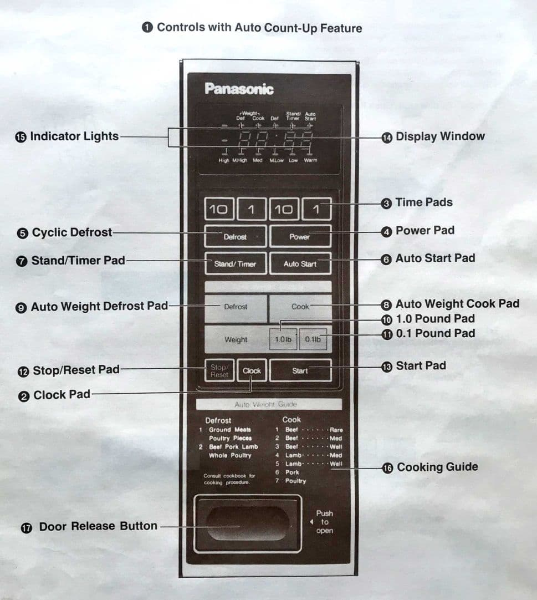

From the basement, I returned. I struggled to carry it and found a spot on the dining room table to place it. It was a Panasonic NE-6850 microwave purchased in 1984. Again, I felt a pang of nostalgia. This microwave oven has been in my family for almost 30 years; my parents used it when I was a kid.

I grabbed some leftovers from the fridge and couldn’t wait to see if it still functioned. But, as I tried to reheat some food, I found that I was unaware of what to do. After a nearly 40-year gap, I struggled to figure out how to operate it. Just look at the user interface users were confronted with, where something as simple as setting the time to cook would become an almost impossible hurdle.

*Diagram provided to set the clock, by pressing appropriate “Time Pads”.*

The NE-6850 microwave oven’s power system was one of the most surprising yet frustrating parts of operating it. I didn’t realize that Panasonic had designed the default power level to be the lowest until I read the manual. In other words, the cooking power level was at the lowest by default. Therefore, I assumed that the unit had finally cooked its final meal.

## What is a Design Pattern?

Design patterns are solutions to common design problems that have been tried and tested. With these standards, designers can more easily develop attractive and functional interfaces for their target audiences.

Initially, when user experience design began to emerge, designers and information architects approached each problem with a one-of-a-kind solution. However, because of this method’s limitations, users found it challenging to move between and operate within various interfaces in various programs and operating systems. In addition, designers saw the need for more standardized solutions to user experience issues as the internet grew and got more complex. This need resulted in the development of the concept of design patterns.

## Notable Examples of Recurring UX Problems Online

### A. Registration Form Design

In the early days of online registration forms, designers needed help to create intuitive and user-friendly interfaces. As a result, registration forms often needed to be more straightforward and required users to fill out multiple fields. These pain points resulted in lower conversion rates and frustrated users. Designers then began to develop and share registration form design patterns that included best practices such as clear labeling, fewer required fields, and clear calls to action. These patterns were developed through user testing and research and proved effective in increasing conversion rates and improving user experience. Registration form design patterns were eventually standardized and implemented across different platforms and applications. Standardization allowed for consistency in user experience, making it easier for users to navigate and complete registration forms.

### B. Navigation Menu Design

Navigation menus were often hard to navigate, especially on larger websites with multiple levels of navigation. As a result, users would repeatedly need to pay more attention to sections.

Over time to help ease user frustrations, designers began to develop and share navigation menu design patterns that included best practices such as clear labeling, hierarchical organization, and visual cues. These patterns were generated through user testing and research and proved effective in improving user experience. As a result, navigation menu design patterns were eventually standardized, allowing consistency in user experience and making it easier for users to navigate and find the information they need.

### C. Product Listing Design

Product listing pages on e-commerce websites often needed to be more straightforward and manageable, making it difficult for users to find the product they sought. As a result, designers began to develop and share product listing design patterns that included best practices such as clear product images, concise product descriptions, and clear calls to action. These patterns were developed through user testing and research and improved user experience effectively. Product listing design patterns were eventually standardized across different platforms and applications.

## What is the Importance of Design Patterns in Good UX Design?

Design patterns are essential in good UX design because they provide a common language and a proven solution for common design problems. By using design patterns, designers can save time and effort in the design process, ensure consistency in the user experience, and improve the overall usability of a product. Additionally, design patterns provide a starting point for designers to build upon, enabling them to create unique and creative solutions to design problems while adhering to established best practices. In short, design patterns play a crucial role in creating a seamless and user-friendly experience.

Design patterns help the user of an application by providing a familiar, consistent, and intuitive experience. By using design patterns, designers can ensure the interface is predictable and easy to navigate. [Design patterns](https://gregchartrau2012.myportfolio.com/) reduce the cognitive load on the user, making it easier for them to complete tasks and find the information they need. Additionally, design patterns often incorporate established best practices, such as using clear and concise language, providing visual cues, and using appropriate color schemes, which helps to improve overall usability and accessibility.

Design patterns can also help improve the application’s overall aesthetic, making it more visually appealing and enjoyable. Attention to these details can significantly enhance the user’s overall experience and create a more favorable product perception.
