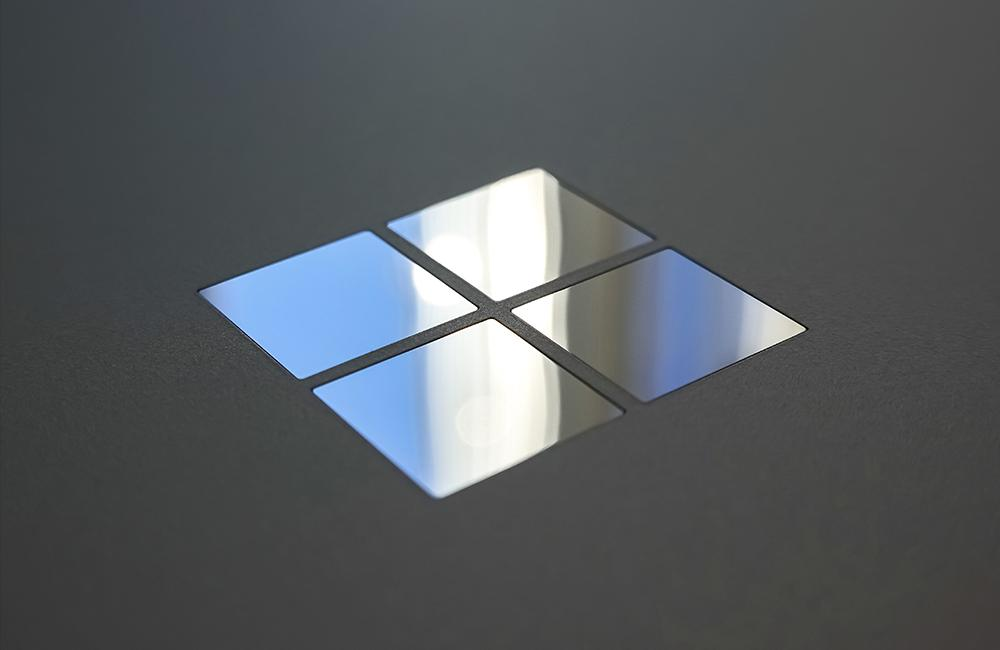

In our first two posts, the Microsoft Services Team has covered two hot topics in the Microsoft Ecosystem: [Zero Trust](https://improving.com/partners/microsoft) and [Application Modernization](https://improving.com/partners/microsoft). For our final post in this series, we will be discussing possibly the hottest topic facing Microsoft Partners that you may not have heard about... **CHANGE!**

In March of this year, Microsoft announced that they were rebranding and making changes to their Partner Program known as The Microsoft Partner Network (MPN) which according to Microsoft will impact 400,000 global partners. So, this explains why it is a hot topic. In October of 2022, Microsoft is launching a new program called Microsoft Cloud Partner Program (MCPP) and changing the way partners are measured and branded.

There has been a lot of content published on the changes impacting partners, but that is not the focus of this post. If you are interested in those changes there is plenty of content from Microsoft to read. In this post, I’m going to flip the focus from what this means to a Microsoft Partner and explore a point of view that received far less coverage. I would like to share my thought on what these changes mean to YOU as a Microsoft technology consumer or end-user.

So now that you have an extremely high-level overview of the changes, what should you think about when selecting a Microsoft Partner to engage on your next project?

First, as a consumer of Microsoft Technology, ask yourself how much emphasis you put on your current partner's competencies when selecting them. My guess is most readers of this blog weighted a partner’s competencies as low priority (if at all) in their selection process. I personally spent 12 years at Microsoft as part of the Field Sales Team, managing partners, and I can say the reason this does not come up more often is because as a Microsoft Partner it is very difficult to differentiate one Microsoft gold partner from another.

During my time at Microsoft, I had the opportunity to have thousands of conversations with Microsoft clients and prospects. The first piece of advice I would give to any of them prior to starting a project was to **select the right partner**. The reason I gave this advice was simple. If you selected Microsoft as the technology, regardless of the project, the technology is the same for every partner. The real difference was what was the partner able to do with that technology.

In my experience, regardless of the changes that Microsoft makes to their Partner Program, a Microsoft label is a great way to validate a partner's skill set. But, seldom is it the driving factor behind why a company is selected for a project. Below are my top 4 reasons partners win deals and are selected for technology projects.

1. **Trust**
   Partners are selected for projects because they have already completed work for a client and delivered on their commitments.
2. **Transferable Trust**
   A partner is selected for a project even if they have not engaged with a buyer because they have delivered on their commitments for another company the buyer knows (aka the referral).
3. **Industry Expertise**
   Proven results in a specific industry the buyer is in, or specific industry IP access or ownership to enhance a solution to provide additional value.
4. **Size**
   Partners are selected because they have multiple resources and the ability to offer value in multiple areas of a technology stack including development, implementation, integration, training, support, coaching, etc. The ability to service multiple challenges in a variety of different business units.

You may have been expecting to see a few others on this list such as location or price, but in my experience, these can be important but are not weighted as high as the key drives I suggest above. I think we all have learned over the past couple of years that location priority has become really a non-issue. As far as price, yes, it is important but many technology buyers understand the phrase “you get what you pay for,” and know the least expensive upfront option often ends up costing more in the long run.

We hope you have enjoyed the 3 Part Microsoft Services Team blog series. If you have comments you would like to share or to learn more about any of our topics like how Improving can effectively help you get to a Zero Trust environment, assist your organization with Application Modernization, or any technology needs [reach out to us](https://improving.com/contact).

*This has been part 3 in a 3-part series discussing focus areas of the Improving Microsoft Services Team.*
