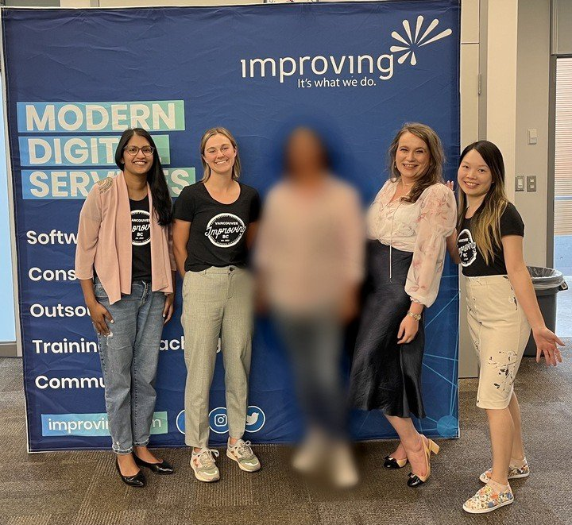

On June 7th, several members of our team had the amazing opportunity of holding a speaking panel to share our personal journeys and insights as women who broke into the tech industry. This event, graciously hosted by the Simon Fraser University (SFU) Burnaby Campus, provided an exciting platform to exchange experiences and ideas between us and their community!

**We respect our team members’ privacy by blurring their image as requested*

One of the most empowering takeaways from our panel was acknowledging that a tech career isn't confined to coding alone. From team members in Software Development to Account Management, Talent Acquisition, and People and development, our panelists showcased the fact that you don’t have to be a developer to thrive in tech! Every part of the team plays a vital role in helping us achieve our goals.

As panelists, we not only shared our knowledge; we also learned from each other as well! We shared insights, lessons learned, and strategies for success, creating a dynamic dialogue that echoed the collaborative spirit of the tech world. There were many thought-provoking questions from the audience that stimulated engaging discussions around topics such as career advancement, the importance of mentorship, and unique challenges for individuals who were beginning their careers.

As the panel came to a close, a sense of unity and inspiration filled the room – there was nothing better than the feeling of coming together to support women in navigating the tech landscape at all stages of their careers. We’ll be back, SFU!!!
