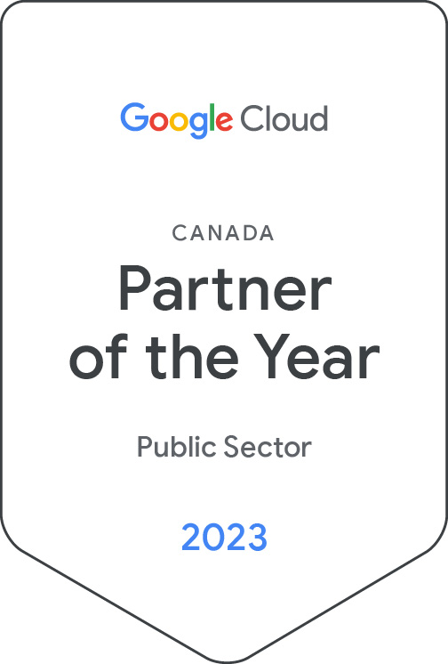

**Ottawa, August 29th, 2023— **YoppWorks, an Improving company, is thrilled to announce today that we have received the 2023 Google Cloud Public Sector Partner of the Year Award for Canada.

YoppWorks has been recognized for our achievements within the Google Cloud ecosystem, helping public sector customers in Canada transform their organizations through the adoption and successful implementation of critical solutions that are in alignment with their digital transformation objectives.

“Google Cloud’s partner awards recognize the significant impact and customer success that our partners have driven over the past year," said Kevin Ichhpurani, Corporate Vice President, Global Ecosystem and Channels at Google Cloud. "We're delighted to recognize YoppWorks Partner as a 2023 Google Cloud Partner Award winner, and look forward to a continued strong partnership in support of our mutual customers.”

We are thrilled to be recognized with the Google Cloud Public Sector Partner of the Year Award for Canada as it highlights the collective work and impact of our team in helping architect and provide solutions that have made a demonstrable impact on government departments and agencies across Canada,” said Jack Gulas, Founder & CEO, YoppWorks. “Working in partnership with Google Cloud, we have been able to create solutions that have helped public sector departments and agencies leverage HPC & AI/ML resources for scientific research, streamline their document processing workflow with Document AI, and begin their journey onto the cloud with our expertise in Cloud Landing Zones.”

YoppWorks is recognized for helping public sector organizations such as National Defence Canada, Health Canada, the Government of Ontario, the Government of Quebec, the Government of British Columbia, and the Government of New Brunswick adopt solutions and begin their journey to the cloud on Google Cloud.

**About YoppWorks - **YoppWorks, an Improving company, is a leader in application and infrastructure modernization in Canada and we hold ourselves to a very high standard. Leveraging Reactive Architecture, Domain-Driven Design, and Agile methodologies, we are able to help public sector departments and agencies drive effective change through digital transformation.

**About Improving** - Improving is a modern digital services company that offers IT consulting, software development, and agile training across the globe. Our innovative solutions have helped thousands of our clients realize their tactical and strategic business objectives, allowing them to achieve great new heights in a competitive and ever-changing market.
