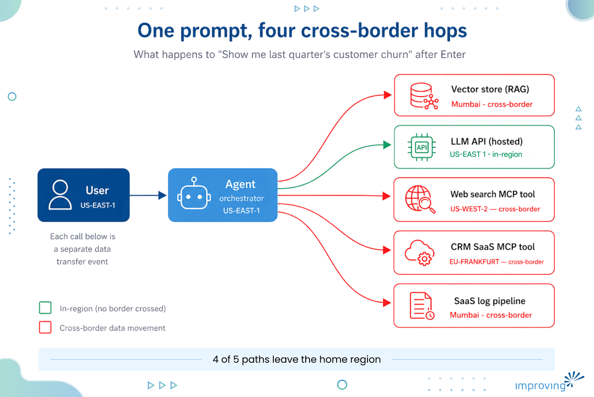
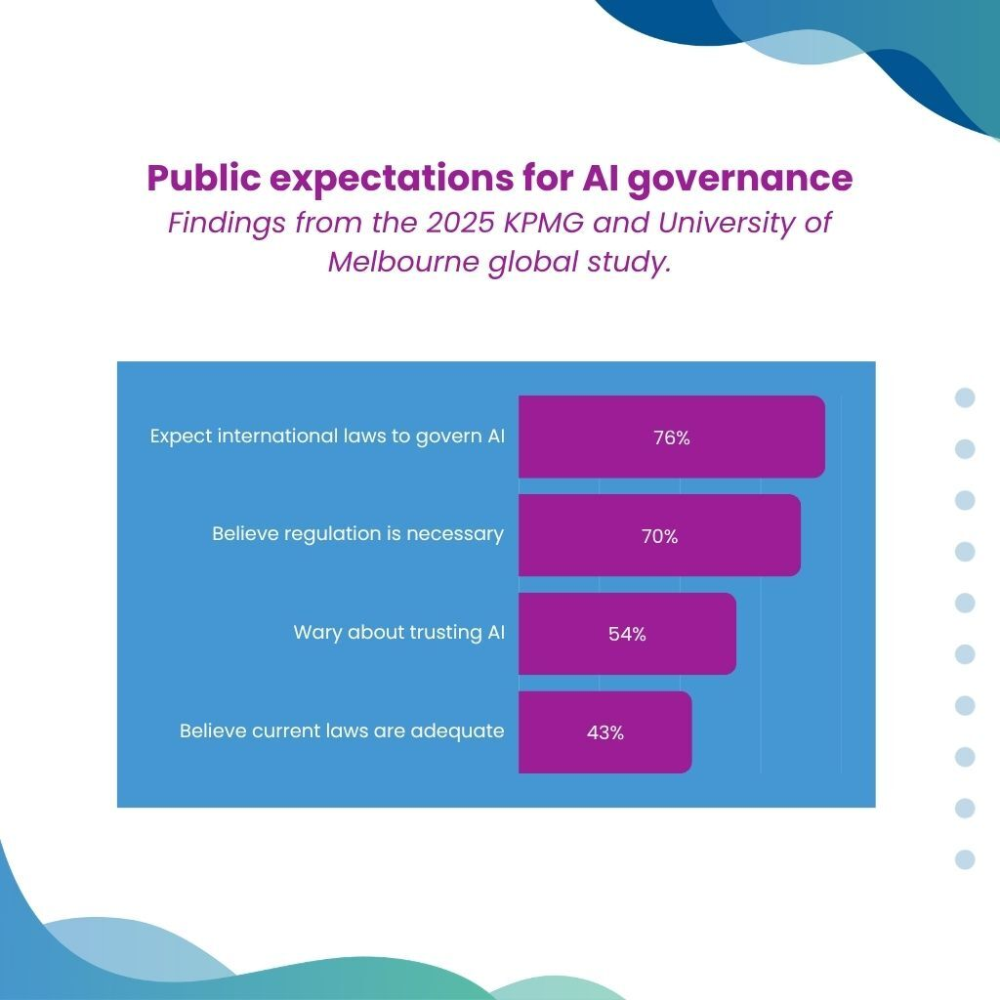
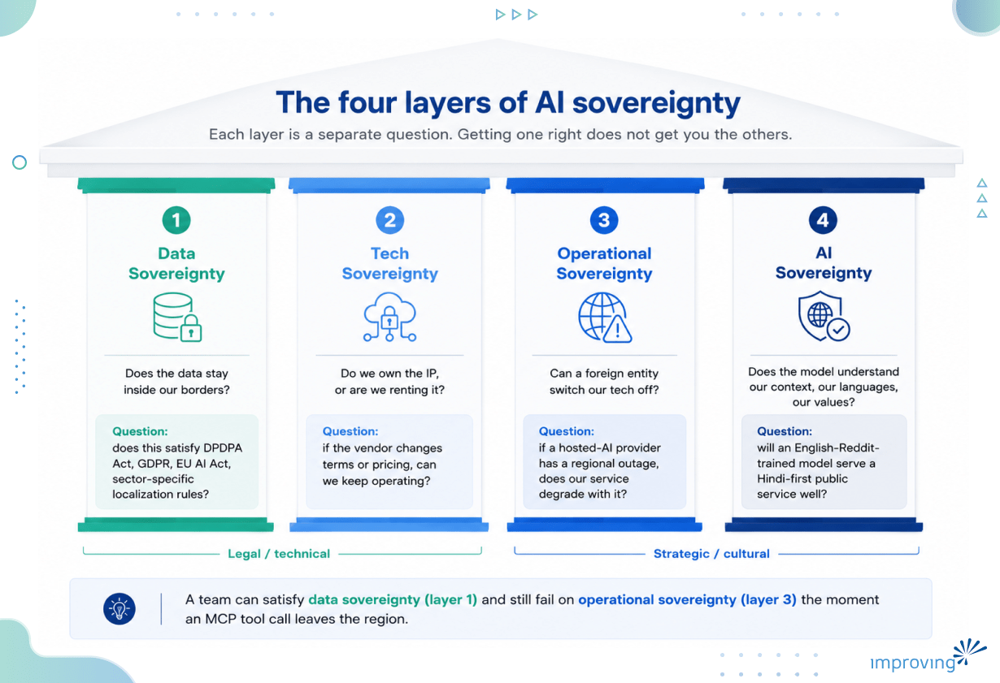
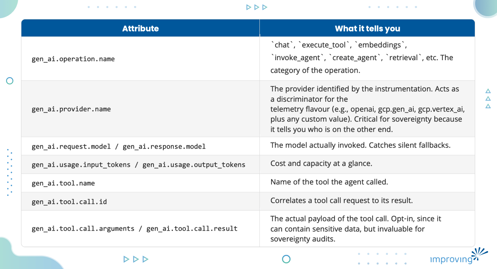
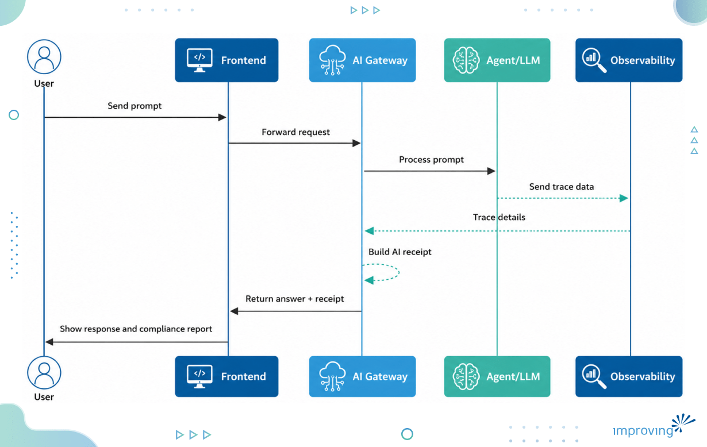
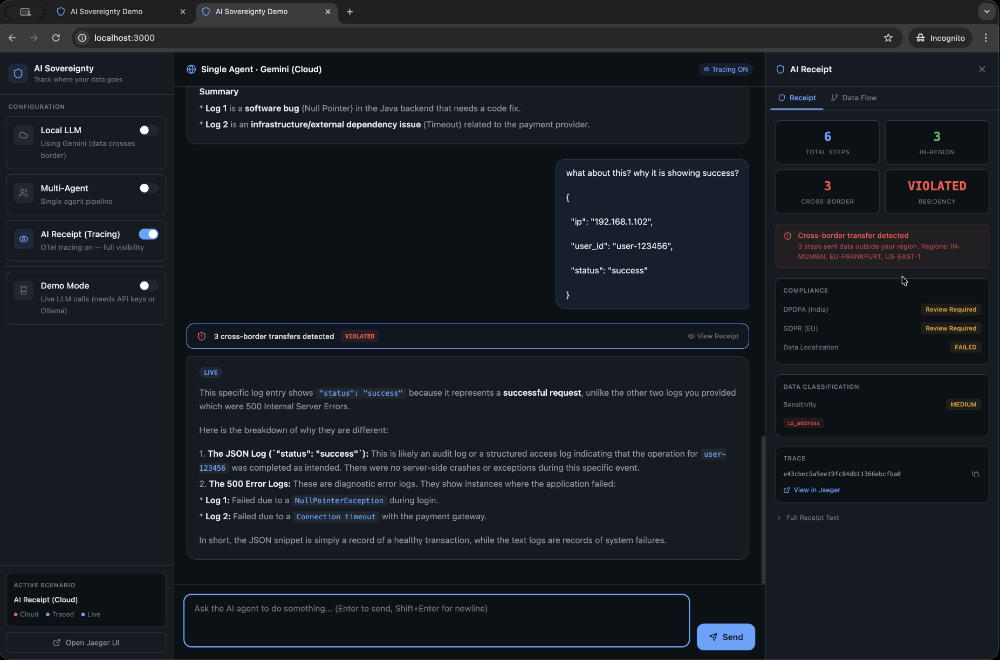
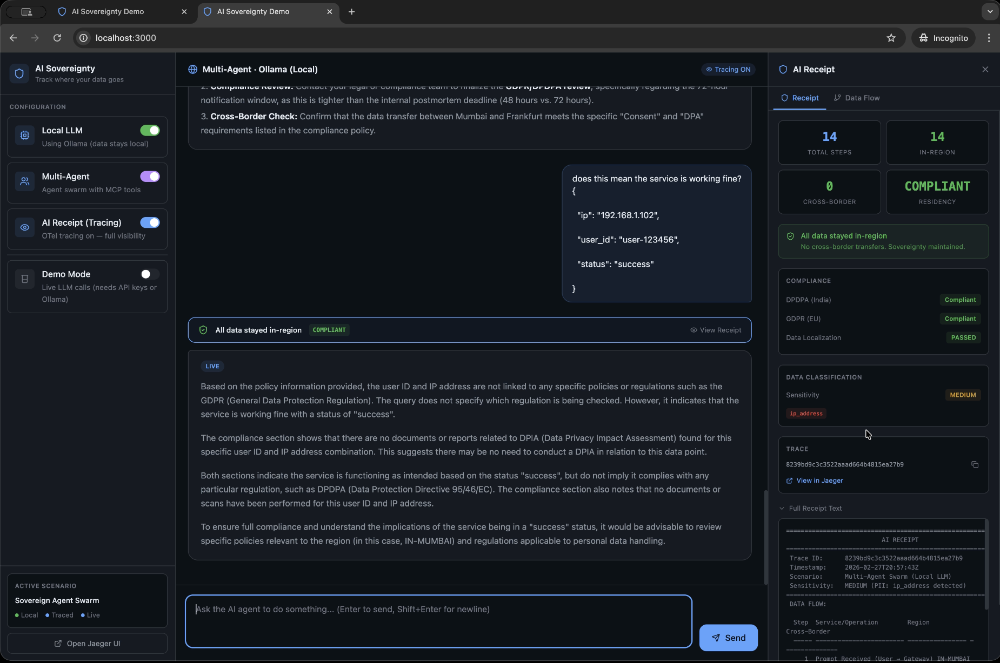
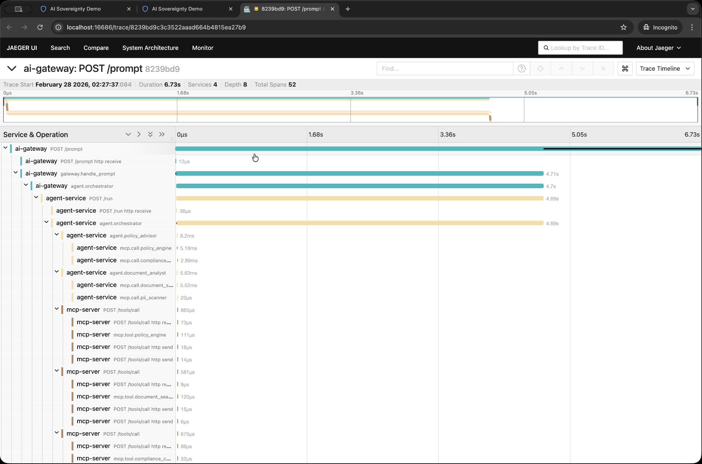

Every time you hit Enter on an AI chatbot, you are signing off on a data transfer with your prompt. Most probably, you have no idea where that data went, which tools it touched, or whether it crossed a border on its way to receive the response.

In this blog post, I will walk you through this observability problem and solution in details, including why AI sovereignty is suddenly an architecture concern, why on-prem alone does not solve it, what OpenTelemetry's GenAI semantic conventions actually give you today, and how an "AI Receipt" demo I built turns the black box into something you can audit.

GenAI is not a chatbot anymore. What we deploy in production today is a stack of four capabilities, and each one widens the data footprint:

1. **Chatbot: **The model reasons for your prompt and answers from its weights alone.
2. **RAG: **The model retrieves context from your documents first, then answers grounded in what it found.
3. **MCP: **The model uses [external tools](https://modelcontextprotocol.io/) - APIs, search engines, and databases, to do real work in external systems.
4. **Agents: **The model plans which of the above to invoke, chains them together, and acts without a human in the loop.

By the time you are running an agent, a single user prompt can fan out into a dozen calls across vector stores, internal APIs, and third-party services. That fan-out is where the sovereignty question gets uncomfortable.

## **The Data is Already Moving. Quietly.**

Data movement without visibility is already happening in the data sensitive places: government services, banking chatbots, telecom log analysis, healthcare claims processing, and the customer support bots you talked to yesterday.

The diagram below shows what happens to a single prompt once it enters an agent. One user request fans out into multiple data transfers, and most of them leave the home region without the user (or often the operator) noticing.



*(One prompt, four cross-border hops: four of the five paths leave the home region.)*

[LayerX's 2025 Enterprise AI and SaaS Data Security Report](https://go.layerxsecurity.com/hubfs/LayerX_Enterprise_AI_and_SaaS_Data_Security_Report.pdf), based on real browser telemetry from enterprises, found that:

- 45% of enterprise users are actively using AI tools.
- 77% of employees paste data into GenAI tools.
- 40% of files uploaded into GenAI tools contain PII or PCI data.

The report calls GenAI the single largest channel for corporate-to-personal data exfiltration, accounting for 32% of all such movement. 67% of that AI usage happens through unmanaged personal accounts, which means most enterprises cannot see it even when it is happening on their own networks.

This is the unmanaged surface. The managed surface, where you are deliberately building agents for production, is bigger and more invisible, because the data movement happens inside your own stack instead of on someone's laptop.

For companies shipping in AI regulated industries, the residency and visibility of the data become a central architecture question.

Pressing Enter feels local, but it is not. Your prompt may hit a model hosted in another region, get enriched by an MCP tool calling a SaaS API in a third region, and return through a logging pipeline in a fourth. Each of those hops is, technically and legally, a cross-border data transfer.

## **Why Sovereignty, Why Now?**

Three things have collided in the last eighteen months: public trust in AI is shaky, regulators are no longer waiting, and enterprises are realizing that their AI roadmaps are tied to providers they cannot fully audit.

On the trust side, the [2025 KPMG and University of Melbourne global study,](https://assets.kpmg.com/content/dam/kpmgsites/xx/pdf/2025/05/trust-attitudes-and-use-of-ai-global-report.pdf) found that:

- 54% of respondents are wary about trusting AI.
- 70% believe regulation is necessary.
- Only 43% believe current laws are adequate.
- 76% expect international laws to govern AI.

The mandate for visible, accountable AI is not coming from a niche advocacy corner; it is the default public position.



On the regulatory side, the rules are arriving faster than most architecture reviews can absorb.

- The EU AI Act's high-risk obligations begin to apply in August 2026.
- The European Commission tabled the [Cloud and AI Development Act](https://www.grosswald.org/european-commission-cloud-ai-development-act-four-level-sovereignty-framework-defence-procurement/) on 3 June 2026.
- In India, the [DPDP Act and the DPDP Rules 2025](https://www.meity.gov.in/static/uploads/2024/06/2bf1f0e9f04e6fb4f8fef35e82c42aa5.pdf) were notified in November 2025 and are now rolling out in phases.
- [China continues to tighten](https://www.morganlewis.com/pubs/2025/06/china-issues-new-national-standard-on-security-requirements-for-sensitive-personal-information) data export controls, and the US is moving in a different direction with deregulation pushes.

The net effect for any multinational is that there is no longer one global AI policy; there are several, and they are not aligned.

A handful of concrete cases make the pattern visible:

- **HPCL (India, oil and gas) **moved [AI workloads on-premise](https://www.youtube.com/watch?v=sY3TfVBQVb8&t=1957s). The headline reason is security around National Critical Information Infrastructure, but the two reasons that surprised me were cost predictability (per-token cloud pricing made budgeting impossible at scale) and avoiding lock-in to any single hyperscaler's pricing curve.
- NABARD (India, agricultural finance) [went on-prem for what their CGM called "strategic independence,"](https://www.youtube.com/watch?v=sY3TfVBQVb8&t=1957s) and to comply with the financial data localization requirements of the DPDP Act. They did not want their agri-finance data sitting in someone else's region, and they did not want their AI roadmap held hostage to a foreign provider's API decisions.
- **The Bundeswehr (Germany, defence) **[declined to use Palantir](https://www.grosswald.org/european-commission-cloud-ai-development-act-four-level-sovereignty-framework-defence-procurement/) for its military cloud and AI project and is actively examining European alternatives - a decision driven less by capability than by the desire for non-US-controlled tooling for sensitive workloads.
- **EU public-sector procurement **is being restructured around the four-level sovereignty framework above, which means any vendor selling into critical European workloads will need an answer to "where exactly does the data go" that holds up to audit.

The [Linux Foundation's 2025 Sovereign AI research report](https://www.linuxfoundation.org/hubfs/Research%20Reports/lfr_sovereign_ai25_082525a.pdf) and [Hugging Face's writing on sovereignty and open source](https://huggingface.co/blog/frimelle/sovereignty-and-open-source) reach the same conclusion from different angles: control over models, data, and infrastructure is now a first-class architectural concern, not a procurement footnote.

## **Four Layers of Sovereignty**

There are four layers of AI sovereignty, and when people say, "sovereign AI", they usually mean one of these four things. Treating them as one bucket is what gets architectures into trouble.



*(Four layers, four separate questions. Getting one right does not get you the others.)*

1. **Data sovereignty: **Does the data stay inside our borders? This is the question your local data protection law - whether that is GDPR, CCPA, LGPD, PIPL, or [DPDP](https://www.meity.gov.in/static/uploads/2024/06/2bf1f0e9f04e6fb4f8fef35e82c42aa5.pdf) - is designed to answer.
2. **Tech sovereignty: **Do we own the IP, or are we renting it? If the vendor changes terms, can we keep operating?
3. **Operational sovereignty: **Can a foreign entity switch our tech off? If a major hosted-AI provider has a regional outage tomorrow, does your critical service degrade with it?
4. **AI sovereignty: **Does the model understand our context, our languages, our values? A model trained predominantly on one language and culture will not serve a government or enterprise operating in a different linguistic and regulatory context well, no matter where the weights are stored.

You can get data sovereignty right and still fail on operational sovereignty. You can host your own model and still leak data through a tool call. These layers need to be reasoned about separately.

## **Build vs Buy**

Once you take care of four layers of sovereignty, the next step could be to build everything from scratch: your own model, your own infrastructure, your own toolchain. It gives you complete control, but it also stalls every other engineering priority while you reinvent commodity infrastructure that hosted providers have already polished for years.

The opposite reaction is what most teams actually do. They pick the fastest hosted API, ship the feature, and treat sovereignty as a problem for next quarter. Velocity stays high, but it leaves you with no real answer when the auditor or security team asks where the data actually went on each request.

The practical path is to make different choices at different layers of the stack.

### Bringing it In-house: BYO-GPU

Bring-Your-Own-GPU pattern has matured over the last year for the layers where you want maximum control. Deploy the model on your own hardware, your own Kubernetes cluster, and route prompts it the same way you would route any other internal service.

The toolchain for this is now genuinely good:

- Kubernetes** **for orchestration
- [vLLM](https://docs.vllm.ai/) for high-throughput inference serving
- [NVIDIA NIM](https://developer.nvidia.com/nim) for packaged, production-ready model microservices
- [NVIDIA Dynamo](https://github.com/ai-dynamo/dynamo) for multi-node, disaggregated inference at scale

The operating rule is simple: prompts and training data never leave the data center. I wrote a separate walkthrough on [deploying LLMs with vLLM on Kubernetes](https://www.infracloud.io/blogs/running-phi-3-with-vllm-ray-serve/) if you want the implementation detail.

### We Have the Infrastructure. We Lack the Trace.

You can host your model locally, lock down your VPC, and still leak data on every request. Why? Because the moment you put an agent in front of that model, the agent starts calling MCP tools including a web search tool, weather API third-party CRM and SaaS knowledge base. Each of those calls can, and often does, leave your region.

The local LLM is not the leak. The agent's tool calls are. And without instrumentation at the request level, you have no idea it is happening.

## **What OpenTelemetry's GenAI semantic conventions Actually Give you**

OpenTelemetry GenAI special interest group has been filling in the gaps for AI workloads specifically. As of writing, the umbrella [Semantic Conventions release](https://opentelemetry.io/docs/specs/semconv/) is at v1.41.0, but the [GenAI conventions](https://opentelemetry.io/docs/specs/semconv/gen-ai/?) inside it is still marked **Development** status, with v1.36.0 acting as the stability baseline for existing instrumentations. That said, even in its current form it gives you enough vocabulary to instrument a real agent pipeline. Here is what is on the table.

### **Five Signal Categories**

The spec covers five signal categories for GenAI observability:

1. **Model spans: **A span for every call to an LLM. Operation name (chat, text_completion, embeddings, generate_content), model name, provider, token usage, parameters.
2. **Agent spans: **A span for the agent layer itself. Distinguishes create_agent and invoke_agent from a raw chat completion, so an orchestrator's reasoning step is visible separately from the underlying LLM call.
3. **Events: **Per-step lifecycle records captured as span events, useful when you want fine-grained timeline data without bloating span attributes.
4. **Metrics: **Token usage histograms, request duration, time to first token, all as proper OTel metrics you can chart in Prometheus or Grafana.
5. **Exceptions: **Standard semantic conventions for capturing GenAI errors (timeouts, model errors, tool errors) with a consistent error type vocabulary.

There are vendor-specific conventions on top of this for [Anthropic](https://opentelemetry.io/docs/specs/semconv/gen-ai/anthropic/), [OpenAI](https://opentelemetry.io/docs/specs/semconv/gen-ai/openai/), [AWS Bedrock](https://opentelemetry.io/docs/specs/semconv/gen-ai/aws-bedrock/), and [Azure AI Inference](https://opentelemetry.io/docs/specs/semconv/gen-ai/azure-ai-inference/), so instrumentation for those providers can layer system-specific detail (request IDs, finish reasons, system fingerprints) without diverging from the core spec.

### **Attributes that Matter**

In practice, a handful of attributes do most of the work. The ones I instrumented in the demo below, all directly from the spec, are:



That alone gets you most of the picture for a single model agent. The interesting part for sovereignty is what happens when the agent starts calling external tools.

### **Tracing Tool Calls: MCP Semantic Conventions**

The OpenTelemetry project has [a dedicated semantic conventions spec for Model Context Protocol](https://opentelemetry.io/docs/specs/semconv/gen-ai/mcp/) as a sub-area of the GenAI conventions, and this is the part that is most directly useful for the cross-border data transfer problem.

The MCP conventions define a Client span and a Server span for every MCP request. Both carry the same core attributes:

- mcp.method.name, the JSON-RPC method (tools/call, initialize, prompts/get, resources/read, and so on)
- mcp.session.id, so you can group every call from one MCP session together
- mcp.protocol.version
- gen_ai.tool.name and gen_ai.operation.name = execute_tool when the call is a tool invocation
- mcp.resource.uri when a resource is being read

The detail that most teams miss is **context propagation**. MCP runs on top of [JSON-RPC](https://www.jsonrpc.org/specification), and JSON-RPC has no native trace context mechanism. The OTel spec recommends injecting traceparent and tracestate (and baggage, if you use it) into the MCP request's params._meta field, so the receiving server can pick up the parent context and continue the trace, following the [W3C Trace Context](https://www.w3.org/TR/trace-context/) standard.

### **What you Still Have to Add Yourself**

OpenTelemetry does not currently define a "where did this data go geographically" attribute set. That is the gap we’re most interested in. The standard resource attributes (cloud.region, cloud.provider, service.name) get you part of the way for the services you own, but they say nothing about whether a span represents a cross-border movement.

For the demo below, I added a small custom namespace on top of the standard GenAI attributes:

```markup
data.sovereignty.source_region        # US-EAST 

data.sovereignty.destination_region   # IN-MUMBAI 

data.sovereignty.cross_border         # true 

data.sovereignty.alert                # "Data crosses border: US-EAST -> IN-MUMBAI" 

data.sovereignty.home_region          # US-EAST (resource attribute) 

data.classification                   # internal | pii | confidential 
```

Five attributes, derived from comparing the prefix of source and destination regions. Nothing fancy. But together with the standard gen_ai.* and mcp.* attributes, it is enough to flag every span where data left the home region, and to produce a per-request compliance verdict. This is the kind of layer that belongs to a community-driven standard eventually.

## **"AI Receipt" Demo**

I built a working demo that puts all of the above together. The point of the project is to treat AI traces the way payment systems treat transactions. Every prompt gets a receipt that tells you exactly what happened on the data's journey.

### **Architecture**

The demo runs as a small set of Docker Compose services, all instrumented with OTel:

```markup
You → AI Gateway (8000) → Agent Service (8004) → MCP Server (8002) ─┐ 

                       └→ LLM Router (8003) → Ollama (local) / Gemini (cloud) 

                       └→ RAG Service (8001)                          │ 

All services → OTLP → OTel Collector → Jaeger ←──── AI Gateway parses 

                                                     → AI Receipt JSON 
```

The AI Gateway does intent detection and orchestration. The Agent Service is the multi-agent variant: it spawns three sub-agents (Policy Advisor, Document Analyst, Action Processor) that run in parallel and each call different MCP tools. The MCP server hosts nine functional tools (policy lookup, currency conversion, document search, PII scanning, GDPR compliance check, timezone conversion, port checking, log analysis, metrics calculation). Each tool is tagged with a deliberate region: most are US-EAST, but pii_scanner and compliance_checker sit in EU-FRANKFURT, and timezone_converter and port_checker sit in US regions, so the demo can actually demonstrate cross-border flows.

The LLM Router toggles between Ollama (local, US-EAST, runs on your host) and Gemini (cloud, US-EAST-1). Traces flow through a [OpenTelemetry Collector](https://opentelemetry.io/docs/collector/) configured with the standard OTLP gRPC receiver and a Jaeger exporter, plus a small attributes processor that stamps a demo version onto every span.

### **What Happens When you Send a Prompt**

Each request walks through the same sequence:

1. **You submit a prompt **through the frontend chat panel.
2. **AI Gateway receives the request, **opens a root OTel span tagged with the home region (US-EAST-1), and runs a quick intent-detection step to decide whether the prompt needs the multi-agent path, the RAG path, or a direct LLM call.
3. **Agent Service plans the work, **spawns its sub-agents in parallel, and each sub-agent issues with MCP tool calls. Every MCP call gets its own child span with gen_ai.operation.name = execute_tool, gen_ai.tool.name, and sovereignty annotations describing the tool's region.
4. **LLM Router picks the model. **If the Local LLM toggle is on, the call goes to Ollama on the host (US-EAST-1). If it is off, the call goes to Gemini (for e.g, europe-west1), and the span is tagged data.sovereignty.cross_border = true with the destination region.
5. **All spans are exported **via OTLP to the OTel Collector, which adds the demo version attribute and forwards them to Jaeger.
6. **AI Gateway closes the loop. **Once the trace flushes, it queries Jaeger's HTTP API for the trace ID, walks the spans, and filters to the ones carrying sovereignty, GenAI, or MCP attributes. From those spans it computes the receipt.
7. **Receipt is returned **to the frontend, where the chat panel renders the natural-language answer and the receipt tab renders the structured compliance report.



### **What the Receipt Actually Shows**

When you send a prompt with tracing enabled, the AI Gateway waits for the trace to flush, queries Jaeger's HTTP API for the trace ID, and walks the spans. It filters to spans that carry sovereignty annotations, GenAI attributes, or MCP attributes (so it ignores generic auto-instrumentation noise), then builds a structured report:

- **Total steps: **Every meaningful span in the trace.
- **In-region count: **How many stayed in US_EAST.
- **Cross-border count: **How many had data.sovereignty.cross_border = true, with the destination region.
- **PII detected: **Whether the prompt itself contained PII patterns (Aadhaar, PAN, email, phone, SSN).
- **Compliance verdict: **FULL, PARTIAL, or NON-COMPLIANT against DPDPA, GDPR, and data localization rules.

### **Running it**

**Prerequisites:**

- Docker,
- Docker Compose, and
- Ollama. Ollama runs on your host (not inside Docker).

Start it up by running the following commands

```markup
ollama pull qwen2.5:1.5b 

docker compose up --build 
```

You can access the frontend at [http://localhost:3000](https://localhost:3000/), Jaeger UI at [http://localhost:16686](https://localhost:16686/).

The frontend has a chat panel, a Data Flow visualization that animates the agent's tool calls, and a receipt tab that decodes the trace into the sovereignty report. Flip DEMO_MODE=false in .env and add a GEMINI_API_KEY to see real cloud calls.



*(On the right side panel, showing a cross-border prompt being processed, marking it as violated.)*



*(AI Receipt tab showing the per-step region breakdown of the request)*



*(Jaeger UI showing the end-to-end tracing of the request calls.)*

The demo repository is here: [AI Sovereignty Demo](https://github.com/sudhanshu456/ai-sovereignty-demo)

## **Beyond the Trace: Confidential Computing**

OpenTelemetry tells you where the data went. It does not protect the data while it is in flight or in memory at the destination. For workloads where even a verified destination is not enough (the agent runs inside a trusted region but on a multi-tenant GPU node, for example), confidential computing is the layer that comes next. The Confidential Computing Consortium has a recent piece on [protecting agentic AI workloads with confidential computing](https://confidentialcomputing.io/2026/01/20/protecting-agentic-ai-workloads-with-confidential-computing/) that pairs well with the observability story here. Trace what moves; encrypt what is in use.

## **Where this is Heading**

AI Receipt is one proof-of-concept of a broader pattern. The pattern itself is what matters more than the specific implementation: **sovereignty observability** is becoming a first-class layer of the AI stack, alongside model serving, retrieval, and agent orchestration.

A few things look likely from here:

1. **Cross-border attributes will become standard: **OpenTelemetry already has resource attributes for cloud regions; what is missing is a community-driven attribute set that says, per span, whether the operation crossed a regulatory boundary and which one. That work will probably happen inside the OTel GenAI SIG over the next year, and the sooner enterprises start emitting their own attributes (whatever you call them), the easier the migration will be when the standard lands.
2. **Receipts will move from afterthought to contract: **Today, most AI systems generate a response and call it done. Regulated industries will start expecting a verifiable artefact per request: span-level, signed, and inspectable by the auditor without needing access to the underlying system. Payment networks did this thirty years ago; AI invocations are heading the same way.
3. **Trace what moves, encrypt what is in use: **Observability tells you where the data went. Confidential computing protects the data while it is being processed at the destination. The two layers are complements, not alternatives. Expect them to converge into a single sovereignty-and-attestation story over the next couple of years.
4. **Audit layer will be open by default: **No regulated enterprise wants its compliance posture to depend on a single vendor's proprietary dashboard. Open standards (OpenTelemetry), open instrumentation, and open audit logic are how this stays workable across jurisdictions and providers.

You do not have to choose between shipping AI and being sovereign. You do have to be willing to instrument what you ship, so that when the regulator, the auditor, or your own security team asks where the data went, you can answer with a receipt.

> **Don't just trust your AI. Trace it.**

## **Keep the Conversation Going**

If you found this useful, the [demo repo](https://github.com/sudhanshu456/ai-sovereignty-demo) is open, contributions and issues are welcome. You can connect with me on [LinkedIn](https://www.linkedin.com/in/sudhanshu212/) to discuss sovereign AI, GenAI observability, or where any of this falls apart in your environment.

Data sovereignty is a critical consideration as organizations begin integrating AI into their operations. Decisions around where data resides, how it is processed, and who has access to it can have significant implications for security, compliance, and governance. Our AI and [data experts](https://www.improving.com/expertise/data/) work with organizations navigating these challenges every day, helping them evaluate architectures and deployment models that align with their requirements.

## **References **

- [OpenTelemetry GenAI semantic conventions](https://opentelemetry.io/docs/specs/semconv/gen-ai/) and the [MCP-specific conventions](https://opentelemetry.io/docs/specs/semconv/gen-ai/mcp/)
- [Confidential Computing Consortium: Protecting Agentic AI Workloads](https://confidentialcomputing.io/2026/01/20/protecting-agentic-ai-workloads-with-confidential-computing/)
- [Linux Foundation 2025 Sovereign AI research report](https://www.linuxfoundation.org/hubfs/Research%20Reports/lfr_sovereign_ai25_082525a.pdf)
- [Hugging Face: Sovereignty and Open Source](https://huggingface.co/blog/frimelle/sovereignty-and-open-source)
- [LayerX Enterprise AI and SaaS Data Security Report 2025](https://go.layerxsecurity.com/hubfs/LayerX_Enterprise_AI_and_SaaS_Data_Security_Report.pdf)
- [KPMG and University of Melbourne: Trust, Attitudes and Use of AI 2025 Global Report](https://assets.kpmg.com/content/dam/kpmgsites/xx/pdf/2025/05/trust-attitudes-and-use-of-ai-global-report.pdf)
- [Reuters: Governments and regulators increase scrutiny of DeepSeek](https://www.reuters.com/legal/litigation/governments-regulators-increase-scrutiny-deepseek-2026-01-06/)
- KubeCon + CloudNativeCon Europe 2026: [Call for Papers](https://sessionize.com/cncf-hosted-co-located-events-europe/) and [scholarship/travel funding](https://events.linuxfoundation.org/kubecon-cloudnativecon-europe/attend/scholarships-travel-funding/#scholarships)
